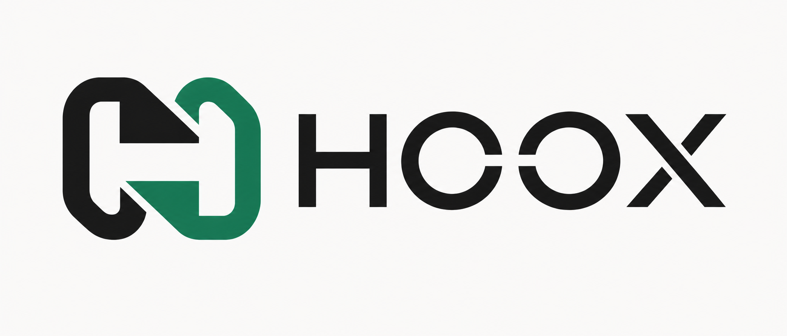

# Hoox

<p align="center">
  
</p>

[](https://github.com/hooxing/hoox/actions/workflows/ci.yml)
[](LICENSE)

English · [简体中文](README.md)

**Hoox is an open-source, self-hostable cloud Agent platform. Write the instructions, plug in your tools, publish your Skills, and you have your own dedicated Agent.**

Public entry points: [Hoox](https://hoox.aisay.cc/) · [Workbench](https://hoox.aisay.cc/app) (sign-in required). The demo environment is not a production-readiness claim.

> [!NOTE]
> This repository's collaboration conventions are in Chinese: documentation, maintainer notes, code comments and Git commit messages are written in Chinese, while public identifiers and protocol fields stay in English. This English README is a condensed translation of the Chinese one; if they disagree, the Chinese version wins. Issues and discussions in English are welcome.

## Who it is for and what you get

Hoox is for developers and companies who want to hand an Agent to their team or users. The Agent works inside an isolated sandbox on the server. It does not run on the end user's computer and cannot read their local files.

Available today:

- **Deliver Agent work through the workbench.** Users upload material and describe a task; the Agent reads files, runs code and calls tools in a cloud sandbox, then delivers the result as files in the conversation, ready to preview and download.
- **Continuous work.** Keep adding requests in the same conversation. The Agent remembers earlier messages and files, and a long task that is interrupted can resume.
- **Reusable Skills.** Package a proven way of working as a Skill, publish it in the Skill center, and let your team enable it when needed.
- **Team collaboration.** Personal and team spaces are separate. A conversation can be branched into a team task; files and Skills stay in the team space.
- **Under your control.** Bring any OpenAI-compatible model endpoint and a sandbox service (E2B, CubeSandbox or Tencent Cloud AGS), deploy on your own infrastructure, and read the Apache-2.0 source.
- **See every step.** Task progress, tool calls and delivered results are recorded, so problems can be traced.

## Why it is safe to put real work on it

- **Recoverable failures.** Persisted execution records, leases and side-effect receipts let a task resume after a crash without repeating external operations.
- **Files have clear owners.** Scratch files, reusable material and final deliverables are kept apart.
- **Sandbox isolation.** All host and file access goes through one tool router that applications cannot bypass.
- **Tenant isolation.** Membership permissions and PostgreSQL row-level security together limit unauthorized access.
- **Traceable supply chain.** Dependencies are pinned exactly, vendored sources keep their origin and licenses, and CI audits production dependencies.

> [!IMPORTANT]
> Hoox is at the `0.x` development stage. The development environment and engineering gates cover many core boundaries, but real production infrastructure, external identity systems, capacity planning and full disaster recovery are not yet verified. Public APIs and the database schema may still change. Do not treat this repository as a complete product that is ready to go live unconditionally.

## Roadmap

The following is **not implemented yet** and is tracked in the [implementation plan](docs/plans/20261119-custom-agent-platform.md) (the target contract is in the [custom Agent platform spec](docs/specs/custom-agent-platform.md)); both documents are in Chinese:

- Define multiple Agents in the admin console: edit instructions, choose a model, enable tools and Skills, and pick an Agent in the workbench.
- Connect external tools without code changes through MCP or HTTP, with permissions and approvals.
- A Playground to try an Agent and compare versions before publishing.
- API keys and a public API, so you can use Hoox as the Agent backend of your own product.
- Evaluation: regression-check Agent quality against sample sets.

## Quick start

Requirements: Node.js `24.18.0` with Corepack and pnpm `10.15.1`, Docker Compose v2, an E2B sandbox (CubeSandbox and Tencent Cloud AGS are optional) and any OpenAI-compatible model endpoint. Model and sandbox keys are configured in the admin console. See the [development setup](docs/development.md) (Chinese) for details.

```sh
cp .env.example .env
corepack pnpm install --frozen-lockfile
docker compose --profile local-postgres -f docker-compose.dev.yml --env-file .env up -d
corepack pnpm db:setup
corepack pnpm dev:up
```

Before enabling the `local-postgres` profile, set a non-empty local `POSTGRES_BOOTSTRAP_PASSWORD` in `.env` that matches the password in `DATABASE_BOOTSTRAP_URL`, and replace the remaining placeholders. On Windows PowerShell use `Copy-Item .env.example .env`. To use an external PostgreSQL, run `docker compose -f docker-compose.dev.yml --env-file .env up -d` instead, which starts MinIO only.

Then open `http://127.0.0.1:4173/admin/`, create the administrator, configure E2B and a model in the admin console, and run your first task.

## Architecture in brief

Web and API sit in front of PostgreSQL and S3-compatible storage; an Agent Worker calls the model provider and reaches the sandbox and files only through the Tool Router; a Scheduler handles cleanup and recovery. See the [architecture overview](docs/architecture/overview.md) and the [repository map](docs/architecture/repository-map.md) (Chinese).

## Documentation, contributing and security

- Start from the [documentation hub](docs/README.md) and the [project status](docs/project-status.md).
- Read the [contributing guide](CONTRIBUTING.md) before opening a pull request. Report vulnerabilities privately following the [security policy](SECURITY.md), not in public issues.
- Production use requires the checks in the [production readiness notes](docs/operations/production-readiness.md) and your own release records.

## License

Hoox is released under the [Apache License 2.0](LICENSE). Third-party components, vendored sources and development-only restricted assets may carry different terms; see [NOTICE](NOTICE) and [THIRD_PARTY_NOTICES.md](THIRD_PARTY_NOTICES.md).
