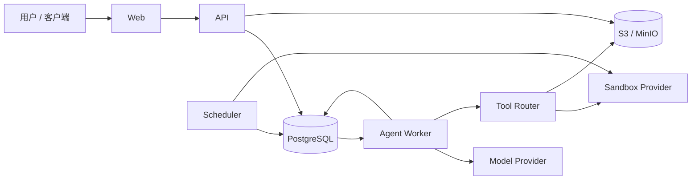

# Hoox

[](https://github.com/hooxing/hoox/actions/workflows/ci.yml)
[](package.json)
[](package.json)
[](LICENSE)

> **你说，它做。**

Hoox 是一个面向可靠执行的多租户 Agent Runtime。它把对话、运行、工作区、沙箱、资源与最终交付物组织成可持久化、可恢复、可审计的执行系统，而不是把 Agent 简化为一次模型调用。

Hoox 使用 TypeScript Monorepo 开发，核心运行链路由 PostgreSQL、S3 兼容对象存储、Sandbox Provider 与模型 Provider 共同组成。旧 Python 原型只作为行为参考，不是运行时依赖，也不承担数据兼容。

> [!IMPORTANT]
> Hoox 目前处于 `0.x` 开发阶段。开发环境和工程 Gate 已覆盖大量核心边界，但真实生产基础设施、外部身份系统、容量与完整灾难恢复尚未全部验收。请不要把本仓库直接视为可无条件上线的完整产品。

## 为什么是 Hoox

- **可靠执行**：Run、Attempt、租约、Outbox 和副作用凭证共同约束失败恢复与重复执行。
- **文件工作流**：Workspace、Resource 与 Artifact 分离临时工作、跨任务资源和最终交付物。
- **安全沙箱**：通过统一边界接入 CubeSandbox、E2B 等 Provider，不让应用绕过 Tool Router 访问宿主机。
- **多租户隔离**：TenantScope、Membership、PostgreSQL RLS 与统一错误映射共同限制越权探测。
- **长程上下文**：Thread 持有连续事实，Runtime 自己负责上下文选择、压缩和恢复。
- **可观测与可审计**：持久事件、内部轨迹和受控模型报文诊断帮助定位执行问题。
- **供应链可验证**：依赖精确锁定，生产闭包生成 SBOM，并对许可证与 vendored 来源执行 Gate。

## 核心模型



- **Tenant**：隔离和授权边界。
- **Thread**：连续对话、Workspace 与 Run 的所有权根。
- **Run / Attempt**：一次用户意图及其可恢复执行尝试。
- **Workspace**：Thread 私有、可版本化的工作目录。
- **Resource**：可跨 Thread 复用的不可变资源版本。
- **Artifact**：Agent 明确发布给用户的最终交付物。

完整说明见[架构总览](docs/architecture/overview.md)和[仓库导览](docs/architecture/repository-map.md)。

## 快速开始

### 环境要求

- Node.js `24.18.0`
- Corepack 与 pnpm `10.15.1`
- Docker Compose v2
- 专用 PostgreSQL 17 开发数据库
- 至少一个可用的 Sandbox Provider
- OpenAI-compatible 模型端点

当前 Compose 只管理本地 MinIO；PostgreSQL、Sandbox 和模型服务需要单独准备。首次启动不是纯单容器体验，开始前请阅读[开发环境准备](docs/development.md)。

### 首次配置

```powershell
Copy-Item .env.example .env
corepack pnpm install --frozen-lockfile
docker compose -f docker-compose.dev.yml --env-file .env up -d
corepack pnpm db:migrate:up
corepack pnpm dev:identity:provision
```

`.env` 只保存在本机。配置分组、必填范围和服务秘密边界见[配置参考](docs/reference/configuration.md)。

### 启动开发工作台

完成首次配置后，在 Windows PowerShell 中运行：

```powershell
.\scripts\start-development.ps1 -CoreOnly
```

脚本会预检外部依赖，启动 API、Agent Worker、Scheduler 和 Web，并打开 `http://127.0.0.1:4173`。Skill 管理面可通过 `-IncludeSkill` 显式启用。

### 验证工程基线

```powershell
corepack pnpm check:clean-workspace
```

真实 PostgreSQL、CubeSandbox、E2B 和容器 Gate 默认按用途单独执行，不会被普通单元测试静默触发。完整命令见[命令参考](docs/reference/commands.md)。

## 仓库结构

```text
runtime-ts/
  apps/             可部署应用与进程装配
  packages/         领域、协议、运行时和基础设施模块
  managed-skills/   由项目维护的 Skill
  vendor/           固定版本并保留许可证证据的第三方源码

docs/               当前文档、架构决策、实施计划和验证记录
deploy/             生产配置契约与发布清单
scripts/            开发、校验、供应链和容器 Gate
supply-chain/       SBOM 与许可证策略证据
tests/              跨包、集成和黑盒测试
```

应用和包的逐项职责见[仓库导览](docs/architecture/repository-map.md)。

## 文档

| 目标 | 入口 |
| --- | --- |
| 第一次了解项目 | [文档中心](docs/README.md) |
| 准备本地开发环境 | [开发指南](docs/development.md) |
| 理解系统边界 | [架构总览](docs/architecture/overview.md) |
| 理解连续上下文与恢复 | [Thread 连续上下文](docs/architecture/thread-continuity.md) |
| 理解子 Agent 与 Todo | [Agent 协作与 Todo](docs/architecture/agent-collaboration.md) |
| 理解 Skill Runtime | [Skill Runtime](docs/architecture/skill-runtime.md) |
| 理解团队协作边界 | [团队协作](docs/architecture/team-collaboration.md) |
| 找到代码位置 | [仓库导览](docs/architecture/repository-map.md) |
| 配置环境变量 | [配置参考](docs/reference/configuration.md) |
| 查询开发命令 | [命令参考](docs/reference/commands.md) |
| 调用开发 API | [开发 API 契约](docs/reference/development-api.md) |
| 查看当前成熟度 | [项目状态](docs/project-status.md) |
| 部署或发布评估 | [生产就绪说明](docs/operations/production-readiness.md) |
| 排查内部轨迹 | [诊断指南](docs/maintainers/diagnostics.md) |
| 理解历史取舍 | [架构决策](docs/decisions/README.md) |
| 参与贡献 | [贡献指南](CONTRIBUTING.md) |
| 了解治理和发布变化 | [项目治理](GOVERNANCE.md) · [变更记录](CHANGELOG.md) |

## 贡献

欢迎提交可复现的问题、文档改进、测试和边界清晰的功能。开始前请阅读[贡献指南](CONTRIBUTING.md)；安全问题请按[安全策略](SECURITY.md)私下报告，不要创建公开 Issue。

Hoox 的代码、维护者说明和 Git 提交使用中文；公共标识符、协议字段和已有技术名词保持英文。

## 安全与生产使用

开发身份、回环监听和本地账号只用于 development，不能替代生产身份系统。生产部署必须使用按服务分片的秘密、最小权限数据库角色、独立对象存储 origin、真实外部依赖 readiness 和可验证回滚记录。

静态 Gate 能证明仓库和镜像满足既定契约，但不能替代真实基础设施验收。详见[生产就绪说明](docs/operations/production-readiness.md)。

## 许可证

Hoox 以 [Apache License 2.0](LICENSE) 发布。第三方组件、vendored 源码和仅供开发使用的受限素材可能适用不同条款，详见 [NOTICE](NOTICE)、[THIRD_PARTY_NOTICES.md](THIRD_PARTY_NOTICES.md) 及对应目录的 `LICENSE`、`SOURCE.md` 和 `PATCHES`。
