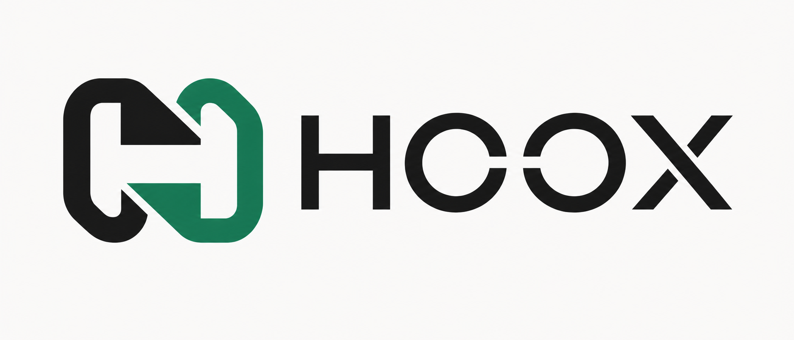
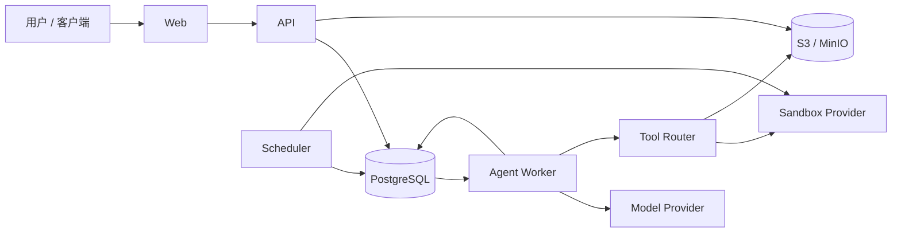

# Hoox

<p align="center">
  
</p>

[](https://github.com/hooxing/hoox/actions/workflows/ci.yml)
[](package.json)
[](package.json)
[](LICENSE)

公开入口：[Hoox](https://hoox.aisay.cc/) · [工作台](https://hoox.aisay.cc/app)。首页介绍产品与开源能力；工作台需要登录。演示环境不替代生产就绪验收。

**Hoox 是一个开源、可自托管的云端 Agent 平台。写好指令、接上你的工具、上架 Skill，就是你自己的专属 Agent。**

[English](README.en.md) · 简体中文

## 适合谁，能得到什么

Hoox 面向想把 Agent 交付给团队或用户的开发者与企业。Agent 在服务端的隔离沙箱里工作，不占用终端用户的电脑，也不会读取他们的本地文件。

今天你可以：

- **用工作台交付 Agent 任务**：用户上传资料、提出需求，Agent 在云端沙箱中读文件、跑代码、调用工具，最后把成果文件交付到对话里供预览和下载。
- **连续工作**：同一个对话里可以不断追加要求；Agent 记得之前的内容和已经产出的文件，长任务中断后能接着做。
- **复用 Skill**：把成熟的工作方法整理成 Skill，上架到 Skill 中心，让团队按需启用和复用。
- **团队协作**：个人空间与团队空间分开，对话可以派生为团队任务，文件与 Skill 留在团队空间。
- **自己掌控**：选择任意 OpenAI 兼容模型端点和沙箱服务（E2B、CubeSandbox、腾讯云 AGS），部署在自己的基础设施上，源码以 Apache-2.0 开放。
- **看清每一步**：任务进度、工具调用和交付结果都有记录，出问题时可以追溯。

## 为什么可以放心放业务

这些能力建立在几项工程约束之上：

- **失败可恢复**：每次任务由持久化的执行记录、租约和副作用凭证约束，进程中断后可以恢复，外部操作不会被重复执行。
- **文件各有归属**：临时工作文件、跨任务复用的资料和最终交付物相互分离。
- **沙箱隔离**：所有宿主机和文件访问都经过统一的工具路由，应用不能绕过它。
- **租户隔离**：成员权限与 PostgreSQL 行级安全共同限制越权访问。
- **供应链可追溯**：依赖精确锁定，第三方源码固定来源并保留许可证，CI 审计生产依赖漏洞。

> [!IMPORTANT]
> Hoox 目前处于 `0.x` 开发阶段。开发环境和工程 Gate 已覆盖大量核心边界，但真实生产基础设施、外部身份系统、容量与完整灾难恢复尚未全部验收。公共接口和数据库 Schema 仍可能变化，请不要把本仓库直接视为可无条件上线的完整产品。

## 自定义与集成

- **构建 Agent**：管理员在后台配置指令、模型、工具和 Skill，用 Playground 试跑草稿，再发布到工作台。每次运行固定 Agent 版本。后台可发布远程 MCP 工具；[HTTP 工具](docs/reference/http-tools.md)在后台仅支持导入预览。
- **接入产品**：使用 API Key 调用[公开 API v1](docs/reference/public-api.md)，支持终端用户映射和客户端工具；提供 [TypeScript SDK](docs/reference/sdk-typescript.md)、[Webhook](docs/reference/webhooks.md) 和[可嵌入聊天组件](docs/reference/chat-embed.md)。
- **评测与运营**：用[评测集](docs/reference/admin-evaluations.md)按规则批量评测、对比版本，在后台查看 Agent 指标、成本和用户反馈；Worker 可选启用 [OpenTelemetry 导出](docs/reference/configuration.md#worker-opentelemetry-配置)。
- **配置与发布**：通过后台或 [`hoox` 命令行](docs/reference/cli.md)管理 Agent YAML，定制[工作台和后台品牌](docs/reference/branding.md)，开发者可在获授权的命名空间内[发布 Skill](docs/reference/skill-publishing.md)。

尚待完成的方向见[项目路线](docs/roadmap.md)；`v0.1.0` 的发布范围与升级方式见[版本说明](docs/releases/v0.1.0.md)。

## 核心模型



- **Tenant**：隔离和授权边界。
- **Thread**：连续对话、Workspace 与 Run 的所有权根。
- **Run / Attempt**：一次用户意图及其可恢复执行尝试。
- **Workspace**：Thread 私有、可版本化的工作目录。
- **Resource**：可跨 Thread 复用的不可变资源版本。
- **Artifact**：Agent 明确发布给用户的最终交付物。

完整说明见[架构总览](docs/architecture/overview.md)和[仓库导览](docs/architecture/repository-map.md)。

## 快速开始

### 环境要求

- Node.js `24.18.0`、Corepack 与 pnpm `10.15.1`
- Docker Compose v2
- E2B Sandbox（也可在后台选择 CubeSandbox 或腾讯云 AGS）
- 任意 OpenAI 兼容模型端点；模型和 E2B 密钥均在后台配置

Compose 默认提供 MinIO；启用 `local-postgres` profile 后另提供本地 PostgreSQL 17。也可改用外部专用 PostgreSQL。完整准备说明见[开发环境准备](docs/development.md)。

### 首次配置（macOS、Linux、Windows）

本地 PostgreSQL 由 `local-postgres` profile 显式启用。启用前必须将 `.env` 中的 `POSTGRES_BOOTSTRAP_PASSWORD` 设为非空本地密码，并与 `DATABASE_BOOTSTRAP_URL` 密码一致；替换其余占位配置。

```sh
cp .env.example .env
corepack pnpm install --frozen-lockfile
docker compose --profile local-postgres -f docker-compose.dev.yml --env-file .env up -d
corepack pnpm db:setup
```

Windows PowerShell 使用 `Copy-Item .env.example .env` 完成复制。

`.env` 只保存在本机。若使用外部 PostgreSQL，保留原命令 `docker compose -f docker-compose.dev.yml --env-file .env up -d`，只启动 MinIO。配置范围见[配置参考](docs/reference/configuration.md)。

### 启动开发工作台

```sh
corepack pnpm dev:up
```

首次打开 `http://127.0.0.1:4173/admin/` 创建管理员，再在后台配置 E2B 与任意 OpenAI 兼容模型，即可执行第一个任务。CubeSandbox、腾讯云 AGS 是可选方案。Windows 也可使用 `./scripts/start-development.ps1`。

### 验证工程基线

```sh
corepack pnpm check:clean-workspace
```

真实 PostgreSQL、CubeSandbox、E2B 等外部服务测试默认按用途单独执行，不会被普通单元测试静默触发。完整命令见[命令参考](docs/reference/commands.md)。

## 仓库结构

```text
runtime-ts/
  apps/             可部署应用与进程装配
  packages/         领域、协议、运行时和基础设施模块
  managed-skills/   由项目维护的 Skill
  vendor/           固定版本并保留许可证证据的第三方源码

docs/               当前文档、架构约束、实施计划和验证记录
deploy/             Demo 部署、生产配置契约示例与 Sandbox 镜像
scripts/            开发、配置校验与 Demo 发布脚本
tests/              跨包、集成和黑盒测试
```

应用和包的逐项职责见[仓库导览](docs/architecture/repository-map.md)。

## 文档

| 目标 | 入口 |
| --- | --- |
| 第一次了解项目 | [文档中心](docs/README.md) |
| 准备本地开发环境 | [开发指南](docs/development.md) |
| 理解系统边界 | [架构总览](docs/architecture/overview.md) |
| 理解连续上下文与恢复 | [Thread 连续上下文](docs/architecture/thread-continuity.md) |
| 理解子 Agent 与 Todo | [Agent 协作与 Todo](docs/architecture/agent-collaboration.md) |
| 理解 Skill Runtime | [Skill Runtime](docs/architecture/skill-runtime.md) |
| 理解团队协作边界 | [团队协作](docs/architecture/team-collaboration.md) |
| 找到代码位置 | [仓库导览](docs/architecture/repository-map.md) |
| 配置环境变量 | [配置参考](docs/reference/configuration.md) |
| 查询开发命令 | [命令参考](docs/reference/commands.md) |
| 调用开发 API | [开发 API 契约](docs/reference/development-api.md) |
| 查看当前成熟度 | [项目状态](docs/project-status.md) |
| 部署演示环境 | [Demo 单机部署指南](docs/operations/demo-cd.md) |
| 生产发布评估 | [生产就绪说明](docs/operations/production-readiness.md) |
| 排查内部轨迹 | [诊断指南](docs/maintainers/diagnostics.md) |
| 理解设计约束 | [架构文档](docs/architecture/README.md) |
| 参与贡献 | [贡献指南](CONTRIBUTING.md) |
| 了解治理和发布变化 | [项目治理](GOVERNANCE.md) · [变更记录](CHANGELOG.md) |

## 贡献

欢迎提交可复现的问题、文档改进、测试和边界清晰的功能。开始前请阅读[贡献指南](CONTRIBUTING.md)；安全问题请按[安全策略](SECURITY.md)私下报告，不要创建公开 Issue。

Issue、讨论、Pull Request 和提交信息可以使用中文或英文。维护者自己的代码注释、文档和提交主要使用中文，因此中文文档更完整；英文版见 [README.en.md](README.en.md)。

## 安全与生产使用

固定开发身份、回环监听和旧本地账号端点只用于 development。production 使用 API 内嵌 Better Auth，并由 Hoox Session、Membership 与 PostgreSQL RLS 完成业务授权；部署仍必须使用按服务分片的秘密、最小权限数据库角色、独立对象存储 origin、真实外部依赖 readiness 和可验证回滚记录。

静态 Gate 能证明仓库和镜像满足既定契约，但不能替代真实基础设施验收。详见[生产就绪说明](docs/operations/production-readiness.md)。

## 许可证

Hoox 以 [Apache License 2.0](LICENSE) 发布。第三方组件、vendored 源码和仅供开发使用的受限素材可能适用不同条款，详见 [NOTICE](NOTICE)、[THIRD_PARTY_NOTICES.md](THIRD_PARTY_NOTICES.md) 及对应目录的 `LICENSE`、`SOURCE.md` 和 `PATCHES`。
