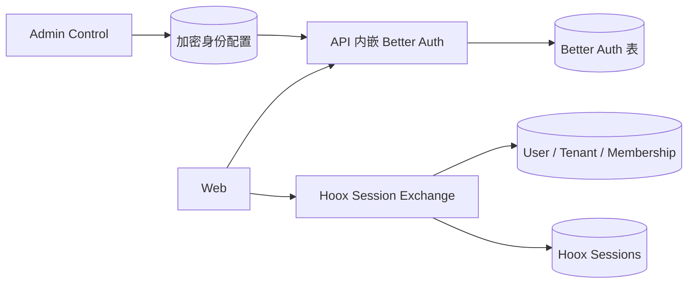

# 身份、账号与会话

本文面向接入登录方式、维护账号映射、配置 SMTP/OAuth/SMS 或排查会话问题的开发与运维人员，描述 Hoox 当前身份边界。

## 运行关系

Better Auth 与 Hoox API 同进程运行，不需要独立身份服务。它负责邮箱密码、邮箱验证 OTP、OAuth 和手机号验证码协议；Hoox 负责账号、Tenant、Membership、业务会话和最终授权。Better Auth Cookie 不能直接访问业务路由。

## 登录和账号映射

1. Web 读取 `GET /v1/auth/config`，只展示后台已启用的登录方式。“允许新用户注册”是全局开关：关闭后邮箱、OAuth 和手机号都不能隐式创建 Better Auth User。
2. 邮箱、OAuth 或手机号流程进入 `/api/auth/*`。邮箱验证码开启时，邮箱密码注册先发送 6 位 OTP，验证成功后才获得同源 Better Auth Cookie Session；未验证邮箱不能用密码登录。
3. Web 调用 `POST /v1/auth/exchange`。API 验证 Cookie 中的 Better Auth Session；邮箱验证开启时，具有 `credential` 账号但邮箱未验证的身份会被拒绝。通过验证后再按 `better_auth_user_id` 或规范化邮箱查找 Hoox 账号。
4. 已关联相同 Better Auth User ID 的账号保留原 User、个人 Tenant、Membership 和数据；新身份原子创建这些事实。同邮箱但尚未关联的本地密码账号返回冲突，不能凭邮箱接管。
5. API 返回 Hoox 不透明会话令牌。后续业务请求继续使用 `Authorization: Bearer <Hoox session>`，并由 Membership 与 RLS 重建 TenantScope。

同一 Hoox 账号不能绑定两个不同 Better Auth User ID。账号被禁用时，两类 Session 都被删除；旧令牌不能继续访问业务数据。管理台停用账号只要求一次会话撤销后果确认，恢复账号直接执行；恢复后用户必须重新登录，旧会话不会恢复。操作不要求人工原因，服务端继续记录审计。

## 服务凭据与集成身份

Tenant API Key 是部署方系统接入 Hoox 的服务凭据，与终端用户 Hoox Session 不同。只有有效的平台 `admin` 能在后台「接入 → API Key」按目标 Tenant 创建、列出、轮换和吊销；Tenant Owner/Admin、普通用户会话和 API Key 本身都不获得管理权。工作台没有集成管理入口，用户 API 不注册 `/v1/api-keys` 或 `/v1/webhooks` 管理路由；后台接口见[接入管理边界](admin-control-plane.md#接入管理边界)。

Key 只以 `hoox_sk_` 前缀加高熵随机串交付；数据库只保存 SHA-256 哈希、可公开前缀和元数据，创建或轮换成功响应各返回一次明文，列表不能取回。列表只返回前缀、名称、备注、作用域、创建/到期/吊销/最近使用时间。轮换立即替换旧哈希，保留原 Key ID、集成 User、作用域和到期时间；已到期或吊销的 Key 不能轮换。最近使用时间按五分钟窗口节流更新。

每个 Key 创建独立 `integration` User，并在所属 Tenant 创建 `member` Membership；集成身份不获得个人或团队空间管理权。该身份没有登录账号，不可登录工作台；创建者只作为审计元数据，离开 Tenant 不会改变 Key 身份。吊销不可恢复；后台复用持久化仓储，在同一事务内先将未吊销 Key 写入吊销时间，再将对应 `integration` Membership 从 active 改为 revoked，并写入管理审计。Admin Control 只有所需列级 UPDATE，专属 RESTRICTIVE RLS 进一步限制有效平台管理员、目标 Tenant、集成 Membership 和旧状态；不能撤销人类成员或恢复已吊销的身份。任一步失败都会回滚整个事务。之后请求同时无法通过凭据校验或 Membership 授权。该身份模型可供终端用户映射复用，但映射本身不属于此边界。

API Key 认证成功后，API 仍使用该集成 User 从 Membership 重建 `TenantScope`，所有业务数据访问继续受 RLS 约束。作用域是额外的路由权限：仅显式声明所需作用域的路由接受 API Key；未声明作用域的路由默认只接受人类会话。登录会话、账号与团队成员管理不接受 API Key；API Key 与 Webhook 管理由后台平台管理员授权，已有 `webhooks:manage` 作用域不赋予后台管理权。无效或跨 Tenant 凭据不泄漏 Key 存在性，返回统一认证/不存在错误；作用域不足使用既有错误信封返回 403。

## 可配置登录方式

首次管理员使用独立于外部身份配置的本地密码登录，边界见[首次管理员与管理面会话](#首次管理员与管理面会话)。

管理台“身份与登录”页面按基础访问策略、发信邮箱、短信服务连接和第三方身份源分区展示，并可以立即启用或关闭：

- 邮箱密码登录、新用户注册和邮箱验证码；
- Google；
- GitHub；
- 微信 Website App；
- QQ Generic OAuth；
- E.164 格式手机号和 HTTPS 短信 Webhook 验证码。

邮箱验证码要求完整的发件人地址、SMTP 主机、端口、用户名和密码。隐式 TLS 与 STARTTLS 都验证服务端证书并要求 TLS 1.2 及以上；不支持明文 SMTP。验证码为 6 位数字，有效期 10 分钟，最多尝试 5 次。发送端点按客户端地址每分钟最多请求 1 次，并使用收件邮箱摘要实施 60 秒持久化冷却；浏览器同步显示 60 秒重发倒计时，但服务端限制才是安全边界。

Hoox 只开放 Email OTP 插件的邮箱验证发送和校验入口，不开放默认验证链接、默认验证邮件、密码外邮箱登录、OTP 找回密码或邮箱变更端点。功能上线前已经存在且邮箱状态未验证的密码账号，在管理员开启邮箱验证码后需要通过发信邮箱验证；邮箱验证码关闭期间新注册的密码账号会直接标记为已验证。

外部 Provider 只有在 Client ID 与 Client Secret 都已配置时才能启用。短信登录要求公网 HTTPS Webhook；明显的本地、私网、带凭据或带 fragment 地址会被拒绝。秘密输入留空表示保留现值，管理 API 只返回是否已配置。

## 配置与秘密

`BETTER_AUTH_SECRET` 是部署级根秘密，API 与 Admin Control 必须使用相同值且至少 32 字节。它同时用于 Better Auth 会话签名和身份配置秘密加密，不能通过管理界面修改、不能进入 Git，也不能跨环境复用。

身份配置通过内部期望版本与幂等键防止并发覆盖，操作自动记录操作者与审计说明；页面不展示版本或要求填写变更原因。旧 API 调用方可继续提供原因。SMTP 密码、Provider Secret 与短信 Webhook Secret 以 AES-256-GCM 密文持久化；OAuth Token 使用 Better Auth 的加密能力。管理 API 和页面只显示这些秘密是否已配置，留空保存表示保留现值。配置按版本动态加载，保存后不需要重启 API。

SMTP 投递不可达、认证失败、TLS 失败或收件方拒收时，本次验证码发送失败且不会降级签发 Hoox Session。Better Auth 可能已经在等待 SMTP 期间持久化用户和密码凭据；Web 在注册请求失败后只使用同一邮箱与原密码探测一次待验证状态，确认凭据有效且邮箱未验证时直接进入验证码页面，不再把可恢复的部分成功显示为普通注册失败。管理员修正配置后，用户可在倒计时结束后重新发送。

## 兼容边界

Better Auth 固定为 `1.7.7`，数据库以 `(provider_id, account_id)` 唯一定位外部或密码账号。账号表保留可为空的 `issuer` 列，新版账号不再写入该列；重复的 Provider 账号键由唯一约束拒绝，不自动合并用户。

production Web 使用内嵌身份入口，旧 `/v1/auth/register` 和 `/v1/auth/login` 不对外注册。development 可以显式保留旧本地账号端点和固定开发身份，用于夹具与兼容测试。生产 JWT 验证仍作为非浏览器调用方的后备，但不会绕过 Hoox 的 User、Membership 和 RLS 授权。

管理交互与内部持久事实的分工见[后台控制面与运行配置](admin-control-plane.md)。

## 首次管理员与管理面会话

空安装通过 `GET /v1/installation` 发现初始化状态，`POST /v1/installation/administrator` 仅在安装授权通过且数据库仍为空时创建管理员。安装单行锁覆盖本地密码账号、个人 Tenant、Membership、Hoox Session、控制面和 Skill 管理授权的完整事务；成功后安装状态不可由 Runtime 重置。已有任意管理员授权（包括禁用）也会关闭入口。运维 SQL 新增授权必须先锁定 `installation_state` 单行，与初始化事务串行；不提供在线自助提权。

`POST /v1/installation/login` 只允许有效的本地管理员密码登录，使用既有 scrypt 凭据与 Hoox Session。工作台正常邮箱登录被身份服务以 401 拒绝时可尝试该入口，其他故障不降级。初始管理员不会按邮箱自动绑定后续 Better Auth 注册身份；显式账号关联尚未提供。

管理 API 收到 Hoox Session 后，通过固定主 API 的 `GET /v1/auth/admin-principal` 确认账号和有效管理角色，禁止重定向、限制超时和响应大小；验证失败不会降级固定开发身份。viewer、operator、admin 及已有 Skill 管理身份继续进入各领域授权，页面不能替代服务端权限校验。安装来源、令牌和部署秘密见[配置参考](../reference/configuration.md#后台管理)，决策理由见[后台控制面与运行配置](admin-control-plane.md)。
