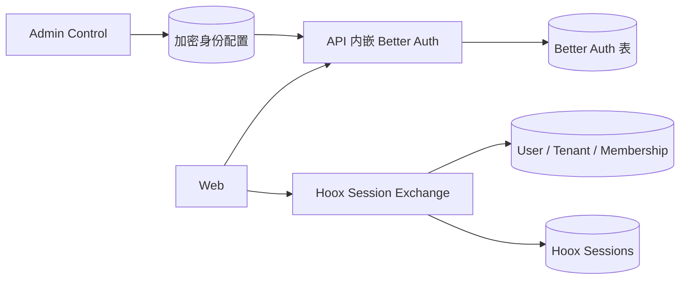

# 身份、账号与会话

本文面向接入登录方式、维护账号映射、配置 SMTP/OAuth/SMS 或排查会话问题的开发与运维人员，描述 Hoox 当前身份边界。

## 运行关系

Better Auth 与 Hoox API 同进程运行，不需要独立身份服务。它负责邮箱密码、邮箱验证 OTP、OAuth 和手机号验证码协议；Hoox 负责账号、Tenant、Membership、业务会话和最终授权。Better Auth Cookie 不能直接访问业务路由。

## 登录和账号映射

1. Web 读取 `GET /v1/auth/config`，只展示后台已启用的登录方式。“允许新用户注册”是全局开关：关闭后邮箱、OAuth 和手机号都不能隐式创建 Better Auth User。
2. 邮箱、OAuth 或手机号流程进入 `/api/auth/*`。邮箱验证码开启时，邮箱密码注册先发送 6 位 OTP，验证成功后才获得同源 Better Auth Cookie Session；未验证邮箱不能用密码登录。
3. Web 调用 `POST /v1/auth/exchange`。API 验证 Cookie 中的 Better Auth Session；邮箱验证开启时，具有 `credential` 账号但邮箱未验证的身份会被拒绝。通过验证后再按 `better_auth_user_id` 或规范化邮箱查找 Hoox 账号。
4. 已有邮箱账号绑定 Better Auth User ID 并保留原 User、个人 Tenant、Membership 和数据；新身份原子创建这些事实。
5. API 返回 Hoox 不透明会话令牌。后续业务请求继续使用 `Authorization: Bearer <Hoox session>`，并由 Membership 与 RLS 重建 TenantScope。

同一 Hoox 账号不能绑定两个不同 Better Auth User ID。账号被禁用时，两类 Session 都被删除；旧令牌不能继续访问业务数据。管理台停用账号只要求一次会话撤销后果确认，恢复账号直接执行；恢复后用户必须重新登录，旧会话不会恢复。操作不要求人工原因，服务端继续记录审计。

## 可配置登录方式

管理台“身份与登录”页面按基础访问策略、发信邮箱、短信服务连接和第三方身份源分区展示，并可以立即启用或关闭：

- 邮箱密码登录、新用户注册和邮箱验证码；
- Google；
- GitHub；
- 微信 Website App；
- QQ Generic OAuth；
- E.164 格式手机号和 HTTPS 短信 Webhook 验证码。

邮箱验证码要求完整的发件人地址、SMTP 主机、端口、用户名和密码。隐式 TLS 与 STARTTLS 都验证服务端证书并要求 TLS 1.2 及以上；不支持明文 SMTP。验证码为 6 位数字，有效期 10 分钟，最多尝试 5 次。发送端点按客户端地址每分钟最多请求 1 次，并使用收件邮箱摘要实施 60 秒持久化冷却；浏览器同步显示 60 秒重发倒计时，但服务端限制才是安全边界。

Hoox 只开放 Email OTP 插件的邮箱验证发送和校验入口，不开放默认验证链接、默认验证邮件、密码外邮箱登录、OTP 找回密码或邮箱变更端点。功能上线前已经存在且邮箱状态未验证的密码账号，在管理员开启邮箱验证码后需要通过发信邮箱验证；邮箱验证码关闭期间新注册的密码账号会直接标记为已验证。

外部 Provider 只有在 Client ID 与 Client Secret 都已配置时才能启用。短信登录要求公网 HTTPS Webhook；明显的本地、私网、带凭据或带 fragment 地址会被拒绝。秘密输入留空表示保留现值，管理 API 只返回是否已配置。

## 配置与秘密

`BETTER_AUTH_SECRET` 是部署级根秘密，API 与 Admin Control 必须使用相同值且至少 32 字节。它同时用于 Better Auth 会话签名和身份配置秘密加密，不能通过管理界面修改、不能进入 Git，也不能跨环境复用。

身份配置通过内部期望版本与幂等键防止并发覆盖，操作自动记录操作者与审计说明；页面不展示版本或要求填写变更原因。旧 API 调用方可继续提供原因。SMTP 密码、Provider Secret 与短信 Webhook Secret 以 AES-256-GCM 密文持久化；OAuth Token 使用 Better Auth 的加密能力。管理 API 和页面只显示这些秘密是否已配置，留空保存表示保留现值。配置按版本动态加载，保存后不需要重启 API。

SMTP 投递不可达、认证失败、TLS 失败或收件方拒收时，本次验证码发送失败且不会降级签发 Hoox Session。Better Auth 可能已经在等待 SMTP 期间持久化用户和密码凭据；Web 在注册请求失败后只使用同一邮箱与原密码探测一次待验证状态，确认凭据有效且邮箱未验证时直接进入验证码页面，不再把可恢复的部分成功显示为普通注册失败。管理员修正配置后，用户可在倒计时结束后重新发送。

## 兼容边界

Better Auth 固定为 `1.7.7`，数据库以 `(provider_id, account_id)` 唯一定位外部或密码账号。迁移 `0070` 保留旧 `issuer` 列与历史值并允许其为空；新版账号不再写入该列。升级发现重复 Provider 账号键时整批失败，不自动合并用户；已有空 `issuer` 或旧来源键冲突时禁止自动降级。版本升级的取舍与回退边界见[账号键兼容决策](../decisions/20261108180541-better-auth-provider-account-key.md)。

production Web 使用内嵌身份入口，旧 `/v1/auth/register` 和 `/v1/auth/login` 不对外注册。development 可以显式保留旧本地账号端点和固定开发身份，用于夹具与兼容测试。生产 JWT 验证仍作为非浏览器调用方的后备，但不会绕过 Hoox 的 User、Membership 和 RLS 授权。

管理交互与内部持久事实的分工见[后台任务操作决策](../decisions/20260906195752-admin-task-oriented-configuration-and-publication.md)。
