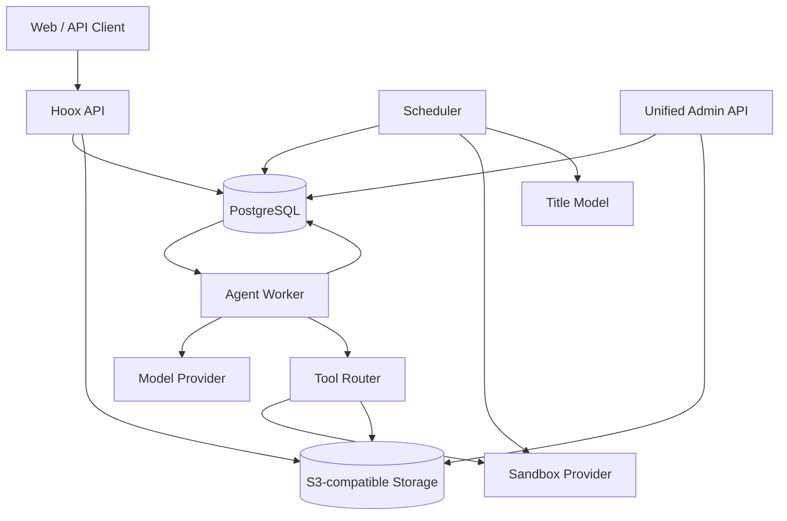
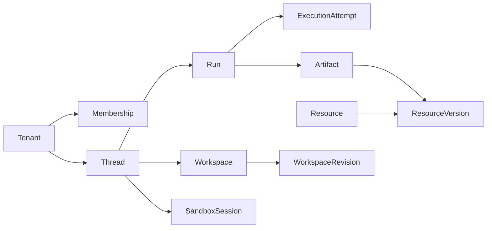
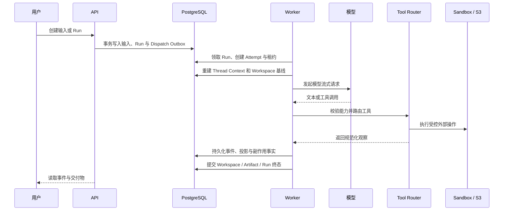

# 架构总览

Hoox 将 Agent 视为一个需要可靠调度、持久事实、受控外部能力和明确交付语义的系统。模型负责推理，Runtime 负责身份、顺序、状态、恢复、工具授权和数据边界。

## 系统上下文



PostgreSQL 是业务状态事实源；S3 兼容存储保存 Blob；Sandbox Provider 提供隔离执行环境；模型 Provider 只负责模型请求。外部系统的成功响应不会自动成为业务事实，Runtime 必须通过事务、幂等键、租约和恢复协议收敛结果。

## 核心领域关系



### Tenant 与 Membership

Tenant 是隔离边界。认证只证明 User 身份，Runtime 必须从 PostgreSQL Membership 重建 TenantScope；客户端声明不能替代成员关系。公开错误不会泄漏跨 Tenant 实体是否存在。

### Thread 与 Run

Thread 是连续对话和文件工作区的所有权根。Run 表示一次待执行意图，ExecutionAttempt 表示一次实际领取和执行。Thread 事实可以跨 Run 重建上下文，Run 的终态不能被静默恢复为运行中。

### Workspace、Resource 与 Artifact

- Workspace 是 Thread 私有工作区，以 Revision 保存不可变结果。
- Resource 是可跨 Thread 发现和导入的不可变版本。
- Artifact 是 Agent 主动发布给用户的最终交付物，只能绑定已经验证的资源和 Blob 身份。

这种分离避免把沙箱临时文件、长期资源和用户交付物混为一谈。

## 一次 Run 的主要链路



## Run 调度并发边界

Agent Worker 使用有界并发而不是“单任务串行”或无限异步启动：

- 同一 Thread 最多执行一个 Run，保护消息顺序、Thread Context 和 Workspace head；
- 单 Worker 最大在途 Run 由已发布运行设置控制，默认 `20`；
- 单用户在同一 Tenant 内最大在途 Run 由已发布运行设置控制，默认 `2`；
- 不设置固定 Tenant 最大运行数，Tenant 实际并发由活跃用户槽位和 Worker 总槽共同决定；
- 用户和 Thread 槽位由 PostgreSQL 在 Tenant RLS 短事务中统一占用，多 Worker 不依赖各自的内存计数；
- 调低上限不会取消在途 Run，只会停止领取新 dispatch，直到活跃数自然回落。

Tenant assignment 负责发现和公平选择。启用维护的 Worker 先领取并启动至多一个 Run，再把 assignment 的收敛交给有界后台维护；没有维护时仍在执行前释放 assignment。单 Worker 进程最多并行维护四个 Tenant，同 Tenant 在单进程内不并发维护。维护失败、Blob 部分收敛或满批，以及维护容量不足时保留 claimed 租约，依靠到期重领；停机先停止新生产者，再等待在途 Run、已启动维护和 settle。

首个已领取 Run 和其他 Tenant 的发现不等待慢维护；同 Tenant 的后续领取仍可能等待维护结束或 assignment 租约到期。维护租约不以 Run 完成为释放条件，数据库中的短时调度锁也不包住模型、Sandbox 或工具执行。该取舍保留了已有恢复机会，尚未引入独立 Blob 定时唤醒机制，见[Run 执行与恢复](run-execution-and-recovery.md)。

## 进程职责

| 进程 | 职责 | 不应承担的职责 |
| --- | --- | --- |
| API | 身份解析、协议校验、TenantScope、命令接收与读取投影 | 直接执行 Agent 或绕过事务写多步领域状态 |
| Agent Worker | 领取 Run、驱动模型和工具、维护执行事实与完成语义 | 公开 HTTP 身份入口或无授权访问宿主机 |
| Scheduler | 清理、恢复、定时任务和可重试后台协调 | 读取不需要的 S3/模型秘密或扫描未授权 Tenant |
| Web | 用户交互和公开协议消费 | 依赖数据库、内部 Repository 或 development 秘密 |
| Admin API | 模型、记忆、配置、统计及 Skill 发布管理；内部隔离两套数据库连接 | 复用普通 Runtime 权限或合并 Admin Control 与 Skill Publisher 数据库角色 |
| Trajectory Viewer | 仅在受控 development 环境读取内部诊断 | 暴露为公开产品 API 或生产默认入口 |

后台统计通过 Migrator 拥有的受限视图跨 Tenant 聚合。底表保留 FORCE RLS；专属读取策略只面向 Migrator，并要求有效平台操作者，用户目录另要求管理员。Admin Control 不增加业务底表读取权限，普通 Runtime 仍按 Tenant 隔离。策略在数据库角色引导时重绑定至当前 Migrator，具体取舍见 [后台控制面与运行配置](admin-control-plane.md)。

## 分层与依赖方向

```text
apps
  -> application/runtime orchestration
    -> domain and contracts
      -> pure types and invariants

infrastructure adapters
  -> declared ports and domain contracts

vendor
  -> only through reviewed adapters
```

应用入口只负责装配。领域规则应位于边界清晰的共享包；宿主机命令和工作目录访问必须经过 Tool Router 与 Sandbox 边界。

## 可靠性原则

- **持久事实优先**：进程内状态不是恢复依据。
- **显式幂等**：相同幂等键只能接受相同请求摘要。
- **租约与 fencing**：失去所有权的 Worker 不能继续提交。
- **副作用可恢复**：远端响应未知时读取固定事实，不猜测成功或盲目重试。
- **终态不可逆**：失败修正通过新版本、新 Attempt 或新 Artifact 表达。
- **失败关闭**：缺少身份、配置、能力或完整绑定时不退回宽松默认值。

## 安全原则

- 生产服务按进程分片秘密和数据库角色。
- PostgreSQL RLS 与应用授权同时生效，不能只依赖其中一层。
- 对象预览限制主动内容，下载使用净化文件名和短期签名。
- Sandbox 不持有宿主机或对象存储的通用凭据。
- 诊断数据可能包含用户内容，默认关闭并受保留策略约束。
- 配置错误、日志和测试失败不得输出秘密值。

## 延伸阅读

- [仓库导览](repository-map.md)
- [Thread 连续上下文](thread-continuity.md)
- [Agent 协作与 Todo](agent-collaboration.md)
- [Sandbox Provider](sandbox-providers.md)
- [Skill Runtime](skill-runtime.md)
- [团队协作](team-collaboration.md)
- [项目状态](../project-status.md)
- [配置参考](../reference/configuration.md)
- [开发 API 契约](../reference/development-api.md)
- [生产就绪说明](../operations/production-readiness.md)
- [Run 执行与恢复](run-execution-and-recovery.md)
- [持久化与数据库边界](persistence-and-database.md)
