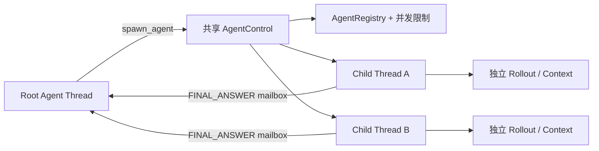
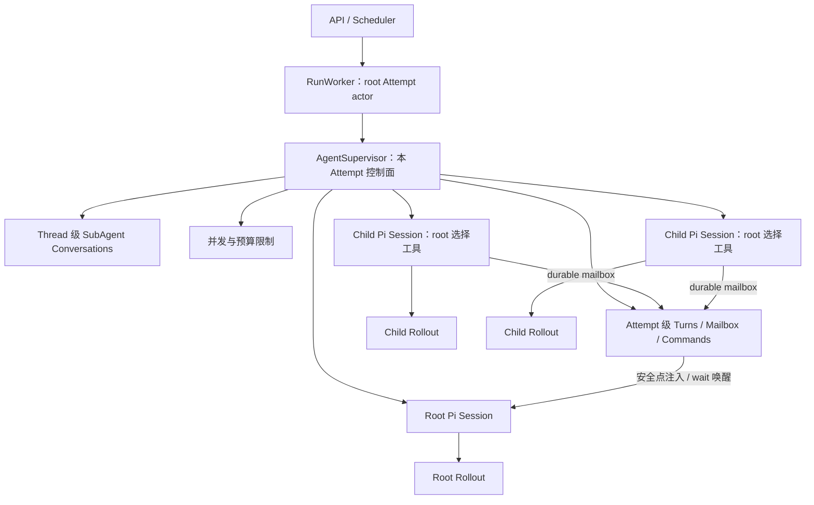

# Codex Subagent 与 Plan 机制调研及 Cube Runtime 实施方案

> 调研日期：2026-08-05
> Codex 源码基线：`openai/codex@7ada37a15e1f6aa84f83b4b9410f9d29e66fefe4`（2026-08-04）
> 目标仓库：`cubesandbox-agent-runtime`

## 1. 结论摘要

Codex 的 Subagent 不是在一个模型请求里模拟多个角色，而是创建多条真实、独立、可继续对话的 Agent Thread。根 Agent 通过一组控制面工具创建、发消息、追加任务、中断、列举和等待子 Agent；每个子 Agent 有自己的上下文、模型调用、工具循环、Rollout 和状态，结果通过父 Agent 的 mailbox 回传。并发上限、父子路径和持久化图共同约束整棵 Agent Tree。

Codex 中名为“Plan”的机制实际包含三个彼此独立的概念：

1. **Plan Mode**：一种 Collaboration Mode，依靠稳定的 developer instruction、工具可用性和客户端交互约束模型先调研、澄清，再给出可执行方案。
2. **Proposed Plan**：模型最终输出的 `<proposed_plan>` 标记块，由流式解析器从普通正文中提取并以专用 UI 展示。
3. **`update_plan`**：Default Mode 中更新执行清单的轻量工具；它不是 Plan Mode 的状态机，并且在 Plan Mode 中被明确拒绝。

Cube Runtime 已完成 SubAgent 核心运行链路：Root Session 可以通过协作工具创建独立子 Session，Agent Thread/Turn、
mailbox、命令、Rollout 和 Agent 级许可已经接入 PostgreSQL 与 Worker。主 Thread 还会保存已完成的子 Agent 对话，供下一次
Root Run 继续使用。Plan Mode、Proposed Plan 和对应 Web 交互仍是后续范围。

本仓库的 SubAgent 决策与 Codex 的默认建议有一处有意差异：root 与所有 SubAgent 共享当前 Run/Attempt 的同一个
CubeSandbox，子 Agent 可使用的工具由 root 在 `spawn_agent` 时显式选择。系统不增加 Agent writer token、文件版本
CAS 或自动合并器；结构化 `edit/write` 只在同一路径实际重叠时向后到调用返回 `FILE_BUSY`。默认最多 4 个并发
Agent（含 root），首版最大深度为 1。具体实施约束见 [ADR-0122](decisions/0122-shared-sandbox-subagent-control-plane.md)
和 [ADR-0127](decisions/0127-thread-scoped-subagent-conversation.md)。

## 2. Codex Subagent 是如何实现的

### 2.1 模型看到的是控制面工具

Codex V2 向模型注册以下工具：

| 工具 | 语义 |
|---|---|
| `spawn_agent` | 创建子 Agent Thread，可选择角色、模型、推理强度和上下文 fork 方式 |
| `send_message` | 向已存在的 Agent mailbox 投递消息，不主动启动新 turn |
| `followup_task` | 复用已存在的 Agent，并在空闲时启动新 turn |
| `wait_agent` | 等待当前 Agent mailbox 活动、用户 steer 或超时 |
| `interrupt_agent` | 中断目标 Agent 当前 turn，但保留 Agent Thread |
| `list_agents` | 返回当前 Agent Tree 中的路径与状态 |

`spawn_agent` 的 `fork_turns` 支持 `none`、`all` 或最近 N 个 turn。未显式覆盖时，子 Agent 继承父 Agent 的模型、推理强度、沙箱、审批策略和运行环境。V2 默认并发槽位是 4，包含 root 本身。

这组工具只是模型协议入口。真正的权限、并发、状态与持久化由 Runtime 控制面实现，模型不能自行伪造一个 Agent。

### 2.2 一个 Subagent 是一条真实 Thread

Codex 为每个子 Agent 创建独立的 Codex Thread，而不是只启动一个异步函数。所有 Agent 共享一个 session-scoped `AgentControl`，其中包含：

- `AgentRegistry`：维护 canonical path、Thread ID、昵称、状态与总数；
- `AgentExecutionLimiter`：限制同时运行的 Agent 数；
- `V2Residency`：按容量延迟加载或逐出不活跃子 Thread；
- `RolloutBudget`：限制整棵树的模型消耗；
- 指向全局 `ThreadManager` 的弱引用：负责创建、恢复和投递 Thread 操作。

创建时先通过 RAII reservation 原子预留并发槽、Agent 名称和路径，成功后才提交；任何中途失败都会自动释放预留，避免“幽灵 Agent”占用配额。



### 2.3 上下文 fork 不是简单复制数组

Codex 创建子 Thread 时可以不继承上下文、继承完整历史，或只继承最近 N 个 turn。完整/N-turn fork 会处理：

- 过滤不应复制的 Agent 间消息与临时 usage hint；
- 保留压缩后的有效上下文语义；
- 正确替换子 Agent 的 developer instruction；
- 记录父 Thread、父 turn 和 `spawn_agent` call ID；
- 将 spawn edge 写入持久化 Agent Graph。

因此 fork 是“从持久 Rollout 构造一个新的合法 Thread 历史”，不是对当前 Provider message 数组做浅拷贝。

### 2.4 消息、完成通知与等待

Codex 将 Agent 间通信表示为 `InterAgentCommunication`，其中 `trigger_turn` 区分两种行为：

- `send_message`：只入 mailbox，`trigger_turn=false`；
- `followup_task`：入 mailbox，并在目标空闲时触发新 turn，`trigger_turn=true`。

子 Agent 每个终止 turn 都会给直接父 Agent 发送一个固定信封，包含 `Message Type: FINAL_ANSWER`、task path、sender 和 payload。这里“Completed”表示这一次 turn 完成，并不意味着 Thread 永久终止；之后仍可用 `followup_task` 复用同一 Agent。

V2 的 `wait_agent` 不是循环查询所有子 Agent 状态。它订阅父 Agent 的 InputQueue 活动，在收到 mailbox 消息、用户 steer 或超时时返回。这一点同时减少轮询负载，并允许用户输入及时打断等待。

### 2.5 状态、持久化与恢复

Codex 的 Agent 状态包括 `PendingInit`、`Running`、`Completed`、`Interrupted`、`Errored`、`Shutdown` 和 `NotFound`。Agent Thread/Rollout 和父子边会持久化；运行时可只恢复元数据，真正需要通信或继续工作时再加载 Thread。

关键设计是将两个状态分开理解：

- **Thread 身份与可复用性**：只要没有关闭，Thread 可接收后续 turn；
- **当前/最近 turn 状态**：可以从 `Running` 进入 `Completed`，随后因 follow-up 再次进入 `Running`。

这与本仓库当前 `AgentThreadStatus=completed` 后永久终止的模型不同。

### 2.6 安全边界

Codex 的官方建议偏向并行、读取密集且边界清晰的任务；多个 Agent 同时修改同一文件会增加冲突风险。子 Agent 继承父 Agent 的沙箱和审批策略，角色配置只能进一步调整受允许的模型与指令，不能绕过宿主权限。

Cube Runtime 保留一个 Workspace lease、一个共享 Sandbox 和一个最终 Revision 提交路径。多个 Session 不各自提交
候选 Revision；RunWorker 在所有 SubAgent 结束后，对共享 Sandbox 统一 verify/publish。并发编辑的产品边界不是
“Runtime 自动合并”，而是 root 选择工具与划分任务所有权，结构化同路径重叠写入得到短暂 `FILE_BUSY`。

## 3. Codex Plan 是如何实现的

### 3.1 Plan Mode 是 Collaboration Mode

Codex 的可见 Collaboration Mode 至少包含 `Plan` 和 `Default`。一个 mode snapshot 包含 mode、模型、推理强度和 developer instructions。内置 Plan preset 使用 Medium reasoning，并注入固定的 Plan 模板。

Collaboration Mode 作为 world-state snapshot 的一部分持久化；只有 mode/model 等状态发生变化时，Runtime 才向模型补充对应 developer 片段，避免每轮重复污染上下文。

Plan 模板要求 Agent：

- 先只读探索环境；
- 区分可以从仓库查到的事实与必须由用户决定的意图；
- 在关键选择未确定时使用 `request_user_input`；
- 不修改仓库；
- 只有在方案 decision-complete 时，才输出一个 `<proposed_plan>` 块。

需要注意：从所检查的 Codex 源码看，这个“不修改”约束主要由 developer instruction、工具暴露和客户端模式共同实现。对拥有通用命令工具的第三方 Runtime，仅靠 prompt 禁止写入并不构成可靠安全边界。

### 3.2 `request_user_input` 是一次可暂停的工具调用

Codex 的 `request_user_input` 只允许 root Agent 使用。Plan Mode 中它是阻塞式工具：Runtime 发出结构化问题事件，客户端收集用户答案，再通过 oneshot 通道把结果交回原工具调用，模型继续当前 turn。问题协议支持短问题、互斥选项和推荐项。

Subagent 不能直接向最终用户提问。它应该把缺失信息报告给父 Agent，再由 root 决定是否询问用户。这保证只有一个 UI 和一个 Agent 持有用户交互权。

### 3.3 Proposed Plan 使用流式标签解析

Codex 要求最终方案严格包在独占行标签中：

```text
<proposed_plan>
...Markdown plan...
</proposed_plan>
```

客户端的 `ProposedPlanParser` 能处理标签被拆在多个流式 chunk 中的情况。解析器把普通正文留在 `visible_text`，把 plan start/delta/end 作为专用 segment 输出，因此计划不会和普通 assistant message 重复显示。

Plan turn 结束后，TUI 弹出三个动作：

1. 切到 Default Mode，在当前上下文中发送 “Implement the plan.”；
2. 清空上下文，在新 Thread 中携带计划正文开始实现；
3. 留在 Plan Mode 继续修改方案。

### 3.4 `update_plan` 只是执行清单

`update_plan` 接收 `explanation` 和若干 `{step, status}`，然后发布 `PlanUpdate` 事件，工具结果固定为 `Plan updated`。它没有驱动 Plan Mode，也不负责 proposed plan 的批准与持久化；在 Plan Mode 调用会直接报错。

因此 Cube Runtime 不应把现有 `domain.Plan` 同时用于“方案审批”和“执行进度”。两者的生命周期、事实源和 UI 都不同。

## 4. 当前 Cube Runtime 的实施状态与剩余差距

| 层 | 当前实现 | 与目标的差距 |
|---|---|---|
| Domain | [`agents.ts`](../runtime-ts/packages/domain/src/agents.ts) 保留通用 `AgentTree`；运行时使用稳定 Agent/Turn 身份 | Plan 领域对象仍未拆分 Proposed Plan 与执行清单 |
| Worker | [`run-worker.ts`](../runtime-ts/apps/agent-worker/src/run-worker.ts) 装配 `AgentSupervisor`，支持多 Session、mailbox、drain 与级联 abort | 尚无公开 Agent Tree UI 投影和永久删除对话能力 |
| Session Port | [`ports.ts`](../runtime-ts/packages/run-contracts/src/ports.ts) 已支持 Agent 身份、显式工具和 fork 历史 | 暂不支持子 Agent 递归创建或动态修改工具清单 |
| Rollout | Root/Child 使用独立 Rollout stream，公开 Run event 使用共享 sequence 编码队列 | 尚未对外提供完整 Child Rollout 查询界面 |
| 副作用许可 | SubAgent 每个 turn 使用 `agent_model_start`，工具 call ID 加 Agent/Turn namespace | Provider/token 的 Agent 级预算仍待增强 |
| Pi Adapter | 已注册六个 Root 协作工具，Child capability manifest 由 Root 显式选择 | Plan 工具、mode-aware capability manifest 和 plan parser 尚未实现 |
| Prompt | [`prompt-builder`](../runtime-ts/packages/prompt-builder/src/index.ts) 生成稳定 Harness 和能力摘要 | 没有 Collaboration Mode 模板及 mode snapshot；不得把动态 mode 数据直接拼进稳定系统提示词 |
| Waiting | Worker 已有 `Run waiting → answer → resume` 骨架 | [`pi-session-factory.ts`](../runtime-ts/apps/agent-worker/src/pi-session-factory.ts) 明确标注 `request_user_input` 尚未实现；当前只有单个文本 question |
| API | `CreateRunRequest` 无 collaboration mode；Thread input 的 `mode` 表示 auto/steer/follow_up | 必须新增独立 `collaborationMode`，不能复用现有 routing mode 字段 |
| Web | 只投影对话、工具和当前状态 | 没有 mode selector、Plan card、批准动作或 Agent Tree 面板 |

SubAgent 核心链路已经替换“每 Attempt 只有一个 Agent”的隐含假设；后续工作主要集中在公开投影、预算、运维指标和
Plan Mode，而不是重新设计共享 Sandbox 或 Agent 生命周期。

## 5. 目标架构

### 5.1 不变量

实现时应先固定以下不变量：

1. root 和每个 subagent 都有唯一 `agent_thread_id`、独立 Rollout 和独立 Session。
2. 一个 Agent Thread 可拥有多个顺序执行的 Agent Turn；turn 完成不等于 Thread 关闭。
3. 同一 Agent Thread 同时最多运行一个 turn；整棵树受统一并发 semaphore 限制。
4. 所有子 Agent 继承当前 Run/Attempt 的 tenant、Thread、Workspace 双栅栏和取消信号，不能改变所有权。
5. 子 Agent 的 Provider/tool call ID 在进入持久层前必须加入 Agent/turn namespace。
6. Agent 原始思考和工具日志只写自己的 Rollout；父 Agent 只收到有界 mailbox 消息和 final answer。
7. 只有 root 能请求用户输入、批准 Plan、发布 Artifact 或提交最终 Workspace Revision。
8. 子 Agent capability manifest 只包含 root 在 `spawn_agent.tools` 中选择且服务端允许委派的工具；`todo_write`、
   `deliver_file`、用户交互与最终发布不允许委派。
9. 关闭/取消 Run 必须级联中断所有活跃子 turn；失去 Attempt 或 Workspace fence 后任何 Agent 都不能继续产生副作用。
10. prompt、tool schema 和 collaboration mode 模板保持稳定、版本化，并进入现有兼容性 hash。
11. 可复用 SubAgent 对话属于主 Thread；Provider Session、进程、AbortController、mailbox 和活动 turn 只属于当前 Root Run。
12. 子 Agent 工具清单在 `spawn_agent` 时固化，后续 follow-up 不允许调整；需要新能力时新建 Agent。
13. 只有完整完成的 turn 才提交对话历史；Root Trace 与 Child Trace 分目录保存，Root 模型上下文不注入 Child 内部轨迹。

### 5.2 运行结构



`RunWorker` 继续拥有 Run 终态、Workspace 提交、Attempt fence 和统一 cleanup。`AgentSupervisor` 在启动时加载主 Thread 的
可复用子 Agent 对话，但只在当前 Attempt 内创建 Session、turn、mailbox 和命令。它不能越过 `RunWorker` 直接提交 Run 或
Workspace；Root 正常终态前必须 drain，异常终态必须 abort 全部活动 Child。

### 5.3 持久化模型

采用规范化表，而不是把整棵 Agent Tree 作为 JSON aggregate 覆盖写入：

#### `runtime_subagent_conversations`

- 归属：`tenant_id/thread_id`，不绑定某个 Root Run 或 Attempt；
- 身份与固定配置：`agent_thread_id`、`canonical_path`、首次任务、`fork_turns`、`enabled_tools` 和
  `tool_manifest_digest`；
- 可复用状态：全局 `turn_ordinal`、最后一次完整完成的 `history` 和 `history_digest`；
- 工具清单创建后不可更新，历史只在 completed turn 结算事务中更新。

#### `runtime_agent_threads`

- 归属：`tenant_id/thread_id/run_id/attempt_id`，表示当前 Root Run 中物化的执行节点；
- 身份：`agent_thread_id`、`parent_agent_thread_id`、`canonical_path`、`kind`；
- 配置：任务、固定工具和 fork policy 的当前 Attempt 副本；
- 生命周期：`open/closed/failed`；Root 初始化会为同一主 Thread 的持久对话重新物化 idle 节点。

#### `runtime_agent_turns`

- 主键：`agent_thread_id + turn_number`；
- 状态：`queued/running/completed/interrupted/failed`；
- 触发来源：spawn/follow-up/mailbox command ID；
- 记录开始、结束、最终消息摘要和错误码；
- 部分唯一索引保证同一 Agent 在当前 Attempt 不会并发启动两个 turn；全局 ordinal 由 Thread 级对话行串行推进。

#### `runtime_agent_mailbox_messages`

- recipient、sender、单调 sequence；
- kind：`message/final_answer/error`；
- mailbox 只属于当前 Attempt，append command 使用 call ID + args digest 幂等；
- 跨 Root Run 复用通过 Thread 级 history 完成，不恢复旧 Run 的 mailbox。

#### `runtime_agent_commands`

记录 `spawn/send/followup/interrupt` 的 idempotency key、参数 digest 与稳定结果。Worker 崩溃恢复后重复同一模型 tool call 必须返回原结果，不能再创建一个子 Agent。

现有 `runtime_rollout_streams` 需要：

- 将 `agent_kind` check 扩展为 `root/subagent`；
- 删除 `(tenant_id, attempt_id)` 唯一约束，保留 `(tenant_id, attempt_id, agent_thread_id)`；
- 以外键绑定 `runtime_agent_threads`；
- 把 `openRootStreamFromClaim` 泛化为受 fence 约束的 `openAgentStreamFromClaim`；
- 保持 entries/checkpoints/replacements 的 Agent 维度主键不变。

### 5.4 Agent 级执行身份与许可

不要直接把 Agent 字段塞进所有 Workspace 领域对象。建议在 `ExecutionScope` 上增加窄扩展：

```ts
interface AgentExecutionIdentity {
  agentThreadId: AgentThreadId;
  agentTurnId: string;
  agentKind: "root" | "subagent";
}

interface AgentExecutionScope {
  execution: ExecutionScope;
  agent: AgentExecutionIdentity;
}
```

模型启动许可必须从“每 Attempt 一次”改为“每 Agent Turn 一次”；模型 continuation、工具执行和 tool receipt 也必须绑定相同 Agent 身份。建议持久化唯一键至少包含 `(tenant_id, attempt_id, agent_thread_id, agent_turn_id, effect, call_id)`。

Provider 可能在不同 Session 重用 tool call ID，因此 Adapter 应生成：

```text
runtime_call_id = agent_thread_id / agent_turn_id / provider_call_id
```

Provider 原始 ID 仅作为 Rollout body 字段保留，不能作为跨 Agent 事实主键。

### 5.5 `AgentControlPort`

在 `run-contracts` 增加面向 Pi tool handler 的窄端口：

```ts
interface AgentControlPort {
  spawn(input: SpawnAgentCommand): Promise<SpawnAgentResult>;
  sendMessage(input: SendAgentMessageCommand): Promise<void>;
  followUp(input: FollowUpAgentCommand): Promise<void>;
  wait(input: WaitAgentCommand): Promise<AgentMailboxWakeup>;
  interrupt(input: InterruptAgentCommand): Promise<void>;
  list(input: ListAgentsQuery): Promise<readonly AgentSummary[]>;
}
```

语义应与 Codex 对齐：

- `sendMessage` 只 steer 当前正在运行的 Child；闲置目标返回 `AGENT_NOT_RUNNING`；
- `followUp` 在空闲时启动新 turn，可复用前序 Root Run 保存的对话；
- `wait` 监听当前 Root Run 的 mailbox/cancel/timeout，不查询循环；
- `interrupt` 只终止当前 turn，不删除 Thread；
- `list` 返回主 Thread 中的可复用 Agent，并投影其在当前 Root Run 的状态；
- `spawn` 成功必须同时得到持久 thread、turn、rollout stream 和确定性返回值。

MVP 默认参数为：总并发 4（含 root）、最大深度 1、单主 Thread 最多保存 16 个 SubAgent 对话、单 mailbox 消息
32 KiB、子 Agent 最终摘要 64 KiB。限额由服务端执行，工具描述只用于告知模型，不能承担 enforcement。

### 5.6 上下文 fork

首版支持三种模式：

- `none`：子 Agent 只收到任务说明、稳定 Harness 和所选工具；
- `all`：从父 Agent 已提交的 durable Rollout/Thread Active History 构建 snapshot；
- 最近 N 个 user turn：从同一可信历史截取最近 N 轮完整消息。

无论哪种模式，都必须复用 Context Policy 生成新的合法历史，并过滤 Agent mailbox、临时工具 usage hint、未完成
tool call 和父 Agent 私有控制消息。禁止直接复制 Pi 内存里的 `state.messages`，因为它不是 Runtime 事实源。fork
完成后父子上下文独立演进，父 Agent 的后续消息不会自动复制给子 Agent。

### 5.7 root 选择 SubAgent 工具面

root 保留当前完整工具列表并新增协作工具。`spawn_agent` 必须显式提交 `tools`（允许空列表），Runtime 再与可委派
白名单取交集。
当前可委派工具为：

- `exec_command`；
- `read`；
- `edit`；
- `write`；
- `skill`。

`todo_write`、`deliver_file`、Artifact 发布、用户输入和 Agent 控制工具只属于 root。子 Agent 不获得递归
`spawn_agent` 能力。工具限制由真实 Session capability manifest 强制执行，不依赖任务提示词；已创建 Agent 的工具清单
永久固定，`followup_task` 不接受工具参数。

### 5.8 共享写入边界

root 与 SubAgent 使用同一 `SandboxSessionRef`，不建立独立 Workspace branch、文件版本表或自动合并服务。不同路径
的结构化 `edit/write` 可并发；同一 Sandbox 对象与规范化路径的调用实际重叠时，后到调用在领取副作用许可前得到
`FILE_BUSY`，模型可等待、重读或把冲突报告 root。

该机制不是完整的 lost-update 检测：`exec_command` 可以执行任意文件写入，Runtime 不解析 shell 命令；两个 Agent
先后基于旧业务假设修改同一逻辑区域也可能产生语义冲突。因此 root 必须通过工具选择、任务说明和文件/模块所有权
降低冲突。RunWorker 仍只在所有 Agent 结束后对共享 Sandbox 统一 verify/publish 一次。

## 6. Plan Mode 在 Cube Runtime 的实现方案

### 6.1 协议与快照

在 API 中新增独立字段：

```ts
type CollaborationMode = "default" | "plan";
```

它应加入 `CreateRunRequest` 和 `CreateThreadInputRequest`，默认 `default`。现有 `mode: auto|steer|follow_up` 是输入路由语义，必须保留且不能重命名成 Plan Mode。

Run dispatch 时将 collaboration mode、mode template version、工具能力 manifest 和可选 model/reasoning override 固化为 Attempt 输入快照。恢复时必须使用相同快照；配置热更新不能改变正在运行或 waiting 的 Run。

### 6.2 稳定 Prompt 与强制能力策略

在 `prompt-builder` 中加入固定、版本化的 Plan/Default developer template，并把 mode/template version 纳入 prompt compatibility hash。模板中只允许稳定平台文本；tenant、Thread、路径、用户问题等动态数据继续走现有低信任 context entry。

Plan Mode 必须同时做两层限制：

1. developer instruction 说明探索、澄清、decision-complete 和 `<proposed_plan>` 协议；
2. 服务端 capability policy 只创建只读工具，拒绝写文件、交付、发布和通用命令。

第二层是实际安全边界。即使模型忽略 Plan instruction，也拿不到修改能力。

### 6.3 `request_user_input`

扩展当前 waiting 协议为结构化版本：

```ts
interface UserInputRequestV1 {
  requestId: string;
  questions: readonly {
    id: string;
    header: string;
    question: string;
    options?: readonly { label: string; description: string; recommended?: boolean }[];
  }[]; // 1..3
}
```

Cube Runtime 不必复制 Codex 的内存 oneshot。更符合现有恢复模型的做法是：

1. tool handler 持久化未完成 tool call、结构化问题和 waiting checkpoint；
2. `RunWorker` 原子进入 Run/Attempt waiting 并释放活跃 Session；
3. API 持久化用户答案并重新调度；
4. 新 Session 从 Rollout 恢复，补写同一 call ID 的 tool result，再继续模型 turn。

这样进程重启不会丢问题或答案。只有 root 能注册该工具；子 Agent 调用必须形成稳定拒绝回执。

### 6.4 Proposed Plan 事实源

在 Pi Adapter 增加可跨 chunk 的 `<proposed_plan>` parser，并发布专用事件：

- `plan.proposed.started`；
- `plan.proposed.delta`；
- `plan.proposed.completed { planId, markdown, digest }`。

普通 `message.delta` 不再包含 plan block，避免 UI 重复。完成后的方案应写入 `runtime_proposed_plans`，至少包含 thread/run/attempt、version、markdown digest、状态 `proposed/accepted/superseded` 和创建时间。

接受 Plan 必须是幂等命令。建议公开：

```text
POST /v1/threads/{threadId}/plans/{planId}/accept
{ "implementationContext": "continue" | "fresh" }
```

- `continue`：新建 Default Mode implementation Run，并在现有 Thread Active History 后引用已接受 plan；
- `fresh`：新建带 `plan-only` context policy 的 implementation Run，只携带稳定 Harness、用户原始目标和已接受 plan。该能力涉及 Thread Context 分支，应在后续小阶段实现；首版可只提供 `continue`。

Plan markdown 是用户/模型内容，应以引用事实进入 user/custom context，不能拼入系统提示词。

### 6.5 `todo_write` 与现有 `domain.Plan`

当前未接线的 `domain.Plan` 不用于本次功能。本仓库实现独立的 Run 级 `todo_write`：Agent 根据复杂度自主决定是否
使用，首次创建全 pending，之后以完整快照更新 pending/in_progress/completed。Runtime 只校验 Todo 自身一致性，
不把 Todo 变成读取、搜索、修改、执行或交付工具的前置门禁。

每次成功更新发布并持久化 `todo.updated` Run event，Web 在“运行进度”区域投影最新快照；既有工具历史继续在原位置
展示。它不需要独立数据库 aggregate，`run_events` 足以作为本次 Run 的 UI 与审计事实源。若未来需要跨 Run 的项目
计划，再单独设计领域生命周期。完整实施说明见 [Todo Writer Runtime 实现说明](todo-writer-runtime-implementation.md)。

## 7. 按模块的修改清单

| 模块 | 建议修改 |
|---|---|
| `packages/domain` | 将 Agent Thread 身份与 Agent Turn 状态拆分；补 canonical path、父子不变量和可复用 turn；将现有 Plan 改为执行清单，新增 ProposedPlan 独立概念 |
| `packages/protocol` | 增加 `CollaborationMode`、结构化 input request/answer、Plan 事件、Agent Tree 事件、Plan accept API；升级公开 schema 版本 |
| `packages/run-contracts` | 增加 `AgentExecutionIdentity`、`AgentControlPort`、Agent 级 Session create 参数、mailbox/wakeup、Agent 级 permit 与 cancellation 契约 |
| `packages/persistence` | 新增 Agent threads/turns/mailbox/commands/proposed plans 迁移与 repository；泛化 rollout stream；修改 model permit 唯一键和 RLS |
| `packages/prompt-builder` | 增加版本化 Collaboration Mode 模板与 mode-aware capability manifest；升级 prompt version 和恢复兼容 hash |
| `packages/pi-adapter` | 新增协作工具；按 root 选择的白名单组装 child 工具集；同路径结构化写入返回 `FILE_BUSY` |
| `apps/agent-worker` | 抽出 `AgentSupervisor`；把单 Session 状态改为 Agent/turn map；并发运行只读 child；mailbox 安全点注入；级联 abort 与恢复 |
| `apps/api` | 接收 mode snapshot；提交结构化 answer；Plan accept；读取 Agent Tree/Plan 投影 |
| `apps/web` | composer 模式切换、结构化提问、Plan card/接受动作、Subagent 面板；root 对话不混入 child 原始 trace |

实现前必须新增 ADR，因为它会改变 Agent 生命周期、PostgreSQL 事实源、公开 API、工具协议、副作用许可和恢复语义。建议至少拆成两个决策：

1. Agent Graph、Agent Turn、mailbox、多 Rollout 与只读并发边界；
2. Collaboration Mode、`request_user_input`、Proposed Plan 与执行清单边界。

## 8. 分阶段交付

### 阶段 0：协议与 ADR

- 固定术语、状态机、表结构、tool schema、限额、错误码和恢复策略；
- 增加 feature flags：`collaboration_plan_enabled`、`read_only_subagents_enabled`；
- 建立 Agent/Plan 的 protocol contract tests。

### 阶段 1：Plan Mode 闭环

- API mode snapshot 与稳定模板；
- root 只读 capability policy；
- durable `request_user_input`；
- proposed plan parser、持久化和 Plan card；
- `continue` 模式的接受并开始实现；
- Default Mode `update_plan` 执行清单。

这一阶段不需要多 Agent，但能先验证最难复用的 waiting、恢复、mode-aware tools 和 UI 协议。

### 阶段 2：共享 Sandbox SubAgent（核心已实现）

- Agent Graph/turn/mailbox/command tables；
- 多 rollout stream 和 Agent 级 permit；
- `AgentSupervisor` 与协作工具；
- `none/all` fork；
- root 选择 child 工具、共享同一 Sandbox、默认 4 槽、深度 1；
- Web Agent Tree/状态面板；
- 崩溃恢复、幂等和级联取消。
- Thread 级对话持久化、跨 Root Run follow-up、完成历史提交和 Child 独立 Trace 目录。

### 阶段 3：运维与可观测性增强

- Agent Tree 公开只读投影与 Web 状态面板；
- Provider/token Run 级预算；
- `FILE_BUSY`、未消费 final answer 和子 Agent 失败指标；
- 根据真实冲突数据决定是否另立 ADR 设计隔离 Workspace branch；不预设文件版本 CAS 或自动合并。

## 9. 测试矩阵与验收标准

### 9.1 必测场景

| 类别 | 场景 |
|---|---|
| Domain | Thread completed turn 后可 follow-up；关闭 Thread 不可启动新 turn；父子路径唯一；深度/数量限制 |
| 幂等 | 相同 `spawn_agent` call 重放只得到同一 child；同 key 不同 digest 冲突 |
| 并发 | 两个 spawn 抢最后一个槽只有一个成功；同一 child 不能并发 turn |
| 能力 | child capability manifest 精确等于 root 选择与服务端白名单的交集；永不包含 deliver/todo/agent-control；跨 tenant/attempt/agent permit 全部拒绝 |
| 共享写入 | root/child 获得同一 Sandbox 对象；不同路径可并发；同路径重叠 edit/write 的后到调用得到 `FILE_BUSY` |
| Rollout | root/child sequence 独立；未完成 tool pair 不能 fork；恢复选择正确 agent stream |
| Mailbox | send 只作用于 running Child；idle send 失败；follow-up 触发；final answer 唤醒 wait；cancel 能打断 wait |
| Recovery | 下一 Root Run 恢复已完成历史和固定工具；spawn 提交后 Worker 崩溃；过期 lease 下的 running turn 收敛 |
| Plan 安全 | Plan Mode 即使模型请求 write，也没有工具或被服务端拒绝；恢复后 mode/tool hash 不漂移 |
| Parser | 开闭标签跨 chunk、缺失闭标签、多 plan block、标签似是而非、UTF-8 边界 |
| Waiting | question/tool call/checkpoint 原子；答案重放幂等；重启后补齐同一 tool result |
| UI | Plan 不重复进普通正文；root 对话不出现 child 原始 trace；接受 Plan 只创建一次 implementation Run |
| 取消 | root Run 取消或 fence 丢失时，所有 child Provider/工具调用停止且不能提交终态副作用 |
| Trace | Root 请求保留原目录；Child 请求写入 `subagents/<agent>/<turn>`；并发 Session 的 model turn 不碰撞 |

### 9.2 完成标准

共享 Sandbox SubAgent 可视为可发布，至少需要满足：

- 一个 root 能并行启动三个 child，收到三个有 sender/path 的 durable final answer；
- Worker 在任一持久化边界崩溃并重启后，不重复创建 child、不重复调用已确认的工具副作用；
- root Run 终态前不存在活跃 child turn；
- child 只能使用 root 选择的可委派工具，无法发布 Artifact、请求用户输入或获得不属于自己的许可；
- root/child 共享同一个 Sandbox；系统不存在 Agent writer token、文件版本 CAS 和自动合并器；
- root/child Rollout 都能单独恢复和审计，Thread 用户对话只包含 root 事实与有界 child 汇总；
- 下一条用户消息产生的新 Root Run 可以 `list_agents` 并 follow-up 既有 Child 对话，但旧 Child 不存在后台执行；
- 现有单 Agent Run 在 feature flag 关闭时行为、prompt hash 和恢复路径保持兼容。

Plan Mode 可视为可发布，至少需要满足：

- mode 在 API、Run snapshot、Prompt、tool manifest、waiting 恢复和 Web 中一致；
- Plan Mode 只能执行只读能力；
- 结构化问题能跨进程重启完成同一工具调用；
- proposed plan 跨任意流式 chunk 边界都只生成一个持久 Plan；
- 接受操作幂等地创建一个 Default Mode implementation Run；
- `update_plan` 与 Plan Mode 的事实和 UI 完全分离。

## 10. 不建议采用的捷径

- **只增加 `spawn_agent` 工具，然后在内存里 `Promise.all`**：崩溃后无法恢复，工具重放会重复创建 Agent，也无法审计。
- **复用一个 Pi Session 模拟多个 Agent**：上下文、工具 call ID、取消和状态互相污染，不具备真正并行性。
- **复用现有 `AgentThread.completed` 作为永久终态**：无法支持 Codex 的 follow-up 复用语义。
- **把 Plan Mode 等同于 `domain.Plan` 或 `update_plan`**：会混淆方案审批与执行进度。
- **仅用 prompt 禁止 Plan/Subagent 写文件**：`exec_command` 仍可修改文件，安全边界不成立。
- **把 `FILE_BUSY` 描述成完整冲突证明**：它只覆盖结构化同路径调用的实际重叠窗口，不能覆盖 shell 写入或语义冲突。
- **把 child 全量 trace 写入 Thread Active History**：会迅速膨胀 root 上下文，并把内部推理暴露成用户对话。
- **轮询子 Agent 状态实现 wait**：浪费资源且响应 steer 较慢，应等待 mailbox activity/cancellation。

## 11. 参考资料

### 官方文档

- [OpenAI Codex：Subagents](https://developers.openai.com/codex/subagents)
- [OpenAI Codex 源码仓库](https://github.com/openai/codex)

### 本次检查的 Codex 源码

- [多 Agent 工具 Schema](https://github.com/openai/codex/blob/7ada37a15e1f6aa84f83b4b9410f9d29e66fefe4/codex-rs/core/src/tools/handlers/multi_agents_spec.rs)
- [V2 spawn handler](https://github.com/openai/codex/blob/7ada37a15e1f6aa84f83b4b9410f9d29e66fefe4/codex-rs/core/src/tools/handlers/multi_agents_v2/spawn.rs)
- [共享 AgentControl](https://github.com/openai/codex/blob/7ada37a15e1f6aa84f83b4b9410f9d29e66fefe4/codex-rs/core/src/agent/control.rs)
- [子 Thread 创建与 history fork](https://github.com/openai/codex/blob/7ada37a15e1f6aa84f83b4b9410f9d29e66fefe4/codex-rs/core/src/agent/control/spawn.rs)
- [AgentRegistry 与 reservation](https://github.com/openai/codex/blob/7ada37a15e1f6aa84f83b4b9410f9d29e66fefe4/codex-rs/core/src/agent/registry.rs)
- [V2 mailbox 驱动的 wait](https://github.com/openai/codex/blob/7ada37a15e1f6aa84f83b4b9410f9d29e66fefe4/codex-rs/core/src/tools/handlers/multi_agents_v2/wait.rs)
- [Agent 间消息信封](https://github.com/openai/codex/blob/7ada37a15e1f6aa84f83b4b9410f9d29e66fefe4/codex-rs/core/src/session_prefix.rs)
- [Plan Mode 模板](https://github.com/openai/codex/blob/7ada37a15e1f6aa84f83b4b9410f9d29e66fefe4/codex-rs/collaboration-mode-templates/templates/plan.md)
- [Collaboration Mode presets](https://github.com/openai/codex/blob/7ada37a15e1f6aa84f83b4b9410f9d29e66fefe4/codex-rs/models-manager/src/collaboration_mode_presets.rs)
- [Proposed Plan 流式解析器](https://github.com/openai/codex/blob/7ada37a15e1f6aa84f83b4b9410f9d29e66fefe4/codex-rs/utils/stream-parser/src/proposed_plan.rs)
- [Plan 完成后的实现选择](https://github.com/openai/codex/blob/7ada37a15e1f6aa84f83b4b9410f9d29e66fefe4/codex-rs/tui/src/chatwidget/plan_implementation.rs)
- [`update_plan` handler](https://github.com/openai/codex/blob/7ada37a15e1f6aa84f83b4b9410f9d29e66fefe4/codex-rs/core/src/tools/handlers/plan.rs)
- [`request_user_input` handler](https://github.com/openai/codex/blob/7ada37a15e1f6aa84f83b4b9410f9d29e66fefe4/codex-rs/core/src/tools/handlers/request_user_input.rs)

### 本仓库相关决策

- [ADR-0029：可信 Prompt 与能力清单](decisions/0029-trusted-prompt-and-session-capability-manifest.md)
- [ADR-0030：Runtime Rollout 事实源](decisions/0030-runtime-rollout-checkpoint-fact-source.md)
- [ADR-0063：Thread 单写者与 Follow-up](decisions/0063-thread-writer-and-durable-follow-up-queue.md)
- [ADR-0067：Durable Steer](decisions/0067-durable-steer-and-unified-thread-input.md)
- [ADR-0068：Runtime 持久 Compaction](decisions/0068-runtime-owned-persistent-compaction.md)
- [ADR-0089：当前状态 UI](decisions/0089-conversation-thinking-and-current-status-only.md)
