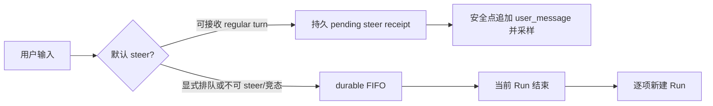
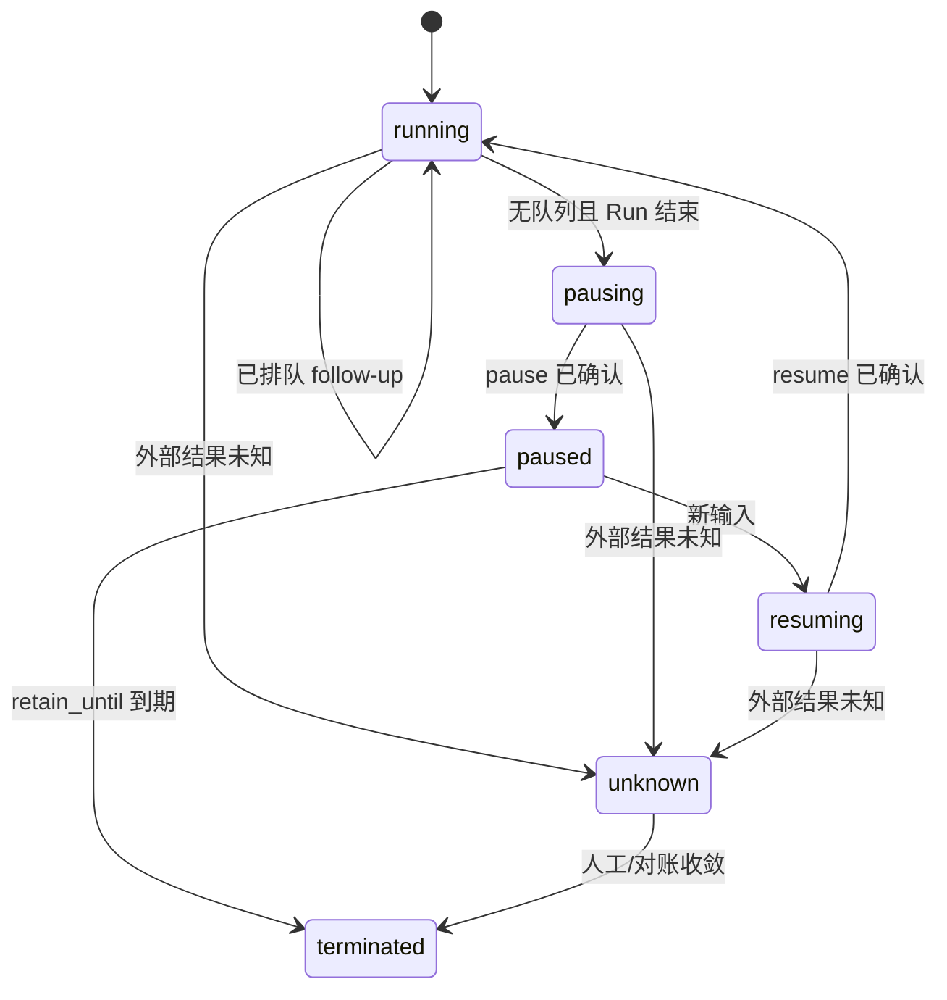

# ADR-0063：Thread 连续上下文、Steer/Follow-up 与 Sandbox 保留

- 状态：提议
- 日期：2026-07-31
- 关联：ADR-0030、ADR-0032、ADR-0033、ADR-0035、ADR-0037
- 拟替代：上述 ADR 中按 Attempt 组织上下文、禁用 compaction、仅 waiting 保温的边界（不修改历史 ADR）

## 背景与已验证事实

当前实现把恢复主要限定在同一 Run/Attempt：新 Run 在 dispatch 时以空 `initial_projection` 入队，而没有从同 Thread 历史重建（`runtime-ts/packages/persistence/src/pg-run-dispatch.ts:10-15,108-143`）。成功 Run 会关闭 Sandbox（`runtime-ts/apps/agent-worker/src/run-worker.ts:613-620`）；pause 只由 `waiting` 路径触发（`runtime-ts/apps/agent-worker/src/run-worker.ts:581-603`），且保温最多十分钟（`runtime-ts/apps/agent-worker/src/waiting-recovery.ts`、ADR-0033 第 2 条）。Pi 适配器暴露 `steer()`/`followUp()`，但它们是活跃 Session 的调用，不能充当跨 Run 的 durable 队列（`runtime-ts/packages/pi-adapter/src/pi-session.ts:177-186`）。ADR-0030/0032 将事实流和恢复投影绑定 Attempt，ADR-0035 禁用 Pi compaction，ADR-0037 又把 waiting-only 的 Sandbox 事实设为边界。这造成同一 Thread 的新 Run 上下文为空、成功后 Sandbox 被关闭、只有 waiting 才 pause、最长仅 10 分钟保温的缺陷。

术语应解耦：**Thread** 是连续上下文边界；**Run** 是一次执行和一个后续 Turn 单元；**steer** 是当前 Run/Turn 内引导；**follow-up** 是下一 Run/Turn。Context Window、Workspace Revision 与 Sandbox 分别是模型可见窗口、可审计文件事实和可丢弃执行缓存，彼此不是同一生命周期。

## 外部研究

固定于官方 Codex commit `0dfa778dae6a94b2ff2c69176cbaf063a3bf18a1`：常规追加先尝试 [`turn/steer`](https://github.com/openai/codex/blob/0dfa778dae6a94b2ff2c69176cbaf063a3bf18a1/codex-rs/tui/src/app/thread_routing.rs#L658-L750)；Core 仅对活跃 regular turn 接收 `pending_input`，不打断正在进行的 provider stream 或已启动工具，而是在下一个安全采样点先写入 history 再采样（[`session/mod.rs`](https://github.com/openai/codex/blob/0dfa778dae6a94b2ff2c69176cbaf063a3bf18a1/codex-rs/core/src/session/mod.rs#L3934-L4006)、[`session/turn.rs`](https://github.com/openai/codex/blob/0dfa778dae6a94b2ff2c69176cbaf063a3bf18a1/codex-rs/core/src/session/turn.rs#L243-L475)）。Review/Compact 不可 steer；expected turn 不匹配、没有活跃 turn、空文本或超限都会拒绝。TUI 的 follow-up 是 FIFO `queued_user_messages`，当前 turn 完成后逐条发起新 `turn/start`（[`input_flow.rs`](https://github.com/openai/codex/blob/0dfa778dae6a94b2ff2c69176cbaf063a3bf18a1/codex-rs/tui/src/chatwidget/input_flow.rs#L131-L174)、[`turn_processor.rs`](https://github.com/openai/codex/blob/0dfa778dae6a94b2ff2c69176cbaf063a3bf18a1/codex-rs/app-server/src/request_processors/turn_processor.rs#L920-L1026)）。这只是可验证的交互参考，不引入其内部协议或源码依赖。

## 备选方案

### 方案 A：保持 Attempt 上下文、waiting-only 保温

改动最小，但新 Run 继续丢失连续语义，用户无法可靠补充或排队，且成功 Run 反复重建 Sandbox。

### 方案 B：仅把 Pi `followUp()` 当持久 follow-up

实现表面简单，但 Pi 队列随进程/Session 消失，且其语义不等于 Codex 的跨 Turn 新 Run；无法提供数据库幂等、审计和恢复。

### 方案 C：Thread 事实流 + Runtime durable 输入队列 + Sandbox 缓存（选择）

在 Runtime 实现 Thread 级上下文和 follow-up FIFO；Pi 只作为当前模型调用适配器；Workspace revision 为文件事实源，Sandbox 仅为可重建缓存。

## 决策

### 输入、Turn 与 API

同时支持 steer 和 follow-up。普通运行中用户补充或纠偏默认尝试 steer；显式“排队”写入 durable FIFO follow-up。steer 在结束竞态、当前阶段不可 steer 或预期 Run/Turn 不匹配时不得丢失，原子转入 follow-up，并在回执中返回实际 `disposition = steered | queued | rejected`。

API 草案为 `POST /threads/{threadId}/inputs`：`mode = auto | steer | follow_up`、`Idempotency-Key`、可选 `expectedRunId/expectedTurnId` 与正文；返回 receipt ID、实际 disposition 和 target Run/Turn。既有 `createRun` 可映射为 `follow_up` 以保持兼容，但该映射仍为提议。`client_request_id` 由 `Idempotency-Key` 规范化并持久化，在同 Tenant/Thread 唯一；同键同正文返回原 receipt，不同正文冲突。拒绝须稳定区分 `empty`、`too_large`、`no_active_turn`、`expected_turn_mismatch` 与 `unsupported_phase`。

可 steer 时先持久化 pending steer receipt，**不**立刻把 `user_message` 插在未完成的 tool call/result 之前。provider stream 与已授权工具不抢占；下一安全采样点由同一 Thread writer 在同一事务中按真实顺序追加 `user_message`、标记 receipt 已消费，再采样。若 abort/结束先发生，则在同一事务把 pending steer 转为 follow-up，绝不丢失。模型可见输入必须最终是 `user_message`，绝不能伪造成 assistant `tool_call`，否则会破坏工具 provenance。每个 follow-up 保持独立 FIFO 项，逐项创建新 Run，永不合并；Run abort 后未消费项仍保留，已领取项通过 receipt/lease 恢复为可重试或明确失败。

### Thread 上下文与压缩

新增 Thread 级 append-only context stream，entry 至少包括 `thread_id, sequence, kind, run_id, turn_id, body/blob_ref, digest, created_at`；`kind` 包括 `user_message`、assistant/tool 事实、checkpoint 和 terminal 边界。每 Thread 单写者（数据库行锁/advisory lock）同时串行 context append、FIFO dequeue 与 checkpoint 写入，避免不同 Run 重排历史。

Compaction 以仅追加 checkpoint 表示：`context_checkpoints(thread_id, checkpoint_id, previous_window_id, window_number, through_sequence, replacement_history, projection, digest, policy_identity)`。每个 checkpoint 的完整 `replacement_history` 一经写入即不可变；后续 checkpoint 可以写新的完整 replacement history，不要求为上一份前缀。只要求 `through_sequence`、`window_number` 和 `previous_window_id` 链单调且可验证。`replacement_history` 只替换模型投影而不覆盖事实；恢复以最新有效 replacement history、其后缀事实和当前 Canonical Context 重建，再按 Context Window 选择模型可见窗口。必须保留最近用户原文；摘要不得吞掉最近未被确认的用户意图。取消“永远禁用压缩”的实施边界，但 Pi 内建 compaction 仍不得成为事实源或自行改写历史。

关键不变量：sequence 无间隙且 Terminal 后不追加同 Turn；所有模型可见用户输入都有 `user_message` 原文或受审计 blob；tool call/result 仍严格配对且来源不可伪造；checkpoint 的 through/window/previous-window 链单调且每份 replacement history 不可变；任何新 Run 都从 Canonical Context 建立而非空 projection；队列 FIFO 的顺序、幂等键和消费 receipt 可恢复。

### 可迁移数据草案与线性化

`thread_input_receipts` 至少含 `tenant_id, thread_id, client_request_id, request_digest, requested_mode, state, disposition, target_run_id, target_turn_id, queue_sequence, input_text, body_blob_ref, body_digest, body_size_bytes, consumed_at, created_at`，唯一约束为 `(tenant_id, thread_id, client_request_id)`；当前纯文本保存不可变 `input_text`，未来多模态改用受审计 `body_blob_ref`。形状约束保证两种 payload 来源恰有一个；`body_digest` 与 `body_size_bytes` 由写入端从实际 payload 重算，不能信任调用方。`state` 覆盖 pending-steer、queued、consumed、rejected，receipt 绑定实际 disposition。`thread_follow_up_queue` 至少含 `tenant_id, thread_id, queue_sequence, receipt_id, request_digest, state, claim_owner, claim_token, claim_epoch, claim_expires_at, consumption_receipt, run_id, created_at`，唯一 `(tenant_id, thread_id, queue_sequence)`，且 sequence 单调递增、不可重排。安全点追加和队列消费必须从 receipt 读取不可变 payload；digest 仅用于幂等冲突检测，不能重建正文。

`thread_sandbox_leases` 至少含 `tenant_id, thread_id, workspace_id, registry_id, run_id, attempt_id, epoch, token, expires_at, released_at`；通过 `released_at IS NULL` 的部分唯一索引保证每个 registry 同时至多一条未释放租约。过期租约必须先用 epoch/token 的 CAS reclaim/release 后才能建立下一条，不能将随时间变化的“未过期”放进索引谓词。registry/run/attempt/epoch/token/expires 必须全量比较，不能仅凭 provider ID 复用。

领取 FIFO、输入 receipt 状态迁移、Sandbox lease handoff，以及“队列为空”时的 pause intent 必须在同一数据库线性化事务内完成：先锁 Thread writer/队列与 registry，再决定 dequeue + 建立下一 Run + 转交 lease，或写入 pause intent。这样关闭“检查为空后恰好新输入”的竞态；外部 pause/resume/create 仍由 outbox 执行并以 receipt 收敛。

### Workspace 与每 Run 文件结果

继续保留 Thread Workspace、不可变 revision 链和 Blob 去重，不复制完整文件树。新增 `run_workspace_results(tenant_id, thread_id, run_id, base_revision_id, result_revision_id, unchanged, committed_at, digest)`，显式记录每 Run 的 base/result/未变化。下一 Run 以 Thread Workspace 最新已提交 revision 为基线；Sandbox 中的文件只在成功提交后成为 revision 事实。

### Sandbox 生命周期

取消 Hot Running Window。若当前 Run 在提交 Workspace 与上下文后已有 queued follow-up，则在上述线性化事务中 FIFO dequeue、建立下一 Run 并转交同一 `running` Sandbox lease；否则持久化 pause intent，随后 `running → pausing → paused`。平台 `onTimeout=pause` 仅为泄漏兜底，不是正确性路径。paused 不耗 CPU/内存但完整保留状态；输入到达时 `paused → resuming → running`。pausing 时到达输入不能与 pause 竞态：先完成 pause，再 resume。超过可配置 `retain_until` 后终止；用户在 10/20 天后回来则创建新 Sandbox 并物化最新 Workspace revision。

建立 Thread/Workspace 级 Sandbox registry，记录 scope、provider/generation、状态、retain_until、effect intent/receipt；Run 通过独占 lease 使用实例。状态至少为 `running`、`pausing`、`paused`、`resuming`、`terminated`、`unknown`；所有外部调用沿用 outbox/attestation 和 UNKNOWN 失败关闭。Sandbox 永远只是缓存，Workspace revision 才是文件事实源。

## 分阶段实施、验证与发布

1. ADR/协议：新增 Thread context、input receipt/FIFO、Run workspace result、sandbox registry/lease 迁移与 API 契约。
2. 跨 Run 连续上下文：修改 `run-contracts`、`persistence`、`agent-worker`，由 Canonical Context 初始化新 Run。
3. steer/follow-up：接入 API/Web/Worker，落库、幂等、竞态转队列和 abort 恢复。
4. compaction：实现 checkpoint/replacement history、预算与恢复验证。
5. Thread Sandbox 复用：替换 waiting-only recovery/cleanup 编排。
6. 指标、迁移与灰度发布：先双写/影子重建，再按 Tenant 开关放量。

测试矩阵覆盖：并发 append/双 worker、expected mismatch、空/超限、provider stream/工具期间 steer、结束竞态转队列、FIFO 与 crash/abort、checkpoint+tail 确定性、工具 provenance、revision unchanged/result、pause/resume 竞态、UNKNOWN、TTL 到期与 10/20 天冷恢复、跨 Tenant/lease 抢占。指标包括 steer 成功/转队列/拒绝率、队列等待、上下文重建与压缩大小、Sandbox pause/resume/recreate/UNKNOWN、paused 时长、冷启动延迟和 revision 提交失败。

风险是存储增长、队列饿死、重复输入、Sandbox 状态漂移和旧客户端兼容。回退时关闭新输入模式并停止复用，继续以新建 Sandbox 执行；已写 Thread entries/checkpoints/receipts 只追加保留，读取器以版本分支兼容，不回写为旧 Attempt projection。`paused retention` 和“普通补充默认 steer”的具体阈值均为未决参数，应在灰度指标后调优，不能把 10 分钟当作新的固定产品约束。

## 影响与实施记录

本 ADR 仍为提议，不授权代码迁移或变更旧 ADR。接受后应以新的替代 ADR/迁移明确哪些条款正式废止；在此之前 ADR-0030/0032/0033/0035/0037 继续约束现有实现。

- 尚未实施。
