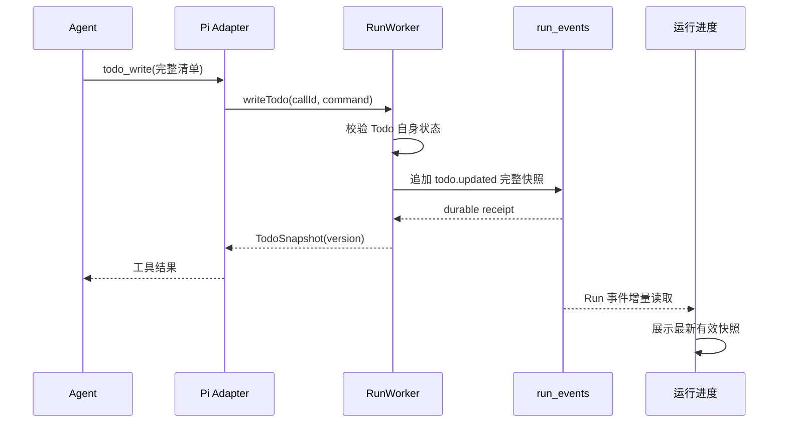

# ADR-0113：Agent Todo Writer 与运行进度清单

- 状态：部分已替代（首次快照全 pending 约束已放宽）
- 日期：2026-08-05
- 决策者：Runtime 团队
- 关联问题：复杂任务缺少由 Agent 自主维护、用户可见的执行清单
- 替代关系：首次快照全 `pending` 约束被 ADR-20260828113100 替代，其余完整快照、持久化和投影决策继续有效

## 背景

Pi 当前没有内置 Plan/Todo 工具。Cube Runtime 的运行进度区域只能显示单一当前状态，工具历史已经在对话区域展示；
用户无法看到复杂任务被拆成哪些步骤，也无法判断完成比例。现有未接线的领域 `Plan` 不是生产事实，Codex 的
`update_plan` 又偏向内部执行清单协议，不能直接满足本产品的通用任务与现有持久化边界。

Todo 的目的仅是帮助 Agent 在复杂或长程任务中先形成步骤并持续校正方向。是否需要 Todo 应由 Agent 根据任务复杂度
决定，简单任务不应为了形式创建清单。Todo 也不是文件、命令或其他工具的授权门禁。

## 备选方案

### 只依赖模型正文描述计划

无需新增协议，但正文难以稳定更新，前端无法可靠计算状态和完成比例，也缺少可审计的最新快照。

### 复用工具历史推断步骤

无需模型显式维护，但工具调用不等于用户目标步骤；通用任务可能不调用工具，同一步也可能包含多次调用。该方案还会
把已经存在的工具历史重复展示到运行进度区域。

### 新增 `todo_write` 完整快照工具

由 Agent 在需要时创建并更新结构化清单，Runtime 持久化每次完整快照，Web 只投影最新有效快照。协议清晰，且不需要
新增数据库表。

## 决策

选择第三种方案：

- 新增顺序执行工具 `todo_write`，参数包含完整 `todos` 和可选 `explanation`；
- 每项使用稳定 `id`、用户可读 `content` 和 `pending | in_progress | completed` 状态；
- 首次创建时所有项均为 `pending`，同时最多一个 `in_progress`；已完成项不可删除、改写或回退；
- 调整步骤结构或把执行中步骤退回 `pending` 时必须提供说明；
- 固定 Platform Harness 指示 Agent：复杂或长程任务自主使用，简单任务跳过；首次列出全部步骤，开始、完成步骤时更新完整清单；
- 不限制 Todo 前后可调用哪些读取、搜索、修改或执行工具，不因 Todo 状态拒绝其他工具；
- Worker 在匹配的 `tool.started` 持久化后，将 `todo.updated` 完整快照追加到现有 `run_events`，然后工具返回；
- API 将 `todo.updated` 作为公开 Agent 事件；Web 在“运行进度”区域展示最新快照、步骤状态和完成数量；清单支持手动折叠，执行中默认展开，终态默认收起，折叠标题保留当前步骤和完成比例；
- 工具历史继续使用既有对话展示，不复制到运行进度清单。

## 数据流与一致性

Todo 是 Run Attempt 级内存状态与追加事件。每次写入使用工具 `callId` 形成幂等键，快照版本单调递增。首版不在
Thread 间继承 Todo，也不为 Todo 新增可变数据库聚合；Run 事件是审计和 UI 读取的事实源。

## 影响

- 复杂任务可以向用户展示明确步骤、当前步骤和完成比例；
- 通用非代码任务与代码任务使用同一协议，不绑定仓库探索流程；
- Prompt 从 `runtime-system-prompt.v7` 升级到 `runtime-system-prompt.v8`，兼容身份与摘要随之变化；
- 每次更新增加一个有界 Run 事件和一组正常工具观察事实，最多 20 项、每项 240 字；
- 无数据库迁移，现有事件读取接口保持结构兼容；旧 Run 没有 `todo.updated` 时继续只显示当前状态；
- Todo 写入持久化未知时失败关闭当前工具继续路径，避免模型误以为清单已经保存；该行为不构成其他工具的前置门禁。

## 验证

- Domain 测试覆盖首次全 pending、单一 in_progress、版本递增、完成项不可改写和结构调整说明；
- Pi Adapter 测试覆盖 Schema、成功/失败 durable Tool Observation 和用户可读工具展示；
- RunWorker 测试覆盖 `tool.started` 后追加 `todo.updated` 完整快照；
- API 测试覆盖公开读取 `todo.updated`；
- Web 投影与组件测试覆盖最新快照、完成比例、运行进度区域中的三种状态，以及执行中默认展开、终态默认收起；
- Prompt Golden 测试覆盖 v8 固定规则与摘要。

## 可逆性与回退

可停止注册工具、恢复 v7 Prompt 并隐藏 Web 清单。已写入的 `todo.updated` 是追加审计事实，不需要删除；旧版本客户端会
按未知事件忽略。若未来需要跨 Run 项目计划，应新增独立聚合与迁移，不改变本 ADR 的 Run 级 Todo 语义。
