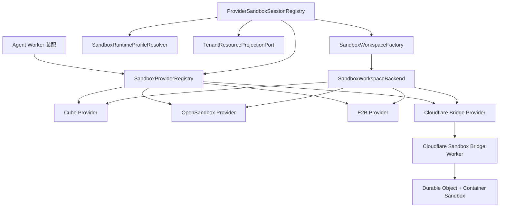
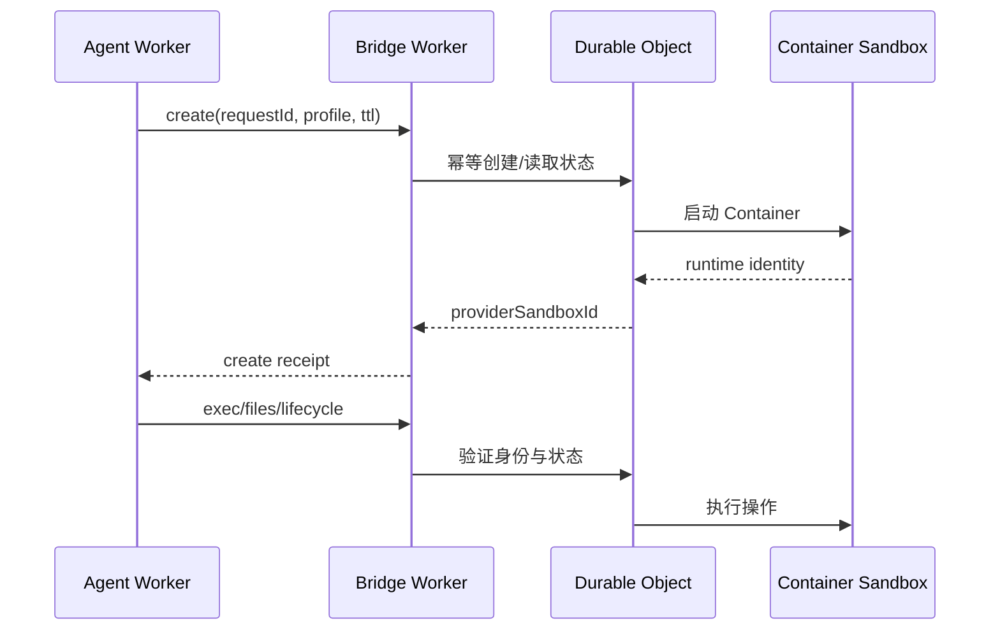

# 多 Sandbox Provider 实施计划

- 文档性质：跨 Sandbox、Worker、Persistence、配置、部署与生产 Gate 的实施总计划
- 状态：提议，尚未开始实施
- 日期：2026-08-14
- 代码基线：`533972bfdcc55238ca4e9b719ed153fa2989b949`
- 首批目标 Provider：CubeSandbox、OpenSandbox、E2B、Cloudflare Sandbox SDK
- 暂不纳入：microsandbox、Cloudflare Computer

## 1. 结论与实施原则

当前 Runtime 已通过 `SandboxGateway`、`SandboxHandle`、`ThreadSandboxProviderPort` 和
`SandboxSessionRegistryPort` 隔离了大部分业务执行语义，但生产装配、Workspace 安全适配、ResourceFS 挂载、配置、
错误映射和创建结果对账仍直接绑定 CubeSandbox。首批多 Provider 实施不能在
`CubeSandboxSessionRegistry` 内增加 Provider 条件分支，而应先把这些 Cube 专属边界重构成稳定的 Provider 无关端口，
随后以一致性测试套件分别接入 OpenSandbox、E2B 和 Cloudflare Sandbox Bridge。

实施遵守以下原则：

1. CubeSandbox 继续作为默认 Provider，Provider 无关重构必须先证明 Cube 行为没有变化。
2. 新 Sandbox 由部署级默认 Provider 选择；首版不允许用户、Run、Agent 或工具动态选择 Provider。
3. 每个持久 Sandbox 身份必须记录 `providerKey`，所有清理、恢复、对账和摘要都使用
   `(providerKey, providerSandboxId)`，不得继续把裸 Provider ID 当作全局身份。
4. 不做跨 Provider 自动故障转移。创建结果未知时禁止尝试第二个 Provider，避免双重创建、双重执行和无法确认的副作用。
5. Workspace Revision 与 Thread Context 继续是事实源，Sandbox 仍只是可验证缓存；Provider 不得成为业务事实源。
6. Provider 能力必须显式声明。内存暂停、文件系统冷恢复和完全重建不能统一伪装成同一种 `pause/connect`。
7. `/resources` 不能因 Provider 接入而退化成无约束复制目录。原生只读挂载与受控物化必须分别建模、验证和观测。
8. Provider SDK 使用精确版本并提交锁文件；若复制第三方源码，只能进入 `runtime-ts/vendor` 并记录来源与许可证。
9. System prompt、developer prompt 和工具 Schema 不包含 Provider、Sandbox ID、动态路径或请求级配置，保持现有上下文缓存约束。

## 2. 范围

### 2.1 本计划包含

- 把 CubeSandbox 专属 Gateway、Session Registry、Workspace Adapter、Resource Volume 和错误事件拆成通用端口；
- 为所有持久 Sandbox 身份增加 Provider 判别；
- 增加部署级 Provider 注册表和默认 Provider 配置；
- 保留并迁移 CubeSandbox 实现；
- 接入 OpenSandbox JavaScript SDK；
- 接入 E2B JavaScript SDK，并把 Code Interpreter 作为可选能力；
- 为 Cloudflare Sandbox SDK 建立独立 Bridge Worker，再由现有 Node Worker 调用 Bridge；
- 建立共享契约测试、真实 Provider 冒烟、故障注入、供应链和生产发布 Gate；
- 更新 `.env.example`、生产配置契约、部署文档、发布清单和运维告警。

### 2.2 本计划不包含

- microsandbox 或 Cloudflare Computer 适配；
- 删除 CubeSandbox 或迁移现有 Cube 模板；
- 用户级、Tenant 级或单 Run 动态 Provider 选择；
- Provider 之间的自动故障转移、负载均衡或按价格动态路由；
- 把 Provider 自带文件系统、快照或对象存储提升为 Workspace 事实源；
- 自动把已暂停的 Cube Sandbox 原地转换为其他 Provider Sandbox；
- 修改模型 Prompt、工具名称或对外 Agent 协议；
- 在首版承诺所有 Provider 都支持内存快照、后台进程连续性或完全相同的网络语义。

## 3. 调研基线

本计划使用以下官方仓库基线形成接口假设；开始对应 Adapter 前必须重新核对 SDK 版本、许可证、生命周期和生产限制：

| Provider | 官方仓库基线 | 当前 JavaScript 包基线 |
|---|---|---|
| E2B | `e2b-dev/E2B@0d507cd53d5d` | `e2b@2.39.0` |
| OpenSandbox | `opensandbox-group/OpenSandbox@7c03b74b8a8c` | `@alibaba-group/opensandbox@0.1.11` |
| Cloudflare Sandbox SDK | `cloudflare/sandbox-sdk@2dd1476e3276` | `@cloudflare/sandbox@0.12.6` |

这些版本只用于计划基线，不代表现在提交依赖升级。P0 Spike 必须选择当时已验证的精确版本，更新 `pnpm-lock.yaml` 和供应链记录，
并把版本与真实 Gate 结果写入对应 ADR 的实施记录。

## 4. 当前代码基线与主要耦合

| 当前位置 | 现状 | 必须解决的问题 |
|---|---|---|
| `runtime-ts/packages/sandbox/src/types.ts` | `SandboxGateway` 基本通用，但创建输入固定为 `templateId`，`volumeMounts` 注释和形状来自 Cube | 引入受控 Runtime Profile、通用 Mount 和显式能力 |
| `runtime-ts/packages/sandbox/src/cube-gateway.ts` | SDK Facade、Gateway、Handle、创建对账和 `UncertainLifecycleEvent` 混在同一文件 | 保留 Cube Adapter，把通用生命周期事件和契约移出 |
| `runtime-ts/packages/sandbox/src/workspace-adapter.ts` | `CubeSandboxWorkspacePort` 直接依赖 `CubeSdkSandbox` 的命令及完整文件 API | 抽出 Provider 无关 Workspace Backend，复用安全扫描逻辑 |
| `runtime-ts/packages/sandbox/src/cube-volume.ts` | 每 Tenant 创建 Cube Volume，并挂载自定义 ResourceFS Driver | 抽出 ResourceFS Projection，区分原生挂载和受控物化 |
| `runtime-ts/apps/agent-worker/src/production-worker-runtime.ts` | `CubeSandboxSessionRegistry` 直接构造 Cube Gateway | 改为注入 Provider Registry、Profile Resolver 和 Resource Projector |
| `runtime-ts/apps/agent-worker/src/process-entry.ts` | `CUBESANDBOX_*` 为生产必填，启动时直接构造 Cube 实现 | 增加严格的多 Provider 配置契约和 Provider Router |
| `sandbox_registry` | 只保存 `provider_sandbox_id` | 增加 `provider_key`，更新唯一约束、外键、摘要和清理协议 |
| `thread_sandbox_sessions` | 对裸 `provider_sandbox_id` 建全局唯一约束 | 改为 `(provider_key, provider_sandbox_id)` 唯一 |
| cleanup/lifecycle consumers | 根据裸 ID 调唯一上游实现 | 根据持久化 `provider_key` 路由到对应 Provider，未知 Provider 失败关闭 |

## 5. 目标架构



### 5.1 Provider 注册表

新增 Provider 注册表，负责：

- 维护固定、低基数的 `providerKey`；
- 暴露部署级默认 Provider；
- 根据持久化 `providerKey` 路由 create/connect/inspect/settle/reconcile；
- 启动时验证默认 Provider 和所有启用 Provider 的配置；
- 不允许请求级字符串直接索引任意实现；
- 对未知、已禁用或未配置 Provider 失败关闭。

首批固定 Key：

```ts
type SandboxProviderKey = "cube" | "opensandbox" | "e2b" | "cloudflare";
```

数据库只校验受控字符和长度，不把枚举永久写死在 SQL；应用层负责已知 Provider 校验，以便未来增加 Provider 时不必改旧表
CHECK 约束。

### 5.2 Provider 能力

新增不可变能力描述：

```ts
interface SandboxProviderCapabilities {
  readonly retention: "memory" | "filesystem" | "none";
  readonly supportsAutoResume: boolean;
  readonly supportsNativeReadOnlyMount: boolean;
  readonly supportsRunCode: boolean;
  readonly supportsCreateReconciliation: boolean;
  readonly supportsDeterministicSandboxId: boolean;
}
```

能力只来自部署和已验证的 Provider Adapter，不接受用户输入。Thread 生命周期根据能力决定：

- `memory`：可报告真正的 paused/resumed；
- `filesystem`：恢复后必须报告冷启动，并重新检查 Workspace、ResourceFS 与运行时依赖；
- `none`：不能复用原 Sandbox，必须以 Workspace Revision 冷重建新 generation；
- 不支持可靠创建对账的 Provider，不得启用生产创建路径。

### 5.3 Runtime Profile

业务层继续只请求固定 Profile，不接收任意镜像、模板、Entrypoint 或资源规格。建议将现有单一
`CUBESANDBOX_TEMPLATE_ID` 提升为：

```ts
interface SandboxRuntimeProfile {
  readonly profileId: string;
  readonly providerKey: SandboxProviderKey;
  readonly providerRuntimeRef: string;
  readonly defaultTtlSeconds: number;
  readonly lifecyclePolicy: "pause" | "close";
}
```

例如同一个逻辑 Profile 可由部署映射为：

- Cube：不可变 Template ID；
- OpenSandbox：固定 OCI Image + Entrypoint + Resource；
- E2B：固定 Template ID/Alias；
- Cloudflare：固定 Bridge Runtime/Container Binding。

首版每个部署只配置一个默认逻辑 Profile，不建设运行时 Profile 管理后台。

### 5.4 Workspace Backend

扩展内部文件能力，不把 Provider SDK 对象暴露给业务层：

```ts
interface SandboxWorkspaceBackend {
  readonly sandboxId: string;
  command(command: string, control?: OperationControl): Promise<CommandOutput>;
  readFile(path: string, control?: OperationControl): Promise<Uint8Array>;
  writeFile(path: string, data: Uint8Array, control?: OperationControl): Promise<void>;
  list(path: string, control?: OperationControl): Promise<readonly SandboxFileEntry[]>;
  stat(path: string, control?: OperationControl): Promise<SandboxFileStat>;
  remove(path: string, control?: OperationControl): Promise<void>;
  rename(from: string, to: string, control?: OperationControl): Promise<void>;
  makeDirectory(path: string, control?: OperationControl): Promise<void>;
}
```

现有 Workspace Adapter 中以下安全语义必须保持共享实现，不能由各 Provider 自行弱化：

- 绝对根固定为 `/workspace`；
- 路径规范化和 UTF-8 长度限制；
- 拒绝根目录、父目录和软链接逃逸；
- 文件类型、数量、单文件大小和总大小限制；
- 读取前后 inode/mtime/ctime/size 指纹一致；
- 原子写入、临时文件校验、`fsync` 和 rename；
- Snapshot token、operation key、scope digest 和 Sandbox generation 绑定；
- 输出上限和 Provider 协议响应验证。

Provider 可以使用原生文件 API，也可以在完整 Linux Sandbox 内执行既有受控 Python helper；最终行为必须通过同一套
Workspace 契约测试。

### 5.5 ResourceFS Projection

新增：

```ts
interface TenantResourceProjectionPort {
  prepare(input: {
    readonly providerKey: SandboxProviderKey;
    readonly tenantId: TenantId;
    readonly signal?: AbortSignal;
  }): Promise<ResourceProjection>;
  probe(providerKey: SandboxProviderKey): Promise<void>;
}

type ResourceProjection =
  | { readonly kind: "native_readonly_mount"; readonly mount: SandboxMountSpec }
  | { readonly kind: "controlled_materialization"; readonly manifestRef: string };
```

实施约束：

- Cube 首先继续使用当前自定义 Volume Driver，不改变行为；
- OpenSandbox 优先验证自定义只读 Volume/PVC/Sidecar；验证失败前不得宣称生产 ResourceFS 等价；
- E2B 首先验证其 Volume Mount 能否满足只读、Tenant 隔离和长期资源视图；不能满足时使用受控物化；
- Cloudflare 优先验证 R2/S3 Bucket Mount 或 Bridge 侧只读投影；
- 受控物化由可信 Worker 读取既有 Resource/Blob 事实并写入 Sandbox，不把 ResourceFS 服务凭据交给 Sandbox；
- 受控物化必须有 manifest digest、字节上限、路径白名单、文件权限、完成证明和复用时清理；
- 若 Provider 无法提供真正只读的 `/resources`，对应限制必须在 capability、文档和 Gate 中显式暴露，不能只依赖 chmod 宣称不可写。

### 5.6 建议文件布局

保持 `@hoox/sandbox` 包名，避免无收益的跨工作区重命名；只重组其内部边界：

```text
runtime-ts/packages/sandbox/src/
  types.ts
  provider-registry.ts
  lifecycle-event.ts
  runtime-profile.ts
  workspace-backend.ts
  resource-projection.ts
  providers/
    cube/
      gateway.ts
      facade.ts
      errors.ts
      resource-volume.ts
    opensandbox/
      gateway.ts
      facade.ts
      errors.ts
    e2b/
      gateway.ts
      facade.ts
      errors.ts
    cloudflare/
      bridge-client.ts
      gateway.ts
      errors.ts
```

Cloudflare Bridge 建议作为独立应用和制品：

```text
runtime-ts/apps/cloudflare-sandbox-bridge/
```

Bridge 不与现有 API、Scheduler 或 Agent Worker 合并发布。共享 Workspace 安全算法保留单一实现，Provider 目录只拥有
SDK 调用、协议验证、错误映射和 Provider 特有 lifecycle/resource 翻译。

## 6. 持久化与兼容迁移

### 6.1 新增 Provider 身份

新增迁移，为以下事实增加 `provider_key`：

- `sandbox_registry`；
- `cleanup_outbox`；
- `sandbox_lifecycle_unknown`；
- `thread_sandbox_sessions`；
- `sandbox_lifecycle_effects` 及其 request/receipt payload；
- waiting recovery、mutation protocol 和所有包含 Provider Sandbox 身份的摘要。

迁移规则：

1. 旧数据全部明确回填为 `cube`；
2. 新列先允许兼容读取，再回填并设为 `NOT NULL`；
3. `UNIQUE(provider_sandbox_id)` 改为 `UNIQUE(provider_key, provider_sandbox_id)`；
4. 所有外键和 identity digest 同时加入 `provider_key`；
5. 不原地把旧 `provider_sandbox_id` 拼接成 `provider:id`，保持字段可审计；
6. 旧事件缺少 `providerKey` 时只在兼容解析层解释为 `cube`，新写入必须显式包含；
7. 含新 Provider 事实后，生产 down migration 必须拒绝，线上回退依靠 Feature Flag 和兼容消费者。

### 6.2 Domain 与 Run Contracts

修改：

- `SandboxSessionRef` 增加 `providerKey`；
- `ThreadSandboxAcquireResult` 和 cleanup receipt 传播 Provider 身份；
- `UncertainLifecycleEvent` 移到 Provider 无关模块并增加 `providerKey`；
- `sandboxCleanupIdentityDigest`、outbox digest 和 waiting recovery proof 纳入 Provider；
- 所有逐字段 capability 绑定同时校验 Provider、registry、sandbox ID、generation 和 ExecutionScope；
- 日志和公开错误不得输出 API Key、Bridge Token、签名 URL 或上游响应正文。

## 7. 配置与启动契约

建议新增：

```env
SANDBOX_DEFAULT_PROVIDER=cube
SANDBOX_ENABLED_PROVIDERS=cube
SANDBOX_PROFILE_ID=agent-pptx-v1
```

Provider 专属配置继续使用独立命名空间：

```env
# Cube
CUBESANDBOX_API_URL=
CUBESANDBOX_API_KEY=
CUBESANDBOX_TEMPLATE_ID=
CUBESANDBOX_RESOURCE_VOLUME_DRIVER=

# OpenSandbox
OPENSANDBOX_API_URL=
OPENSANDBOX_API_KEY=
OPENSANDBOX_IMAGE=
OPENSANDBOX_ENTRYPOINT=

# E2B
E2B_API_KEY=
E2B_DOMAIN=
E2B_TEMPLATE_ID=

# Cloudflare Bridge
CLOUDFLARE_SANDBOX_BRIDGE_URL=
CLOUDFLARE_SANDBOX_BRIDGE_TOKEN=
CLOUDFLARE_SANDBOX_RUNTIME_PROFILE=
```

配置规则：

- 默认 Provider 必须出现在启用列表；
- 所有持久事实可能引用的 Provider 必须在清理/恢复 Worker 中可路由；
- Provider 必填字段只在启用该 Provider 时要求；
- 生产环境禁止明文 HTTP，开发环境只能显式允许 loopback 或受控私网；
- Bridge Token、Provider API Key 和 Volume 凭据标记为 secret，配置错误不得回显值；
- 新增环境变量同步更新 `.env.example`、`deploy/production.env.example`、配置契约测试和发布清单；
- 首版不读取请求级 Provider 配置，不把 Provider 信息注入 Prompt。

## 8. 分阶段实施

### 阶段 0：ADR、能力 Spike 与冻结契约

#### 交付

- 新增多 Provider 总体 ADR；
- 新增生命周期 retention ADR；
- 新增 ResourceFS 原生挂载与受控物化 ADR；
- 固定 `SandboxProviderKey`、能力模型、Runtime Profile 和创建结果未知协议；
- 对 OpenSandbox、E2B、Cloudflare Sandbox 分别完成最小真实 Spike；
- 固定首批 SDK 精确版本和许可证处理方式。

#### Spike 必测

- create 后命令与文件 API 可用；
- API 超时发生在 Provider 接受创建前后时能否对账；
- pause/sleep/stop 后是否保留内存、进程和文件系统；
- connect/resume 是否更新 TTL；
- kill/destroy 的重复调用语义；
- list/inspect 是否能区分 running、paused/stopped、not found；
- Volume 是否支持只读、Tenant 隔离、复用和清理；
- 真实模板能否生成 `.pptx` 并通过 pause/resume 或冷恢复冒烟。

#### Gate

没有真实证据的能力必须保持未启用；不得仅根据 SDK 类型或 README 将 capability 标记为生产支持。

### 阶段 1：Provider 无关内核与 Cube 回归

#### 主要修改

- `runtime-ts/packages/sandbox/src/types.ts`：Provider Key、能力、Runtime Profile、通用 Mount；
- 新建通用 Provider Registry、Workspace Backend 和 Lifecycle Event；
- 将 `CubeSandboxGateway` 改为通用接口实现；
- 将 `CubeSandboxWorkspacePort` 的共享安全逻辑移到通用 Workspace Adapter；
- 将 `CubeSandboxSessionRegistry` 重构为 `ProviderSandboxSessionRegistry`；
- 保留 Cube SDK Facade 供单元测试和错误注入；
- 生产装配仍只启用 Cube。

#### 测试

- 原有 Cube 单元测试全部保留；
- 新增共享 Gateway/Handle/Workspace 契约测试；
- Cube Adapter 必须通过共享契约；
- 现有真实 Cube 冒烟结果保持不变；
- Prompt、工具 Schema 和公开 API 快照无变化。

#### Gate

Cube-only 配置下构建产物、生产容器、readiness、Thread Sandbox reuse、Workspace publish 和清理对账全部通过，才允许继续。

### 阶段 2：Provider 身份持久化与 Router

#### 主要修改

- 新增 additive migration 和 down 拒绝逻辑；
- Domain、Run Contracts、Persistence、Outbox、Waiting Recovery 增加 `providerKey`；
- cleanup consumer、thread lifecycle consumer 和 orphan cleanup 根据 Provider 路由；
- 所有摘要和幂等键加入 Provider；
- 新增配置契约、Provider Registry 装配和 readiness；
- 默认 Provider 仍为 Cube，新写入开始显式保存 `cube`。

#### 测试

- 空库 up/down；
- 旧 Cube 数据回填；
- 含非 Cube 事实时 down 拒绝；
- `(providerKey, providerSandboxId)` 同 Provider 冲突、跨 Provider 不冲突；
- 跨 Tenant、跨 Provider、跨 generation 重放负例；
- 未知 Provider、已禁用 Provider 和缺失配置失败关闭；
- cleanup/recovery 在进程滚动升级期间仍能处理旧 Cube 事实。

#### Gate

生产以 Cube-only 运行至少一个完整发布周期，确认迁移、清理和恢复指标没有回归后再启用新增 Provider。

### 阶段 3：OpenSandbox Provider

#### 适配内容

- 精确版本的 OpenSandbox JavaScript SDK；
- `OpenSandboxGateway` 与 SDK Facade；
- OCI Image/Profile 映射；
- command、filesystem、inspect、connect、pause/resume/kill；
- Metadata/Label 创建对账；
- Workspace Backend；
- ResourceFS 原生只读挂载或经 ADR 批准的受控物化；
- Provider 错误到稳定 `SandboxRuntimeError` 的映射；
- Docker 和 Kubernetes 两套真实冒烟。

#### 必须验证

- Pause/Resume 的真实 retention 类型；
- Server Proxy 与 Sandbox 数据面网络；
- 自定义镜像中的 Node、pptxgenjs、LibreOffice 和 Poppler；
- Volume/PVC 在暂停、恢复、节点迁移后的行为；
- 创建超时与重复请求不会产生不可对账的泄漏；
- 凭据不进入 Sandbox 环境、日志或模型上下文。

#### Gate

- 共享契约测试通过；
- 真实 `.pptx` 生成、Workspace publish、waiting pause 和下一 Run 恢复通过；
- ResourceFS required/optional 两条链路通过；
- 故障注入后的 UNKNOWN、告警和人工回收流程通过。

### 阶段 4：E2B Provider

#### 适配内容

- 精确版本的 E2B JavaScript SDK；
- `E2BSandboxGateway` 与 SDK Facade；
- Template Profile 映射；
- commands、files、list/inspect、pause/connect/kill；
- Lifecycle `onTimeout`、`autoResume` 和 keep-memory/filesystem 配置；
- Volume Mount 或受控物化；
- 可选 `runCode` 能力：只有配置 Code Interpreter Runtime 时才声明原生支持；
- 创建 Metadata/Label 对账和泄漏清理。

#### 必须验证

- 账号套餐对应 TTL、Pause 和 Snapshot 上限；
- `connect` 对 running/paused/not-found 的精确语义；
- keep-memory 与 filesystem-only 恢复区别；
- Volume 生命周期、配额和跨 Sandbox 复用；
- 命令输出、流式文件和 AbortSignal 的超时边界；
- API 限流和暂时错误不会被误映射成 NOT_FOUND。

#### Gate

除共享 Gate 外，必须记录实际套餐、区域、模板和配额基线；生产配置不能依赖未验证的默认值。

### 阶段 5：Cloudflare Sandbox Bridge

Cloudflare Sandbox SDK 运行在 Workers、Durable Objects 和 Containers 体系内，现有 Node Worker 不直接依赖其 Durable Object
对象。新增独立 Bridge Worker：



#### Bridge 内部协议

至少提供：

- 创建与 request ID 幂等查询；
- inspect/open；
- command；
- read/write/list/stat/remove/rename/mkdir；
- runCode capability；
- sleep/stop/destroy；
- ResourceFS Bucket Mount 或 Bridge 侧投影；
- 健康检查与低基数指标。

#### 安全约束

- Worker 与 Bridge 使用短时签名请求、mTLS 或等价的服务间认证；
- 请求包含时间窗、nonce、body digest 和稳定 operation ID，拒绝重放；
- Bridge 不接受任意镜像、任意 Container Class 或任意外部 URL；
- Durable Object ID 与 Runtime 的 Provider Sandbox ID 映射稳定且可审计；
- Bridge 响应和错误不得包含 Cloudflare Token、R2 凭据或内部 Durable Object 标识细节；
- Agent Worker 不持有可直接管理整个 Cloudflare Account 的宽权限 Token。

#### Gate

- 本地 Miniflare/Workers 测试；
- 部署环境真实 Container 冒烟；
- Durable Object 重启、Container sleep、Bridge 超时和重复请求故障注入；
- 创建结果未知能够通过 request ID 对账；
- Bridge 暂时不可用时不触发第二 Provider；
- `destroy` 与已开始的 cleanup effect 最终收敛。

### 阶段 6：灰度、运维与发布

#### 灰度顺序

1. Schema、Router 和 Cube Adapter 先发布，默认仍为 Cube；
2. OpenSandbox/E2B/Cloudflare Adapter 以配置关闭状态进入生产制品；
3. 预生产启用单一新增 Provider，执行真实 Gate；
4. 所有 Worker 同时配置旧 Provider 和新 Provider，保证旧 Session 可恢复和清理；
5. 通过部署级默认值切换新创建 Sandbox，不迁移正在运行或暂停的 Session；
6. 等旧 Provider 的 retention 和 cleanup 全部收敛后，才能删除旧 Provider 凭据；
7. 每次只启用一个新增 Provider，不同时灰度多个变量。

#### 指标

现有指标继续使用低基数维度，并允许增加固定 `provider` 维度：

- sandbox create/resume/pause/close latency；
- create/cleanup unknown total；
- reconcile success/failure；
- cold rebuild total；
- ResourceFS native mount/materialization total；
- Workspace protocol/integrity failure；
- Provider rate limit/authentication/upstream unavailable；
- orphan sandbox detected/closed；
- paused retention 和 idle running seconds。

Provider Sandbox ID、request ID、Tenant ID、Thread ID、路径和错误正文不得成为指标标签。

## 9. 共享测试矩阵

| 测试层级 | Cube | OpenSandbox | E2B | Cloudflare |
|---|---:|---:|---:|---:|
| Facade 单元测试 | 必须 | 必须 | 必须 | 必须 |
| Gateway/Handle 契约 | 必须 | 必须 | 必须 | 必须 |
| Workspace 安全契约 | 必须 | 必须 | 必须 | 必须 |
| ResourceFS required/optional | 必须 | 必须 | 必须 | 必须 |
| 创建未知与对账 | 必须 | 必须 | 必须 | 必须 |
| pause/resume retention | 必须 | 必须 | 必须 | 必须 |
| cleanup 幂等与 not-found | 必须 | 必须 | 必须 | 必须 |
| Persistence 跨 Provider | 通用 | 通用 | 通用 | 通用 |
| 真实 `.pptx` 冒烟 | 必须 | 必须 | 必须 | 必须 |
| 生产容器/部署 Gate | 必须 | 必须 | 必须 | 必须 |

共享契约至少覆盖：

- 非法 Profile、TTL、环境变量、路径和超时；
- AbortSignal 在请求前、中、响应后边界；
- 命令 stdout/stderr/exitCode 协议；
- 二进制文件、空文件、大文件和输出上限；
- list/stat 的普通文件、目录、软链接和未知类型；
- create 成功、明确失败、响应丢失和清理失败；
- connect running、paused、not found、timeout；
- pause/close 重复执行；
- Provider 返回畸形 JSON、错误状态和超大正文；
- Workspace TOCTOU、软链接替换、rename 竞争和 Snapshot identity drift；
- Provider Key 跨 Tenant、跨 Provider、跨 Session 的重放负例。

## 10. 供应链与部署

- 所有新增 npm 依赖使用精确版本；
- 更新 `pnpm-lock.yaml`、SBOM、许可证清单和生产容器复制规则；
- 不把 Provider CLI、开发服务器或测试工具带入 Runtime-only 镜像；
- Provider 模板/镜像使用不可变摘要或不可变版本；
- OpenSandbox、E2B 和 Cloudflare 模板分别保留构建来源与回滚版本；
- Bridge Worker 有独立发布、回滚、密钥和观测配置，不与 API/Scheduler/Worker 共用整包环境变量；
- 生产发布清单增加 Provider readiness、真实执行、ResourceFS、pause/resume、cleanup 和泄漏审计；
- 第三方 SDK 的重大版本升级必须重新运行共享契约和真实 Provider Gate。

## 11. 风险与缓解

| 风险 | 后果 | 缓解 |
|---|---|---|
| 不同 Provider 的 pause 语义被错误统一 | 后台进程或内存状态静默丢失 | 显式 retention capability，冷恢复重新物化并使用新 generation |
| 创建超时后自动切换 Provider | 双重 Sandbox 和重复副作用 | 禁止自动 failover，必须对账或进入 UNKNOWN |
| 裸 Provider ID 跨 Provider 冲突 | 错误连接、清理或跨租户能力重放 | 持久化 `providerKey`，所有唯一键和摘要使用复合身份 |
| ResourceFS 被降级成可写复制目录 | Skill/附件完整性与隔离承诺失真 | 原生只读挂载优先；物化模式显式 capability、digest 和 Gate |
| Provider SDK 错误正文包含秘密 | 日志或告警泄密 | 统一错误适配，只记录稳定码和受控摘要 |
| Cloudflare Bridge 成为宽权限控制面 | Account 级影响面扩大 | 最小权限、窄协议、请求签名、重放保护、独立密钥 |
| 滚动升级时旧 Session 无法恢复 | Thread continuity 中断 | 所有 Worker 在旧 Session 收敛前同时配置旧、新 Provider |
| 多 Provider 分支侵入业务层 | 长期维护成本和行为漂移 | 所有差异封装在 Provider Registry、Gateway、Workspace Backend 和 Resource Projection |

## 12. 回退策略

- Provider 无关重构阶段通过 Cube-only 配置回退，不删除旧 Cube 实现；
- 新增 Provider 默认关闭，关闭后停止创建新 Session，但继续处理已开始的 lifecycle effect 和 cleanup；
- 默认 Provider 回切不修改已有 Session 的 `providerKey`；
- 已暂停的新 Provider Session 先 drain/terminate，再删除对应凭据；
- Schema 增加采用兼容读写，含非 Cube 事实后不执行破坏性 down；
- Cloudflare Bridge 可独立回滚，但已有 Durable Object/Container cleanup 必须由兼容版本继续完成；
- UNKNOWN 事实、审计记录和 Workspace Revision 不因 Provider 回退而删除。

## 13. 完成定义

多 Provider 首版只有在以下条件全部成立时才算完成：

1. CubeSandbox 通过共享契约和现有真实 Gate，无外部行为回归；
2. 所有 Sandbox 持久身份包含 `providerKey`，迁移和跨 Provider 负例通过；
3. OpenSandbox、E2B、Cloudflare 分别通过真实 create/command/files/workspace/lifecycle/cleanup Gate；
4. 每个 Provider 的 retention、ResourceFS、runCode 和对账能力均来自真实验证；
5. 创建 UNKNOWN、cleanup UNKNOWN 和 orphan 回收有稳定告警及运维手册；
6. 默认 Provider 可在不迁移既有 Session 的情况下切换和回退；
7. 配置示例、生产配置契约、SBOM、许可证、部署清单和回滚文档同步完成；
8. 本计划明确排除的 microsandbox、Cloudflare Computer 没有进入生产依赖、配置或运行时分支。

## 14. 建议任务切片

| 切片 | 内容 | 依赖 | 可独立验收结果 |
|---|---|---|---|
| P0 | 三组 ADR 与 Provider Spike | 无 | 能力证据、版本和契约冻结 |
| P1 | Provider Key、Capabilities、Profile 类型 | P0 | Sandbox 包类型与单测 |
| P2 | 通用 Workspace Backend | P1 | Cube 通过共享 Workspace 契约 |
| P3 | 通用 Session Registry 与 Cube Adapter | P1/P2 | Cube-only 生产装配无回归 |
| P4 | Provider 身份数据库迁移 | P1 | migration/RLS/跨 Provider 测试 |
| P5 | Provider Router、配置与 cleanup 路由 | P3/P4 | Cube 显式 providerKey 全链路 |
| P6 | OpenSandbox Adapter | P2/P3/P5 | OpenSandbox 真实 Gate |
| P7 | E2B Adapter | P2/P3/P5 | E2B 真实 Gate |
| P8 | Cloudflare Bridge Worker | P0 | Bridge 本地与部署冒烟 |
| P9 | Cloudflare Adapter | P2/P3/P5/P8 | Cloudflare 真实 Gate |
| P10 | 灰度、指标、运维和发布文档 | P6/P7/P9 | 可切换、可回退、可审计 |

P2、P4 和 P8 在契约冻结后可以并行；P6 与 P7 在 P5 完成后可以并行。任何 Provider Adapter 都不得绕过共享
Workspace、ResourceFS、错误映射、生命周期 UNKNOWN 和持久 Provider 身份边界。
