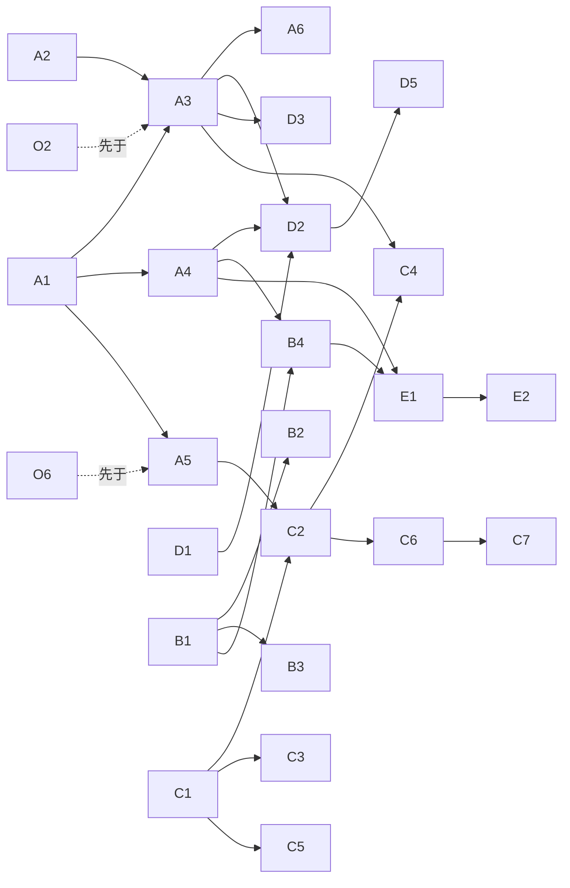

# 可定制 Agent 平台实施计划

- 状态：进行中
- 创建日期：2026-11-19
- 适用范围：见[可定制 Agent 平台规范](../specs/custom-agent-platform.md)，并包含开源首发与对外表述相关的仓库、文档和 Landing 工作
- 目标读者：领取工作包的开发者与协作智能体、负责排期和合并的维护者
- 目标契约：[可定制 Agent 平台规范](../specs/custom-agent-platform.md) · [MCP 与外部工具接入规范](../specs/mcp-and-external-tool-integration.md)

## 1. 生命周期与权威边界

本文只规定**做什么、按什么顺序、哪些可以并行、谁拥有哪些文件**。各能力必须满足的行为和约束以[规范](../specs/custom-agent-platform.md)为准；本文与规范冲突时以规范为准，并先修订本文。

[规范第 12 节](../specs/custom-agent-platform.md#12-已确认的决定)的决定已于 2026-11-19 确认，本文进入“进行中”。工作包的完成情况在第 6 节的表格中维护。全部里程碑完成、当前说明已更新后，本文标为“已完成”并删除。

## 2. 目标结果

1. **M1 Agent 基座**：后台可以创建、编辑、发布 Agent；工作台可以选择 Agent 新建任务；Run 固定 Agent 快照；默认 Agent 与现状等价。
2. **M2 不改代码做出自己的 Agent**：远程 MCP 与 HTTP 工具可以在后台注册并挂到 Agent 上；Playground 可以测试草稿；后台可以浏览 Run 轨迹。**M2 是开源首个版本 `v0.1.0` 的目标范围。**
3. **M3 Headless**：业务方用 API Key、公开 API、Webhook、客户端工具和 TypeScript SDK，把 Hoox 当作 Agent 后端。
4. **M4 评测与运营**：评测集、按 Agent 的指标与成本、终端用户反馈、OpenTelemetry 导出、配置即代码、白标、开发者自助发布 Skill。

开源首发相关工作（O 轨道）与 M1、M2 并行推进，在 `v0.1.0` 前完成。

## 3. 不做事项

- 不做多组织 SaaS 计费与自助开通；部署形态仍是“一家机构自托管一套 Hoox，在其中建多个 Agent”。
- 不允许个人或团队创建、编辑、发布 AgentDefinition；他们只有使用权。
- 不在 Agent Worker 宿主拉起 stdio MCP Server。
- 不做跨供应商的模型或 Sandbox 自动故障转移。
- 不为未发布的能力写对外宣传文案。

## 4. 工作包

每个工作包（WP）都是一个独立分支和 PR。“主要位置”是该 WP 拥有的写入范围；需要改动其他 WP 拥有的位置时，先与该 WP 的负责人协调，或把改动拆为独立的前置 PR。

### 4.1 A 轨道：Agent 基座（M1）

| WP | 内容 | 主要位置 | 依赖 | 验收 |
| --- | --- | --- | --- | --- |
| A1 | AgentDefinition、AgentRevision 领域对象与校验；迁移、RLS、角色授权；内置默认 Agent 种子；Thread 增加 AgentDefinition 绑定，已有 Thread 指向默认 Agent | `domain`、`persistence`（新迁移）、`protocol` 中的 Agent Schema | 无 | 不可变性、发布唯一性、停用与撤销、Tenant 可用范围、RLS 隔离的单元与 PostgreSQL 测试 |
| A2 | Prompt 分层：从 Platform Harness 移出身份与语言；新增 Operator 指令层输入；提升 `RUNTIME_PROMPT_VERSION`；默认 Agent 指令承接原内容 | `prompt-builder`、`pi-adapter` 中 Prompt 输入装配 | 无，可与 A1 并行 | Golden Test 证明默认 Agent 等价、同 Revision 字节稳定、越权指令测试；更新 [Prompt 与模型交互](../architecture/prompt-and-model-io.md) |
| A3 | `RunAgentSnapshot`：Run 创建时固定 Revision；Worker 从快照读取指令、模型、工具名单、工具调用模式、Sandbox 模板、记忆开关；子 Agent 与恢复只读快照；平台 `enabledTools` 成为上限 | `run-contracts`、`persistence` 中 Run 创建与 Worker 状态、`agent-worker`、`pi-adapter` Session 装配 | A1、A2 | 快照在重试、恢复、子 Agent、Worker 重启中一致；新发布不影响在途 Run；缺失或撤销时失败关闭；新增 `docs/architecture/agent-definition.md` |
| A4 | 后台 Agent 管理：列表、草稿编辑（指令、模型、内置工具、Skill、Sandbox、可用范围、展示信息）、发布、停用、撤销、版本对比 | `admin-control`、`admin-control-api`、`admin-web` | A1（可先按 `protocol` 契约开发界面） | 幂等、`expectedGeneration` 冲突、审计、权限测试；界面截图验收 |
| A5 | 工作台选择 Agent：列出 Tenant 可用的 Agent；新建任务时选择；展示欢迎语和建议问题；Thread 列表显示所属 Agent | `api`（Thread 创建与 Agent 列表路由）、`web` | A1；端到端联调需要 A3 | 不可用 Agent 返回 404；默认 Agent 体验不变 |
| A6 | Agent 自带 Skill：合并 Agent 自带 Skill 与 Tenant 已安装 Skill 写入 `RunSkillSnapshot`，记录来源与冲突裁决 | `skill`、`persistence` 中 Skill Runtime | A1、A3 | 合并与冲突测试；更新 [Skill Runtime](../architecture/skill-runtime.md) |

### 4.2 B 轨道：不改代码接入工具（M2）

| WP | 内容 | 主要位置 | 依赖 | 验收 |
| --- | --- | --- | --- | --- |
| B1 | 外部工具共同骨架：工具版本存储、凭据加密托管、Tool Router 外部调用路径、许可绑定、结果截断、出站地址校验、结果未知进入恢复 | `tool-router`、`run-contracts`、`persistence`、`pi-adapter` 工具工厂 | 无；接入 Agent 白名单需要 A3 | 规范 6.1 的全部约束都有测试 |
| B2 | 远程 MCP（Streamable HTTP），按 MCP 规范实施；启用关系改为由 AgentRevision 白名单决定 | 新 MCP 客户端模块、`tool-router` | B1 | MCP 规范第 9 节验收，包括真实 MCP Server 冒烟 |
| B3 | HTTP 工具：端点声明、OpenAPI 片段导入、签名头、响应归一化 | `tool-router`、`protocol` | B1 | 签名、超时、非 2xx、响应上限测试 |
| B4 | 后台工具注册：MCP Server 与 HTTP 工具的草稿、凭据写入、发布前探测、发布、撤销；在 Agent 编辑页挑选工具 | `admin-control`、`admin-control-api`、`admin-web` | B1、A4 | 凭据不回显、发布原子性、撤销失败关闭 |

### 4.3 C 轨道：Headless（M3）

| WP | 内容 | 主要位置 | 依赖 | 验收 |
| --- | --- | --- | --- | --- |
| C1 | API Key：创建、作用域、到期、轮换、吊销、哈希存储、使用审计；API 认证中间件 | `identity`、`persistence`、`api` 认证层、`web` 中的 Key 管理页 | 无，可在第一波开工 | 明文只显示一次；吊销立即生效；RLS 不被绕过 |
| C2 | 公开 API v1：稳定化 Agent、Thread、Run、文件、事件、Artifact、取消接口；从 `protocol` 生成 OpenAPI；区分公开与内部接口 | `protocol`、`api`、新的 `docs/reference/public-api.md` | C1、A5 | 契约测试；OpenAPI 生成结果入库并有一致性检查 |
| C3 | 终端用户映射：业务方终端用户 ID 映射到内部 User 与空间 | `identity`、`persistence`、`api` | C1 | 不同终端用户互相不可见；重复映射幂等 |
| C4 | 客户端工具：AgentRevision 声明、`requires_action` 事件、结果提交接口、超时回执 | `run-contracts`、`agent-worker`、`api`、`tool-router` | A3、C2 | 重复提交幂等、超时、Run 取消时的行为测试 |
| C5 | Webhook：注册、事件订阅、Outbox 投递、签名、退避重试、自动停用 | `persistence`、`scheduler`（或独立投递进程）、`api`、`web` 管理页 | C1；事件类型与 C4 的 `requires_action` 对齐 | 至少一次投递、签名校验、停用测试 |
| C6 | TypeScript SDK：类型、SSE 续连、客户端工具回传辅助、示例项目 | 新包，例如 `runtime-ts/packages/sdk` | C2；客户端工具部分依赖 C4 | 针对本地 API 的集成测试 |
| C7 | 可嵌入聊天组件 | 从 `web` 抽取的组件包 | C6 | 示例页面可嵌入运行 |

### 4.4 D 轨道：测试与观测（M2–M4）

| WP | 内容 | 主要位置 | 依赖 | 验收 |
| --- | --- | --- | --- | --- |
| D1 | 后台 Run 浏览器：把现有轨迹查看能力产品化进 `admin-web`；按 Agent、Revision、Tenant、状态、来源筛选；新增受审计的正文访问权限 | `trajectory`、`admin-control`、`admin-control-api`、`admin-web` | 基础部分无依赖；Agent 筛选需要 A1、A3 | 无权限时看不到正文；每次正文访问有审计 |
| D2 | Playground：选择草稿运行、`origin=playground`、实时轨迹侧栏、工具 Mock | `admin-web`、`api` 或 `admin-control-api`、`agent-worker` 中 Mock 路由 | A3、A4、D1；Mock 需要 B1 | Mock 绝不影响正常 Run |
| D3 | 指标与成本：在现有 Token 指标上增加 Agent 与 Revision 维度、成功率、工具失败率、延迟分位数、成本 | `persistence` 聚合视图、`admin-control`、`admin-web` 运营页 | A3 | 聚合视图不暴露正文；单价未配置时成本显示为未知 |
| D4 | 终端用户反馈：工作台与公开 API 的点赞、点踩、附言，关联 Run 与 Revision | `api`、`web`、`persistence` | A5；API 部分需要 C2 | 反馈与 Run 的关联和权限测试 |
| D5 | 评测集与批量评测：用例、断言、评审模型评分、`origin=eval` 批量运行、Revision 对比、可选发布门槛 | 新的评测模块、`admin-web`、`scheduler` | D2、A3 | 确定性断言与模型评分测试；批量并发受上限约束 |
| D6 | OpenTelemetry 导出：GenAI 语义约定的 Span 与指标，默认不含正文 | `agent-worker`、`api`、配置契约与 `.env.example` | 无，可随时开工 | 关闭时零开销；开启时内容开关独立 |

### 4.5 E 轨道：配置即代码与交付形态（M4）

| WP | 内容 | 主要位置 | 依赖 | 验收 |
| --- | --- | --- | --- | --- |
| E1 | Agent 配置文件格式与后台导入导出，凭据只导出引用；与路线图中的“运行配置导出与导入”合并 | `protocol`、`admin-control-api`、`admin-web` | A4、B4 | 往返导入导出无损；不含秘密 |
| E2 | `hoox` 命令行：`validate`、`push`、`pull`，使用后台服务凭据 | 新的 CLI 包 | E1 | 命令测试与文档 |
| E3 | 白标：产品名、Logo、主题色、页脚链接、可隐藏的功能模块 | `web`、`ui-theme`、`admin-web` 设置页 | A5 | 默认外观不变 |
| E4 | 开发者自助发布 Skill：按命名空间授权的 Skill 发布者角色 | `skill`、`persistence`、`admin-control-api`、`admin-web` | 无 | 发布者只能发布自己命名空间内的 Skill |

### 4.6 O 轨道：开源首发与对外表述（与 M1、M2 并行）

| WP | 内容 | 主要位置 | 依赖 | 验收 |
| --- | --- | --- | --- | --- |
| O1 | 仓库卫生：处理[首次公开发布检查清单](../maintainers/open-source-release-checklist.md)中仓库内的未完成项 | 根目录、`.agents/`、`AGENTS.md`、`docs/` | 无 | 清单对应项全部勾选 |
| O2 | 清理遗留兼容代码：删除 `TODO(codex-alignment)` 标注的旧调用方兼容字段与旧装配 ABI，清理文档中的旧 Python 原型说明 | `agent-worker`、`tool-router`、`README.md`、`docs/` | 与 A3 在 `agent-worker` 冲突，必须在 A3 开工前合并，或交给 A3 负责人 | 测试通过；相关注释不再出现 |
| O3 | 新人启动体验：开发 Compose 加入 PostgreSQL 与角色初始化；跨平台启动脚本（不再只支持 PowerShell）；把 E2B 加任意 OpenAI 兼容模型写成默认最短路径；CI 增加 macOS | `docker-compose.dev.yml`、`scripts/`、`docs/development.md`、`.github/workflows/` | 无 | 在干净的 macOS 和 Linux 上按文档 10 分钟内跑通第一个任务 |
| O4 | Landing 技术修复：首页不再等待安装状态检查才渲染；补 Open Graph、Twitter Card、canonical；`robots.txt` 与 `sitemap.xml` 返回正确内容；首页构建时预渲染；手机端导航；页脚补文档、变更记录、社区、隐私与条款入口 | `web` 中的 `site-root.tsx`、`landing-*`、`index.html`、构建配置与 Demo Nginx 模板 | 无 | 浏览器验收；首屏不出现“正在检查 Hoox 安装状态”；分享卡片预览正确 |
| O5 | 定位与内容：统一一句话定位；重写 README 开头并新增英文 README；Landing 按规范第 11 节改写叙事，去掉内部术语；文档按开发者旅程重组。只写已经实现的能力，M2 之前对 Agent 定制能力只放路线图 | `README.md`、`README.en.md`、`package.json#description`、`web` 的 `landing-*`、`docs/README.md` | 叙事框架可立即开工；“构建你的第一个 Agent”教程依赖 M2 | 各入口定位一致；无未实现能力的现在时表述 |
| O6 | 大文件拆分：`apps/api/src/app.ts` 按路由域拆分为装配加路由模块；`persistence` 中的超大文件按职责拆分 | `api`、`persistence` | 与 A5、C1、C2 在 `api` 冲突，必须在它们开工前完成，或推迟到 M3 之后 | 纯重构，无行为变化，测试全部通过 |
| O7 | 发布 `v0.1.0`：版本号、CHANGELOG、Release Notes、GitHub 组织设置与公开 | 根目录、GitHub 设置 | M2 全部 WP、O1–O5 | 检查清单全部完成 |

## 5. 顺序与并行

### 5.1 依赖关系

关键路径是 **A1 → A3 → D2/B4 → M2**。A1 和 A3 应由最熟悉 Run 快照与恢复语义的开发者负责，并优先评审。

### 5.2 并行波次

同一波次内的 WP 可以同时开工；后一波次的 WP 在依赖合并到 `main` 后开工。

| 波次 | 可并行的 WP | 说明 |
| --- | --- | --- |
| 第 1 波 | A1、A2、B1、C1、D1（基础部分）、D6、O1、O2、O3、O4、O5（叙事框架）、O6 | 互相没有代码依赖。O2 与 O6 要在第 2 波前合并 |
| 第 2 波 | A3、A4、B2、B3、C5 | A3 是关键路径；A4 可先按 `protocol` 契约开发界面 |
| 第 3 波 | A5、A6、B4、D2、D3 | A5、A6 合并后达到 **M1**；B4、D2 与 D1 的 Agent 筛选合并后达到 **M2** |
| 第 4 波 | C2、C3、E4、O7 | O7 在 M2 后发布 `v0.1.0` |
| 第 5 波 | C4、C6、D4、D5、E1、E3 | C6 的客户端工具辅助在 C4 合并后补齐；本波结束达到 **M3** |
| 第 6 波 | C7、E2 | 达到 **M4** |

### 5.3 冲突热点

以下位置会被多个 WP 修改，同一时间只能有一个 WP 修改它：

| 热点 | 规则 |
| --- | --- |
| `persistence/migrations` | 迁移文件编号按合并顺序递增。尚未合并的 PR 在合并前必须变基并重新编号；已合并到 `main` 的迁移永远不可修改 |
| `prompt-builder` 的 `RUNTIME_PROMPT_VERSION` 与 Golden Test | 只有 A2 修改，其他 WP 需要改 Prompt 时排在 A2 之后，并自行提升版本 |
| `pi-adapter/src/pi-session.ts` 工具注册 | A3 先合并；B1、C4 在其之后基于新的快照接口注册工具 |
| `apps/api/src/app.ts` | O6 先拆分；之后 A5、C1、C2 各自修改自己的路由模块 |
| `apps/agent-worker/src/run-worker.ts` | O2 先清理；之后由 A3 负责人独占到 M1 |
| `protocol` 包导出 | 各 WP 新增独立文件，只在 `index.ts` 追加导出，合并冲突按追加解决 |
| `admin-web` 路由与菜单 | A4 建立“Agent”菜单分组；B4、D1、D2、E 轨道在该分组下追加页面 |

## 6. 进度

| 里程碑 | 状态 | 包含 WP |
| --- | --- | --- |
| M1 Agent 基座 | 已完成 | A1–A6（#66、#60、#72、#69、#74、#76） |
| M2 不改代码做出自己的 Agent（`v0.1.0`） | 已完成 | M1、B1–B4、D1、D2（#67、#75、#71、#78、#64、#82）；另含外部工具接入 Session（#80） |
| M3 Headless | 进行中：C1、C5 已完成（#68、#79），C2、C3、C4、C6 未开始 | C1–C6 |
| M4 评测与运营 | 进行中：D6 已完成（#73），其余未开始 | C7、D3–D6、E1–E4 |
| O 开源首发 | 进行中：O1–O6 已完成（#81、#61、#63、#62、#65、#59），O7 未开始 | O1–O7 |

WP 合并后，负责人在本表或对应轨道的表格中把状态更新为“已完成”，并链接 PR。

## 7. 协作约定

领取 WP 的开发者或智能体必须：

1. 开工前阅读[规范](../specs/custom-agent-platform.md)、本文对应的 WP 行，以及“主要位置”里的现状文档与代码。
2. 只修改本 WP 拥有的位置；需要改动他人拥有的位置时，先协调或拆出前置 PR。
3. 遇到规范没有覆盖、且影响架构边界的选择时，先在规范中补充结论（单独 PR 或同一 PR 的独立提交），不得只在代码中留下结论。
4. 遵守仓库根 [`AGENTS.md`](../../AGENTS.md)：中文文档、注释与提交信息；行为改动必须带测试；system prompt 与工具 Schema 不注入请求级数据；不绕过 `tool-router`。
5. 实现完成时，把稳定约束写入 `docs/architecture` 中对应的现状文档，把接口写入 `docs/reference`。不得让读者通过本计划拼装现状。
6. 遇到规范第 12 节之外、会影响本 WP 的新待决问题时，先向维护者提出并写入规范，确定后再继续。

## 8. 失败语义与回滚

- 每个 WP 必须能独立回滚。新增的数据库结构只能通过追加迁移撤销，不修改已合并的迁移。
- A 轨道合并后到 M1 完成前，Agent 选择在工作台中隐藏，所有新 Thread 使用默认 Agent，保证主路径不受未完成功能影响。
- 外部工具、客户端工具和 Webhook 在后台未配置时完全不生效，不影响内置工具路径。
- 某个 WP 发现规范不可行时，暂停该 WP，先修订规范；依赖它的 WP 同步暂停。
