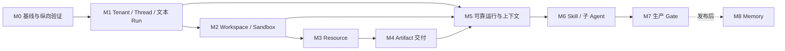

# 实施路线与阶段 Gate

本文把已经确认的首版路径带入新仓库。它只保留阶段结果、依赖和进入下一阶段的证据；具体任务在开发前仍需按 ADR 模板补齐失败、幂等、验证和回滚。

## 当前实施基线

- 新代码只在本仓库 `runtime-ts/` 开发，不修改或运行旧 Python 作为生产依赖；
- Node.js `24.18.0`、pnpm `10.15.1`、TypeScript `5.9.3`、Pi `0.82.1`；
- CubeSandbox v0.6 环境，Node SDK 固定到上游 `v0.6.0` 提交，正式复制和冒烟尚需完成；
- PostgreSQL 是状态事实源，MinIO/S3 是私有 Blob 存储；
- Pi 默认 Compaction 完全关闭，Runtime 自有 Context Policy；
- 首版个人租户，Memory、团队、真实 FileSource 和丰富预览后置。

## 开发 Ready Gate

- [ ] 从 Agent Worker 实际运行位置可连接 PostgreSQL、MinIO、模型 Provider 和 VMware 中的 CubeSandbox；
- [ ] CubeSandbox 真实链路完成 create → command/code → file → pause → connect → kill；
- [ ] 模型真实流式 Tool Call 成功，Fake Provider/Fake Sandbox 边界可用于自动化测试；
- [ ] 所有秘密只在被 Git 忽略的本地配置中，日志、测试夹具和 Sandbox 环境没有秘密；
- [ ] 两个固定开发租户可用于所有权和越权测试；
- [ ] Clean install、typecheck、test 和 build 可以在不依赖 Python 的环境通过。

Ready Gate 未通过时可以开发 Fake、领域类型和文档，但不能把真实集成标记为完成。

## 阶段路线

### M0：工程与关键契约

结果：ADR、原型参考、Monorepo 工程基线，以及 Pi 自定义工具调用 CubeSandbox 的纵向证据。

Gate：

- [x] 所有权、持久化、技术边界、文件对象、Context Policy、首版范围和供应链决策已记录；
- [x] Python 原型行为按保留/重新设计/放弃分类；
- [ ] 全部包可 Clean build/test，依赖图无越界；
- [ ] Pi 自定义工具、abort、错误映射和 Compaction 禁用断言通过；
- [ ] CubeSandbox v0.6 真实生命周期冒烟通过。

### M1：个人 Tenant、Thread 与文本 Run

结果：两个开发用户分别拥有个人 Tenant；可以创建 Thread、连续发送消息、观察流式 Run，纯文本任务不创建 Sandbox。

Gate：两个租户的 Thread/Run/SSE 完全隔离；消息幂等；API 和 Worker 独立入口；新链路不读取旧数据。

### M2：Thread Workspace 与 Sandbox 连续性

结果：不可变 WorkspaceRevision、按需物化/发布、单 Workspace 写入权、10 分钟 warm Session 与失败重建。

Gate：同 Thread 多次 Run 延续文件，新 Thread 为空；落后 Revision 不覆盖；变量/进程丢失不影响正确恢复；复用与重建对 Agent 可见。

### M3：跨 Thread Resource

结果：上传、ResourceVersion、搜索、局部预览、快照导入、显式提升，以及 FileSource 协议/Fake Provider。

Gate：历史内容不自动进入 Prompt；普通过程文件不污染搜索；导入不改写来源；所有搜索/预览/导入受 Tenant 授权和大小限制。

### M4：最终交付物

结果：`publish_artifact`、结构化 Deliverables、私有下载和独立交付物界面。

Gate：必需 Artifact 发布失败时 Agent 修正后再完成；Artifact 固定到不可变版本；下载重新授权；Diagnostic 不与 Deliverable 混排。在线预览不阻塞本阶段。

### M5：可靠执行、恢复与长上下文

结果：持久状态机、Worker Lease、工具幂等/未知结果、Pi Session Entry + Runtime Rollout、自有 Prompt/截断/Compaction、waiting 恢复和端到端审计。

Gate：只有一个 Worker 推进 Run；未知外部副作用不自动重试；重启后从数据库重建 Pi 投影；Pi 默认 Compaction 从未运行；压缩不删除事实；Artifact 可追溯到工具和 Revision。

### M6：首版高级能力

结果：Tenant 级 Skill 渐进加载，以及默认 `explicit_request_only` 的独立子 Agent Thread。

Gate：Skill 与子 Agent 继承 Tenant Context；租户脚本只在 Sandbox 运行；父子 Pi Session 独立；Root Agent 保有最终交付权；关闭 Feature Flag 不影响单 Agent 主链路。

### M7：生产化

结果：配额、对象生命周期、可观测性、安全/故障/容量验收和可复现供应链。

Gate：越权矩阵全部通过；DB/S3/Worker/Sandbox 故障有确定结果；无引用清理不误删；镜像无 Python/旧数据依赖；固定依赖、SBOM、License、回滚和容量门槛通过。

当前切片状态（不代表 M7 已完成）：

- [x] API、Worker 与 Scheduler 的公开 production 入口固定模块内真实装配并拒绝调用方 Fake；Worker 保持 Workspace→Revision→Artifact 持久化闭环，API/Worker 共用 stable Blob prefix。
- [x] production PostgreSQL 强制单一 `sslmode=verify-full` 与显式证书/主机名验证；角色探针同时验证 current/session user、非 superuser 且无 BYPASSRLS，Scheduler 在远端 cleanup 前执行探针。API/Worker/Scheduler 拒绝 development 身份与明文秘密端点。
- [x] 生产 API JWT 身份、最大 token 生命周期、Tenant selector 的 Membership/RLS 二次授权与 TLS/受限代理边界已实现。
- [x] API/Scheduler/Worker 基础镜像 digest、runtime-only 非 root 闭包、离线确定性 CycloneDX SBOM、License allow/deny、vendor 证据与静态发布/回滚清单已实现；Scheduler 在 loop 前探测 PG/Cube 且不接收无用 S3 密钥。容器 Gate 不是真实基础设施 ready 证明。
- [ ] 在真实 Linux 部署中，以最小权限 Runtime 角色和真实 PostgreSQL/S3/CubeSandbox/模型完成 ready、关闭、故障与回滚验收。
- [ ] 完成真实代理/身份系统集成、全量越权矩阵、配额、对象生命周期、观测、镜像签名/provenance、容量与集群发布回滚验收。

### M8：发布后 Memory

只有首版稳定且 Memory Provider ADR 单独通过后实施。Memory 服务不可用时必须降级为无记忆运行，且不能改变现有 Thread/Workspace/Resource/Artifact 的所有权。

## 每项任务开始前

任务说明至少包含：主要结果、用户/系统价值、依赖、输入与输出、范围内外、数据与协议、涉及包、Tenant/安全不变量、失败/重试/幂等、验收、自动化/人工验证、监控、发布和回滚。

遇到任务说明没有覆盖的关键选择时，按 [决策记录规则](decisions/README.md) 留下背景、备选、选择、理由、影响、验证和可逆性，不能只在代码里留下结论。
