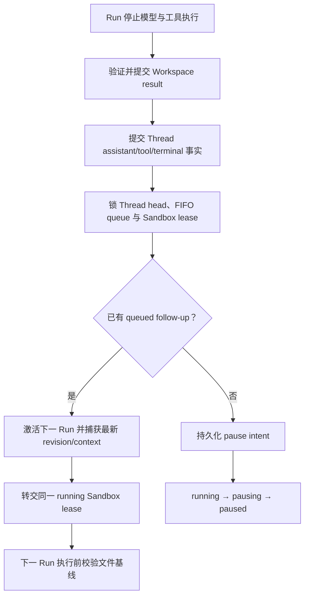
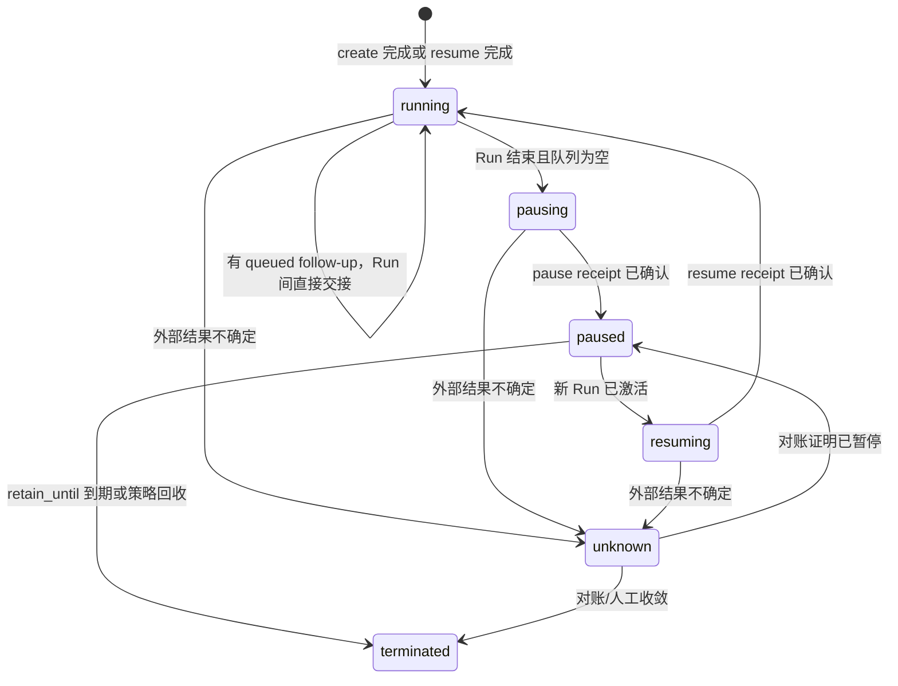

# Thread 连续上下文、输入续接、上下文压缩与 Sandbox 生命周期实施总计划

- 文档性质：后续实现总计划，不是 ADR
- 状态：阶段 1～6 已实施，进入验收与运行数据优化
- 更新日期：2026-08-01
- 当前实现说明：连续性能力默认开启；旧 Thread 仍按证据式 anchor 迁移
- 相关现有决策：ADR-0030、ADR-0032、ADR-0033、ADR-0035、ADR-0037
- 外部参考：本地 Codex 源码提交 `0dfa778dae6a94b2ff2c69176cbaf063a3bf18a1`

## 1. 文档目的

这是一次跨 API、数据库、Worker、模型上下文、Workspace、Sandbox、Scheduler 和 Web 的大改造。本文集中记录现状、目标产品语义、关键不变量、数据模型草案、故障处理、实施顺序、测试 Gate、灰度与回滚，作为后续任务拆解和实现时的全貌来源。

本文是这次大改造的完整实施计划。后续每个会改变外部行为、数据语义或兼容边界的实施切片，仍需在动工前用新的、范围更小的 ADR 确认具体决策；不得因为本文存在就跳过仓库的 ADR 与测试要求。

本文确定的是产品方向和跨阶段约束。精确的压缩阈值、paused 保留时长、不同租户策略、Provider 能力上限等参数必须可配置、可观测，并根据真实数据调整，不能提前固化成永久常量。

## 2. 已确认的核心要求

后续实现必须同时满足以下要求：

1. **Thread 是连续对话边界。** 同一个 Thread 中，不论发生多少个 Run，模型都要获得连续、可恢复的上下文；Run 完成不能让下一次请求从空历史开始。
2. **Run 是一次执行单元。** 每次独立的用户任务或 follow-up 对应一个 Run；Run 负责状态、事件、执行尝试、文件结果与审计，但不拥有整个 Thread 的长期上下文。
3. **支持两种运行中追加方式。** 用户看到 Agent 跑偏时，可以把新输入作为当前 Run 的 steer；用户是在部署下一项工作时，可以把输入排入 follow-up 队列，等当前 Run 结束后再启动新的 Run。
4. **steer 必须是真实用户消息。** 不能构造假的 assistant `tool_call` 来注入引导。它先持久化，在安全点按真实顺序进入模型上下文。
5. **follow-up 必须持久、FIFO、逐项执行。** 不依赖 Pi Session 的内存队列，不把多条用户输入合并为一条，也不因 Worker 崩溃或当前 Run 取消而丢失。
6. **同一 Thread 同时只有一个模型上下文写者。** 不允许两个 Run 从相同旧上下文并行执行后竞争写回。
7. **取消空闲 Hot Running Window。** Run 结束且没有已排队 follow-up 时，Sandbox 立即进入 `pausing → paused`；不设置“空闲保持 running 30～120 秒”之类的窗口。
8. **有已排队 follow-up 时允许直接交接 running Sandbox。** 这是两个相邻 Run 之间的有工作交接，不是空闲保温。交接必须发生在 Workspace、Thread Context 和租约都完成线性化提交之后。
9. **paused Sandbox 是优先复用路径。** 新输入到来后执行 `paused → resuming → running`。如果输入恰好在 `pausing` 阶段到达，首版先等 pause 确认，再 resume，避免取消 pause 的竞态。
10. **Sandbox 是缓存，不是事实源。** Sandbox 可以被暂停、丢失、终止或重建；Thread Context 和 Workspace Revision 必须独立持久化。
11. **长时间后允许冷恢复。** Sandbox 超过保留策略或已 `terminated` 时，新建 Sandbox 并物化最新 Workspace Revision。用户相隔 10 天、20 天再次请求，也不能丢失对话和文件事实。
12. **上下文接近模型窗口时采用 Runtime 自有压缩。** 压缩生成可恢复的 `replacement_history`，保留最近用户原文，重新构建当前 Canonical Context，原始事实不因压缩被删除。
13. **文件按 Run 可追踪，但底层不重复复制。** 每个 Run 明确记录 base/result revision；实际文件继续使用不可变 manifest、稳定 Blob 和内容去重。
14. **策略必须数据化。** Sandbox 保留、压缩阈值、复用条件和降级策略由指标驱动逐步优化。

## 3. 当前实现全貌

### 3.1 当前第二次用户请求

Web 端在同一个 Thread 中调用：

```http
POST /v1/threads/{threadId}/runs
Content-Type: application/json
Idempotency-Key: <随机幂等键>

{
  "input": "把刚才生成的页面改成深色主题"
}
```

主要调用位置：

- `runtime-ts/apps/web/src/api.ts`：Web `createRun`；
- `runtime-ts/apps/api/src/app.ts`：`POST /v1/threads/:threadId/runs`；
- `runtime-ts/apps/api/src/service.ts`：Run 创建服务；
- `runtime-ts/packages/persistence/src/pg-run-dispatch.ts`：创建 Run、执行输入和 dispatch outbox。

客户端不传 `messages`、`previousRunId` 或 `previousResponseId`。这个边界本身是正确的：历史必须由服务端根据 `threadId` 从可信事实源恢复，不能由客户端提交一份可篡改、可漏项、可重排的历史。

### 3.2 当前创建 Run 时保存的数据

当前创建事务会写入：

- `runs`：状态为 `queued` 的新执行；
- `run_execution_inputs`：用户输入、Workspace 基线和初始投影；
- `run_dispatch_outbox`：等待 Worker 领取的调度消息；
- `api_idempotency_records`：`run.create` 的 API 幂等结果。

关键问题是 `runtime-ts/packages/persistence/src/pg-run-dispatch.ts` 中所有新 Run 都使用空投影：

```json
{
  "schemaVersion": 2,
  "checkpointId": "initial",
  "items": []
}
```

因此，当前同一 Thread 的 Run B 不会自动继承 Run A 的用户消息、助手回复和工具事实。

### 3.3 当前模型请求

Worker 创建 Pi Session 后调用 OpenAI-compatible `/chat/completions`。概念请求体为：

```json
{
  "model": "配置的模型 ID",
  "stream": true,
  "messages": [
    {
      "role": "system",
      "content": "Runtime 生成的系统指令、规则、技能、环境与 Workspace 约束"
    },
    {
      "role": "user",
      "content": "把刚才生成的页面改成深色主题"
    }
  ],
  "tools": [
    {
      "type": "function",
      "function": {
        "name": "sandbox_command",
        "description": "...",
        "parameters": {}
      }
    },
    {
      "type": "function",
      "function": {
        "name": "deliver_file",
        "description": "...",
        "parameters": {}
      }
    }
  ],
  "max_tokens": 2048
}
```

一次 Run 内的后续工具循环会包含当前 Session 已积累的 assistant tool call 和 tool result。这是“Run 内的模型工具多轮”，不是“跨 Run 的用户多轮”。开启 `MODEL_WIRE_TRACE_MODE` 后，`model-wire-traces/<runId>/<attemptId>/` 下的请求文件是核对 Provider 实际请求体的最终证据。

### 3.4 当前持久化层次

```text
Thread
├─ Workspace
├─ Run A
│  ├─ run_execution_inputs
│  ├─ execution_attempts / run_claims
│  ├─ run_events
│  ├─ runtime_rollout_* / rollout_projections
│  ├─ workspace revision
│  └─ artifacts
└─ Run B
   └─ 一组新的 Run/Attempt 数据
```

当前 `runtime_rollout_*` 和 `rollout_projections` 主要解决同一个 Run/Attempt 的崩溃恢复、waiting 恢复、工具观察恢复。它们以 Attempt/agent thread 为边界，不是整个业务 Thread 的统一对话事实流。`run_events` 主要服务事件流和 UI 展示，也没有在创建新 Run 时回灌模型。

### 3.5 当前 Sandbox 生命周期

当前主链路为：

```text
领取 Run
→ acquire 新 Sandbox
→ 写入 sandbox_registry
→ 物化 base Workspace Revision
→ 创建 Pi Session
→ 模型和工具执行
→ 验证并发布 Workspace Revision
→ 成功时 close Sandbox
```

正常成功路径在 `runtime-ts/apps/agent-worker/src/run-worker.ts` 中调用 `settleSandbox(..., "close")`。只有 `waiting` 路径调用 `settleSandbox(..., "pause")`。`sandbox_registry` 当前绑定 Attempt，状态名称也还是 `acquiring/ready/pausing/paused/closing/closed/unknown`。当前数据库还把 `actual_ttl_seconds` 限制在 1～86400 秒，现有 waiting 恢复策略也不是 Thread 级长期缓存。

第二个 Run 能看到第一个 Run 的文件，是因为它读取 Workspace 当前 `current_revision_id` 并在新 Sandbox 中物化，而不是因为复用了 Sandbox 或继承了模型历史。

### 3.6 当前能力与目标的差距

当前已经具备：

- Thread 级连续 Workspace；
- Run 内模型与工具循环；
- Attempt 级 durable rollout；
- waiting 的有限 pause/recovery；
- Workspace Revision、Blob、Artifact 与 cleanup outbox。

当前缺少：

- Thread 级连续模型上下文；
- Thread 内执行串行与 durable follow-up 队列；
- 运行中输入的持久 steer；
- Runtime 自有持久 compaction；
- 成功 Run 后 Sandbox pause/resume 与跨 Run 复用；
- 每个 Run 的 base/result revision 显式结果关系；
- 上述能力在 API、Web、指标和灰度开关上的完整闭环。

## 4. 目标概念与生命周期

| 概念 | 目标职责 | 生命周期 |
|---|---|---|
| Thread | 连续用户任务、上下文事实、执行顺序和 Workspace 的长期边界 | 用户创建到归档/删除 |
| Turn | Thread 中有序的一项用户意图 | 从 receipt 接收到消费/取消 |
| Run | 一个 follow-up Turn 的执行状态、Attempt、事件和结果 | queued 到 terminal |
| Attempt | 某 Run 的一次 Worker 执行尝试 | claim 到完成/恢复/放弃 |
| Context Stream | Thread 中模型可见事实的 append-only 序列 | 与 Thread 同寿命 |
| Context Window | 当前真正发给模型的活动历史 | 可被 compaction 替换 |
| Workspace Revision | 某次 Run 前后持久文件事实 | 不可变、长期保留 |
| Sandbox Session | Thread/Workspace 的可复用执行缓存 | running/paused 到 terminated |
| Artifact | 用户明确交付物的不可变引用 | 按现有 Blob 生命周期管理 |

必须始终成立：

```text
Run 结束 ≠ Thread 结束
Sandbox 终止 ≠ 对话或文件丢失
上下文被压缩 ≠ 原始事实被删除
同一 Sandbox 被复用 ≠ 可以跳过 Workspace Revision 校验
```

## 5. 全局不变量

### 5.1 上下文与顺序

- 每个 Thread 的 `sequence` 和 Turn ordinal 单调递增，不重排、不复用。
- 同一时刻每个 Thread 最多一个 active Run，最多一个获授权的 Context writer。
- Worker 不持有跨网络调用的数据库行锁；长执行通过 `writer_epoch + token + expires_at` fencing，写入时用 CAS 验证。
- 新 Run 只在成为 Thread 队首时捕获 Workspace base revision 和上下文 through-sequence，不能在前一 Run 尚未提交时固化旧基线。
- 所有进入模型的用户输入都有不可变 receipt 和真实 `user_message`；不得伪造工具调用或 Assistant 消息。
- assistant/tool 事实只能按 Provider 实际产生且通过协议验证的顺序追加；tool call/result 必须成对。
- 流式 partial event 可以进入 `run_events`，但只有规范化后的最终消息进入跨 Run Context Stream。
- failed/cancelled Run 的事实不会被抹除；投影时必须带 terminal 语义，避免把未提交结果描述成成功事实。

### 5.2 压缩与恢复

- Runtime 是 compaction 的事实源，Pi 内建 compaction 不能自行改变持久历史。
- 每个 checkpoint 的 `replacement_history` 一经提交不可变。
- 后一个 checkpoint 是新的完整活动历史，不要求是上一份 replacement history 的前缀。
- `through_sequence`、`window_number`、`previous_window_id` 链必须单调、无分叉且可校验。
- 运行时安装的活动历史必须与从最新 checkpoint 加后缀恢复出的活动历史一致。
- 压缩失败不改变当前活动历史；只有 checkpoint 成功提交后才切换窗口。
- Canonical Context 始终按当前可信配置重建，不依赖旧摘要保存系统指令。

### 5.3 Workspace 与 Sandbox

- Workspace Revision 是文件唯一事实源；Sandbox 文件系统只是可验证缓存。
- 每个 Run 明确绑定 base revision 和 result revision；没有文件变化也要记录 `unchanged`。
- 每个 Sandbox Session 同一时间最多一个未释放 lease。
- 复用必须同时验证 Tenant、Thread、Workspace、generation、状态、租约、retention 和 materialized revision。
- 任何 `unknown` 外部副作用都失败关闭，不能推测 pause/resume/terminate 已成功。
- 没有 queued follow-up 时不保留空闲 running Sandbox。
- Sandbox 销毁后必须能仅靠数据库、Blob、Workspace Revision 和 Thread Context 重建任务。

### 5.4 租户与安全

- 所有新表都必须包含 `tenant_id`、复合外键、RLS 和受限角色权限。
- Idempotency-Key、receipt、queue sequence、writer lease 和 sandbox lease 都必须限定在 Tenant/Thread 范围。
- 大正文和大工具输出使用受审计 Blob 引用；日志、错误、wire trace 继续遵守秘密与大小限制。
- 历史用户消息和工具输出仍是非可信内容，不能被提升成 system/developer 指令。

## 6. 目标端到端流程

### 6.1 Thread 空闲时提交请求

```text
API 接收输入并写 input receipt
→ 锁定 Thread execution head
→ 创建 queued Run 与 queue item
→ 发现没有 active Run
→ 激活队首 Run
→ 此刻捕获最新 Workspace revision 与 Thread context through-sequence
→ 写 run_execution_inputs 和 run_dispatch_outbox
→ Worker 领取
→ 选择 resume 或冷建 Sandbox
→ 重建模型上下文并执行
```

### 6.2 Run 运行中提交普通补充

默认 `mode=auto`：

```text
持久化 receipt
→ 当前为可 steer 的 regular Run
→ 标记 pending_steer 并通知 Worker
→ 不打断正在进行的 Provider stream 或已授权工具
→ Worker 到达下一个安全采样点
→ 事务中追加真实 user_message 并标记 receipt applied
→ 下一次模型采样看到该消息
```

如果用户明确选择“排队下一个任务”，则不进入当前 Session，而是创建独立 queued Run，等待当前 Run terminal。

### 6.3 steer 与结束竞态

如果 receipt 写入时 Run 看起来可 steer，但 Worker 到安全点前已经进入不可 steer 阶段或完成：

```text
pending_steer
→ Thread head CAS 发现目标 Run/Turn 已结束
→ 原子转换为 follow_up
→ 创建 queued Run/queue item
→ 返回或推送 disposition_changed: queued
```

输入不能因为竞态丢失，也不能同时既作为当前 Run 的 user message 又创建下一个 Run。

### 6.4 Run 结束时的 Sandbox 决策



“检查队列、激活下一 Run、转交 lease”或“确认队列为空、写 pause intent”必须在同一个数据库线性化事务中完成。这样不会出现 Worker 刚判断队列为空，API 又写入输入，而 Sandbox 被错误当作仍可直接使用的竞态。

### 6.5 pausing 时有新请求

首版不尝试撤销进行中的 pause：

```text
新输入进入 durable queue
→ 等待 pause effect receipt
→ registry 变为 paused
→ 写 resume intent
→ paused → resuming → running
→ 执行队首 Run
```

如果 Provider 返回不确定结果，进入 `unknown` 并由 Scheduler 对账；不能并发发起 resume 或创建另一个使用同一 provider sandbox ID 的 Run。

### 6.6 长时间后恢复

```text
用户 10/20 天后提交输入
→ Thread Context 从 checkpoint + tail 恢复
→ Sandbox 已 terminated、过期或无法证明可复用
→ 新建 Sandbox
→ 物化 Workspace current revision
→ 执行新 Run
```

丢失的只有未持久化的进程缓存、语言服务内存和临时运行态；对话事实、文件、Run、Artifact 与压缩窗口都不应丢失。

## 7. 输入协议：steer、follow-up 与 waiting

### 7.1 Codex 行为参考与本项目结论

对本地官方 Codex 源码提交 `0dfa778dae6a94b2ff2c69176cbaf063a3bf18a1` 的核对结论必须保留，后续实现不能只凭 Pi 方法名猜测语义：

- Codex 同时支持 steer 和 follow-up，不要求二选一；
- TUI 的普通运行中输入先尝试 `turn/steer`；
- Core 只对活跃 regular turn 接受 `pending_input`；Review/Compact、没有活跃 turn、expected turn 不匹配、空文本或超限都会拒绝 steer；
- steer 不打断当前 Provider stream，也不抢占已经启动的工具；它在下一个安全采样点进入 history，然后触发下一次采样；
- 如果模型本来准备结束但仍有 pending input，同一 task 会继续采样；
- Codex TUI 的 follow-up 是本地 FIFO `queued_user_messages`，当前 turn 完成后逐条启动新的 `turn/start`；
- 用户中断可能清空 Core 内存中的 pending input，所以服务端产品必须先建立 durable receipt，不能直接照搬纯内存行为。

固定源码参考：

- [`thread_routing.rs`](https://github.com/openai/codex/blob/0dfa778dae6a94b2ff2c69176cbaf063a3bf18a1/codex-rs/tui/src/app/thread_routing.rs#L658-L750)
- [`input_flow.rs`](https://github.com/openai/codex/blob/0dfa778dae6a94b2ff2c69176cbaf063a3bf18a1/codex-rs/tui/src/chatwidget/input_flow.rs#L131-L174)
- [`turn_processor.rs`](https://github.com/openai/codex/blob/0dfa778dae6a94b2ff2c69176cbaf063a3bf18a1/codex-rs/app-server/src/request_processors/turn_processor.rs#L920-L1026)
- [`session/mod.rs`](https://github.com/openai/codex/blob/0dfa778dae6a94b2ff2c69176cbaf063a3bf18a1/codex-rs/core/src/session/mod.rs#L3934-L4006)
- [`session/turn.rs`](https://github.com/openai/codex/blob/0dfa778dae6a94b2ff2c69176cbaf063a3bf18a1/codex-rs/core/src/session/turn.rs#L243-L475)

本项目采用其交互分层，但增加数据库幂等、审计和崩溃恢复。当前 Pi Adapter 的 `steer()`/`followUp()` 都属于活跃 Session；现有测试还明确验证 Pi 可能在同一安全点把二者合入下一次模型上下文。因此，Pi `followUp()` 不能直接等同于“当前 Run 完成后创建下一个 durable Run”。跨 Run follow-up 必须由 Runtime 队列实现。

### 7.2 新统一入口

计划新增：

```http
POST /v1/threads/{threadId}/inputs
Idempotency-Key: <稳定键>
Content-Type: application/json

{
  "input": "不要重写组件，沿用现在的结构，只改配色",
  "mode": "auto",
  "expectedRunId": "run-...",
  "expectedTurnId": "turn-..."
}
```

`mode`：

- `auto`：有可 steer 的 active regular Run 时优先 steer；无 active Run、不可 steer 或发生结束竞态时进入 follow-up。
- `steer`：只允许进入指定 active Run/Turn；不满足条件时默认返回稳定拒绝。客户端可显式指定 `fallbackToFollowUp=true`，避免隐式改变用户意图。
- `follow_up`：始终创建独立 FIFO 项和 queued Run，不进入当前 Run。

建议响应：

```json
{
  "receiptId": "input-...",
  "requestedMode": "auto",
  "disposition": "pending_steer",
  "targetRunId": "run-current",
  "targetTurnId": "turn-current",
  "queuedRunId": null,
  "queueSequence": null
}
```

最终 disposition 至少包括：

- `pending_steer`：已持久化，等待安全点；
- `steered`：已作为当前 Run 的 user message 应用；
- `queued`：已成为独立 follow-up；
- `resuming`：未来完整 waiting 交互中，作为当前 waiting Run 的恢复输入；
- `rejected`：输入本身不合法或显式约束不满足；
- `cancelled`：用户在尚未消费前取消。

稳定拒绝原因至少包括 `empty`、`too_large`、`no_active_turn`、`expected_run_mismatch`、`expected_turn_mismatch`、`unsupported_phase`、`thread_archived` 和幂等冲突。

### 7.3 既有 `/runs` 的兼容

既有 `POST /v1/threads/{threadId}/runs` 暂时保留，并固定映射为 `follow_up`，避免旧客户端在 active Run 中把新任务意外 steer 到当前模型循环。

为了继续立即返回 Run ID，接受 follow-up 时先创建状态为 `queued` 的 Run，但**不立即捕获** `base_revision_id` 或空 `initial_projection`，也不立即写可领取的 dispatch outbox。只有该 Run 成为 Thread 队首时，才在同一事务中：

1. 读取最新 Workspace head；
2. 固定 Thread context through-sequence/checkpoint；
3. 写执行输入快照；
4. 写 dispatch outbox；
5. 将 Thread active Run 指向它。

这避免排队中的 Run 锁死在前一个 Run 尚未产生的旧 Workspace 和旧上下文上。

### 7.4 durable receipt 先于内存投递

API 成功响应前必须保存不可变原始 payload。不能只保存 digest；digest 只能用于幂等冲突检测，不能在崩溃后恢复用户正文。

Worker 获得 steer 的推荐顺序：

1. 从数据库 claim pending receipt；
2. 在模型安全点，以 Thread writer fencing 追加 `user_message`；
3. 同一事务标记 receipt applied，并记录 context sequence；
4. 提交后把消息安装进当前 Pi Session 或从持久上下文重建下一次采样；
5. 如果步骤 3 后进程崩溃，恢复时由 context sequence 去重，不再次消费 receipt。

数据库是事实源；进程内通知、WebSocket 或消息总线只用于降低延迟。

### 7.5 安全点定义

首版安全点至少包括：

- Provider 流已经完成一个完整 assistant item；
- 已开始的工具调用都已经有对应结果或被明确记录为失败/取消；
- 当前没有正在提交 Workspace Revision；
- 下一次 Provider 请求尚未发出。

不得把 steer 插到 assistant tool call 与对应 tool result 中间。不得抢占已经授权的外部副作用。未来若实现真正的 stream interrupt，必须另立协议和 ADR。

### 7.6 follow-up FIFO

- 每个输入一条 queue item、一个 queue sequence、一个 queued Run；不合并。
- dequeue 只按 `(tenant_id, thread_id, queue_sequence)`。
- claim 必须有 owner/token/epoch/expires，并可在崩溃后 reclaim。
- 当前 Run abort/cancel 不自动删除尚未消费的 follow-up。
- 用户可以取消尚未激活的 queued Run；取消写入 receipt/queue 状态，不物理删除。
- 队首无法执行时要有明确 failed/cancelled 结果并继续处理下一项，不能永久阻塞 Thread。

### 7.7 waiting 输入

现有 waiting 恢复不是完整用户交互入口。实施统一输入 API 时要显式区分：

- regular active Run 的补充：steer；
- waiting Run 对问题的回答：恢复当前 Run，未来 disposition 为 `resuming`；
- 新的独立任务：follow-up。

在 waiting 恢复协议完成前，`auto` 不得猜测输入是 waiting answer；可以先将它排队，或由 Web 显式展示“回答当前问题”和“排队下一任务”两个动作。此边界需单独 ADR 后再开放。

## 8. Thread Context 架构

### 8.1 五层数据

目标实现必须区分：

| 层 | 内容 | 是否直接进入模型 |
|---|---|---|
| Thread Context Facts | 用户、Assistant、工具、Run 边界和压缩检查点的追加事实 | 不会全部进入 |
| Active History | 当前窗口内规范化后的模型可见项 | 会 |
| Compaction Checkpoint | 完整 replacement history 和窗口链 | 恢复后成为基线 |
| Canonical Context | 当前系统规则、AGENTS、Skill、工具、权限、环境和 Workspace 身份 | 每个窗口重新构建 |
| Workspace/Blob | 文件和大观察事实 | 模型按需通过工具读取 |

### 8.2 哪些事实进入 Thread Stream

至少包括：

- `run_started` / `run_terminal`；
- 最终 `user_message`；
- 最终 `assistant_message`；
- 规范化 `tool_call`；
- 对应 `tool_result` 或结构化失败；
- `workspace_committed` / `workspace_unchanged`；
- `compaction_checkpoint`；
- 需要恢复语义的 rollback/cancel 标记；
- 可选的子 Agent 通信事实，但必须有明确来源和兼容策略。

不直接进入：

- 每个流式 token delta；
- UI 进度动画；
- 未完成、未验证的 assistant partial；
- 日志中的内部异常栈和秘密；
- 全量 Workspace 文件正文。

`run_events` 继续承担 UI 流式展示；Thread Stream 承担跨 Run 模型语义。迁移阶段允许双写，但两者用途不能再次混淆。

### 8.3 恢复公式

```text
模型活动历史
= 最新兼容 checkpoint.replacement_history
+ checkpoint.through_sequence 之后的有效 Thread Context Facts
+ 当前重新构建的 Canonical Context
```

如果从未压缩，则从 Thread Stream 起点恢复，但仍要应用工具输出截断、角色规范化和当前模型能力过滤。

### 8.4 新 Run 的目标模型请求

未压缩时，Run 2 的请求概念上应为：

```json
{
  "model": "...",
  "stream": true,
  "messages": [
    { "role": "system", "content": "当前可信 Canonical Context" },
    { "role": "user", "content": "生成一个管理后台" },
    { "role": "assistant", "content": "已经完成基础页面……" },
    { "role": "user", "content": "改成深色主题，并简化左侧菜单" }
  ],
  "tools": []
}
```

压缩后应类似：

```json
{
  "messages": [
    { "role": "system", "content": "当前可信 Canonical Context" },
    { "role": "user", "content": "近期仍需保留原文的用户要求" },
    { "role": "user", "content": "另一个模型留下的任务交接摘要……" },
    { "role": "assistant", "content": "检查点之后的真实回复" },
    { "role": "user", "content": "本次新需求" }
  ]
}
```

实际顺序由 context builder 根据 Provider 协议生成；这里表达的关键是：历史由服务端重建，最新系统约束不从旧摘要继承，最近原文与压缩后事实继续保留。

### 8.5 兼容性身份

checkpoint 和活动历史需要记录 `compatibility_identity`，至少覆盖：

- Provider/模型协议能力；
- 工具 schema 版本；
- context projection schema；
- compaction 策略与 prompt 版本；
- 对 reasoning、图片、音频和特殊 item 的支持。

模型切换或协议变化时，如果旧窗口不兼容，必须在旧模型可用时先压缩，或走显式降级/冷重建；不能静默丢弃不支持的关键事实。

## 9. Runtime Context Compaction

### 9.1 所有权

当前 Pi compaction 保持关闭，直到 Runtime 自有实现具备持久化、恢复和一致性验证。未来即使复用 Provider 的远程压缩接口，调用时机、输入、输出校验、checkpoint 提交与恢复仍由 Runtime 控制。

建议新增清晰的 Thread Context 组件；命名可以在实施 ADR 中确定，但职责必须包括：

- 从 checkpoint + tail 恢复活动历史；
- 规范化消息和工具配对；
- 计算最终 Provider 可见 token；
- 判断 Turn 前和 Turn 中压缩；
- 调用本地或远程 compaction；
- 生成完整 replacement history；
- 原子写 checkpoint；
- 将同一份 history 安装到内存 Session；
- 输出诊断、wire trace 与指标。

### 9.2 触发点

至少支持：

1. 新 Turn/Run 第一次模型采样前；
2. 同一 Run 的模型—工具循环中、下一次采样前；
3. 模型或兼容性身份变化时；
4. 用户手动触发的维护动作，后续再开放产品入口。

只按消息数量触发是不正确的。预算必须基于最终 Provider 请求可见 token，并同时考虑：

- 模型硬上下文窗口；
- 自动压缩软阈值；
- 预留输出 token；
- 工具 schema 与 Canonical Context 占用；
- 当前未完成 Turn 继续执行所需余量。

### 9.3 压缩输入和输出

本地压缩 prompt 的目标是“给下一个模型的任务交接”，而不是聊天流水账摘要。至少要求保留：

- 已完成进度与当前真实状态；
- 关键决策、约束和用户偏好；
- 未完成工作、阻塞和明确下一步；
- 继续任务必需的文件、符号、命令、错误和引用；
- Workspace revision 身份和已经验证的结果；
- 哪些结论不确定或已经失败。

replacement history 至少由以下部分组成：

```text
最近真实用户原文
+ 任务交接摘要/Provider compaction item
+ 压缩后继续产生的真实事实
+ 当前 Canonical Context
```

最近用户原文需要单独预算，不能只依赖摘要转述。初始预算可参考 Codex 的做法，但具体 token 数必须依据本项目模型窗口和实际测量配置化。

### 9.4 压缩安全边界

- 压缩调用禁用业务工具，不能产生 Workspace 或外部副作用。
- 不在 tool call/result 中间压缩；必要时先补齐明确失败结果。
- 大 tool result 在模型投影中截断或 blob 化，但事实层保留摘要与引用。
- 压缩请求、输出和使用模型有独立 trace；不记录秘密。
- Provider 拒绝、超时或输出无效时，保留旧 history，并根据剩余预算重试受控裁剪或返回明确 `context_too_large`。
- 不允许为了成功调用而静默删除最近用户需求或未完成工具结果。

### 9.5 多次压缩与恢复

```text
Window 0 原始事实
→ Checkpoint 1: replacement_history H1
→ Window 1 新事实
→ Checkpoint 2: replacement_history H2
→ Window 2 新事实
```

H2 可以完全重新组织 H1 与 Window 1，不要求 H1 是 H2 的前缀。必须保存窗口链和 through-sequence，恢复时只安装最新有效 H2，再重放其后的事实。

多次压缩有信息损失风险。产品后续应在长 Thread 或多次压缩后提示准确率可能下降，并鼓励把必须长期精确保留的信息写入 Workspace/计划/规范文件，而不是只依赖摘要。

## 10. 数据模型草案

以下是实施级草案，不是最终 SQL。每一组表都必须同时提供 up/down migration、RLS、受限角色权限、Repository、Fake、契约测试和 PostgreSQL 并发测试。

### 10.1 `thread_execution_heads`

用于 Thread 串行化和 fencing：

```text
tenant_id
thread_id
active_run_id nullable
active_turn_id nullable
next_turn_ordinal
next_queue_sequence
writer_owner nullable
writer_token nullable
writer_epoch
writer_expires_at nullable
version
updated_at
```

关键约束：

- 每 Thread 一行；
- active Run 必须属于同 Tenant/Thread；
- writer epoch 单调递增；
- 所有 context append、Run 激活和 terminal handoff 都验证 active Run + writer epoch/token。

### 10.2 `thread_input_receipts`

```text
tenant_id
thread_id
receipt_id
client_request_id
request_digest
requested_mode
state
disposition
target_run_id nullable
target_turn_id nullable
queued_run_id nullable
queue_sequence nullable
input_text nullable
body_blob_ref nullable
body_digest
body_size_bytes
applied_context_sequence nullable
rejection_code nullable
created_at / updated_at / consumed_at nullable
```

关键约束：

- `(tenant_id, thread_id, client_request_id)` 唯一；
- `input_text` 和 `body_blob_ref` 恰有一个；
- digest 和 size 由服务端从真实 payload 重算；
- 同幂等键同正文返回原 receipt，不同正文返回冲突；
- 状态转换使用 CAS，正文永不更新。

### 10.3 `thread_follow_up_queue`

```text
tenant_id
thread_id
queue_sequence
receipt_id
run_id
state
claim_owner nullable
claim_token nullable
claim_epoch
claim_expires_at nullable
consumption_receipt nullable
created_at / activated_at / finished_at nullable
```

关键约束：

- `(tenant_id, thread_id, queue_sequence)` 唯一；
- receipt 和 Run 都属于同一 Thread；
- queued Run 在激活前没有可领取 dispatch；
- claim 过期后通过 epoch/token reclaim；
- 取消和失败写状态，不删除队列事实。

### 10.4 `thread_context_streams`

```text
tenant_id
thread_id
next_sequence
current_window_number
current_checkpoint_id nullable
compatibility_identity
schema_version
created_at / updated_at
```

### 10.5 `thread_context_entries`

```text
tenant_id
thread_id
sequence
entry_id
run_id nullable
attempt_id nullable
turn_id nullable
kind
role nullable
normalized_tool_call_id nullable
predecessor_sequence nullable
body nullable
body_blob_ref nullable
body_digest
schema_version
created_at
```

关键约束：

- `(tenant_id, thread_id, sequence)` 主键或唯一；
- append command 有独立幂等键；
- tool call/result 来源和 predecessor 可验证；
- 大正文 blob 化；
- 压缩不更新或删除 entries。

### 10.6 `thread_context_checkpoints` 与 replacement items

```text
thread_context_checkpoints
├─ tenant_id / thread_id / checkpoint_id
├─ through_sequence
├─ window_number
├─ first_window_id / previous_window_id / window_id
├─ compatibility_identity
├─ replacement_history_digest
├─ token_usage / policy_identity
└─ created_at

thread_context_replacements
├─ tenant_id / thread_id / checkpoint_id
├─ item_ordinal
├─ item_id / kind / role
├─ body 或 body_blob_ref
├─ digest
└─ predecessor/item pairing 字段
```

不建议把无上限的完整 history 塞进一个 JSONB 行。可以沿用现有 `runtime_rollout_replacements` 的规范化思想，但事实主键改为 Thread 范围，并消除 Attempt 绑定。

### 10.7 `run_workspace_results`

```text
tenant_id
thread_id
run_id
workspace_id
base_revision_id nullable
result_revision_id nullable
outcome = committed | unchanged | failed_before_commit
manifest_digest nullable
committed_at nullable
```

示例：

```text
Run 1: base=null       → committed revision-1
Run 2: base=revision-1 → committed revision-2
Run 3: base=revision-2 → unchanged revision-2
Run 4: base=revision-2 → failed_before_commit
```

底层 revision/manifest/Blob 继续去重，不为每个 Run 复制完整文件树。

### 10.8 `thread_sandbox_sessions`

```text
tenant_id
thread_id
workspace_id
registry_id
provider_sandbox_id
generation
state = running | pausing | paused | resuming | terminated | unknown
materialized_revision_id nullable
active_run_id nullable
retain_until nullable
provider_expires_at nullable
last_used_at
last_verified_at nullable
state_version
created_at / updated_at
```

### 10.9 `thread_sandbox_leases`

```text
tenant_id
thread_id
workspace_id
registry_id
run_id
attempt_id
epoch
token
expires_at
released_at nullable
created_at / updated_at
```

用 `released_at IS NULL` 的部分唯一索引保证每个 registry 同时最多一条未释放租约。不能把随时间变化的“未过期”条件放进唯一索引谓词；过期 lease 先经 epoch/token CAS 释放或 reclaim，再创建下一条。

### 10.10 Sandbox effect intent/receipt

create、pause、resume、terminate 都是外部副作用，需要与现有 cleanup outbox 相同等级的持久意图：

```text
intent_id / idempotency_key
registry_id / generation
effect
expected_from_state / desired_state
state = pending | started | completed | unknown
claim/fencing
provider receipt 摘要
payload_digest
created_at / updated_at
```

不要继续把所有生命周期动作都抽象成 Attempt cleanup；目标模型需要 Thread Session 级 lifecycle reconciler。

## 11. Workspace 与“按 Run 存文件”

用户需要的是每个 Run 的文件结果可定位、可比较、可回滚，而不是每个 Run 复制一整份目录。

正确结构为：

```text
Thread Workspace
├─ Revision 1（Run 1 产生）
├─ Revision 2（Run 2 产生，parent=Revision 1）
├─ Run 3 unchanged（仍指向 Revision 2）
└─ Revision 3（Run 4 产生，parent=Revision 2）
```

每个 Run 激活时记录 base，terminal 时记录 result。查询某 Run 时可以直接得到：

- 它从哪个 revision 开始；
- 是否修改文件；
- 产生了哪个 revision；
- 对应 manifest digest；
- Artifact 固定在哪个 revision。

Sandbox 复用前必须比较 `materialized_revision_id` 与 Run base revision。以下任一情况禁止直接复用：

- revision 不一致；
- generation 不一致；
- 上次外部调用结果为 unknown；
- 文件系统校验无法证明与 revision 一致；
- 存在无法收敛的后台写入或未授权进程；
- lease 不可证明唯一。

禁止复用时可以重物化到同一 Sandbox，若重物化的清洁性无法证明则终止旧 Sandbox 并新建。

## 12. Sandbox 生命周期与资源策略

### 12.1 状态机

目标状态含义固定如下：

| 状态 | 含义 |
|---|---|
| `running` | Sandbox 正在运行，实际占用 CPU/内存，可以接收请求和执行代码 |
| `pausing` | 平台正在保存 VM 快照，属于有持久 intent/receipt 的瞬时态 |
| `paused` | VM 内存已落盘为快照，不消耗 CPU/内存，Sandbox 状态完整保留 |
| `resuming` | 平台正在从快照恢复，属于有持久 intent/receipt 的瞬时态 |
| `terminated` | 已显式销毁或被平台回收，不能恢复，只能创建新 Sandbox |
| `unknown` | 外部调用结果无法证明，禁止复用，等待对账收敛 |

当前 registry 的 `ready/closing/closed` 需要在迁移期映射到目标状态；不能仅重命名 TypeScript enum 而遗漏数据库约束、cleanup consumer、Scheduler 和历史行兼容。



`pausing`、`resuming` 是真实持久状态，不是只存在 Worker 内存的瞬时变量。

### 12.2 不使用 Hot Running Window

初始策略为：

- active Run 执行期间保持 running；
- terminal 时若事务中已经存在队首 follow-up，则把 running Session 直接交给下一 Run；
- terminal 时没有队列，立即持久化 pause intent；
- 不允许“先空闲 running 一段时间看看用户是否回来”。

这样可以减少 CPU/内存占用，也减少 Workspace revision 已提交后后台进程继续漂移的时间。它不能完全消除后台进程风险，因此 Run 间交接和 resume 后仍需 revision/generation/lease 校验。

### 12.3 paused retention

paused 不占用 CPU/内存，但会占用快照存储。`retain_until` 必须由策略模块给出，至少能按以下维度调整：

- Provider 支持的最大 TTL/快照保留能力；
- 租户配额与产品等级；
- Sandbox 快照大小；
- Thread 最近活跃度；
- 历史 resume 成功率和延迟；
- 冷建与物化成本；
- 系统总体存储压力。

当前表约束最大 86400 秒，若目标 Provider 只支持 24 小时，则不能承诺更长 warm pause；超过能力上限自动走 cold rebuild。后续是否扩大数据库范围，必须先用真实 CubeSandbox 能力测试确认。

初期可以设置保守默认值，但它是配置，不是架构常量。10 天、20 天后的正确路径默认应是 terminated 后冷建，不要求一直保留 paused 快照。

### 12.4 `on_timeout="pause"`

如果 CubeSandbox create 生命周期支持 `onTimeout: "pause"`，应把它暴露到 `SandboxCreateInput` 和生产配置中，作为 Worker/Scheduler 异常时的资源泄漏兜底。

它不能替代 Runtime 的 pause intent/outbox，因为：

- 平台 timeout 不理解 Thread queue；
- 无法提供数据库线性化顺序；
- 无法替代 effect receipt 和 unknown 对账；
- 无法保证 Workspace/Context 已先提交。

### 12.5 后台进程和漂移

Run 完成前需要明确 quiesce 边界：

- 停止发起新的工具调用；
- 撤销当前 Attempt 的工具授权 generation；
- 对允许后台运行的命令建立可追踪进程策略；
- 发布 Workspace revision 后记录 manifest digest；
- 下一 Run 使用前重新检查 revision 与必要的目录摘要。

如果不能证明 Sandbox 没有漂移，宁可丢弃缓存并从 Workspace revision 重建。Sandbox 复用只优化延迟，不得降低正确性。

## 13. 崩溃、竞态与 UNKNOWN 处理

### 13.1 API 成功、Worker 未收到 steer

receipt 已落库，Worker 通过数据库扫描/通知重试。API 不能只把输入发到进程内 Session 后再落库。

### 13.2 steer 已写 Thread Stream、Session 尚未安装时崩溃

恢复时根据 `applied_context_sequence` 重建，不能再次追加；新 Session 会自然看到该 user message。

### 13.3 Run terminal 与 follow-up 同时到达

两者锁同一 `thread_execution_heads` 行并使用 queue sequence。最终只有两种合法结果：

- follow-up 在线性化点前存在：直接激活和 handoff；
- follow-up 在线性化点后到达：pause intent 已存在，先 pause 再 resume。

不允许出现输入丢失、双激活或一个 Sandbox 被两个 Run 同时使用。

### 13.4 pause 请求超时

registry 进入 `unknown`，Scheduler 用 provider query/receipt 对账。对账前不 resume、不 terminate 后重用 provider ID，也不把它当 paused。

### 13.5 resume 失败

- 明确“Sandbox 不存在/已终止”：标记 terminated，创建新 Sandbox 并物化 revision；
- 暂时性错误且结果明确未生效：按有界退避重试；
- 结果不确定：进入 unknown，对账后决定；
- 冷建也失败：Run 保持可恢复失败状态，不能伪造 terminal success。

### 13.6 Workspace 已提交、Context terminal 未提交

Workspace publish、`run_workspace_results` 和 Thread Context terminal 需要统一提交协议。若无法放入同一数据库事务，则用持久 finalization intent 和幂等命令收敛，恢复时必须能识别“revision 已成功，但上下文边界尚未写完”，避免重复发布或向模型隐瞒已提交结果。

### 13.7 Thread writer lease 过期

新 Worker 提升 epoch 后，旧 Worker 的任何 context append、queue consume、Workspace commit 或 Sandbox handoff 都因 fencing 不匹配失败。旧 Worker 不得在租约失效后继续调用有副作用的工具。

## 14. 模块与代码改动地图

| 区域 | 主要职责变化 |
|---|---|
| `runtime-ts/packages/domain` | Thread Turn/Run 串行状态、receipt/queue/Sandbox 状态转换的纯领域不变量 |
| `runtime-ts/packages/run-contracts` | 新端口、DTO、错误码、writer fencing、context 与 Sandbox lifecycle 契约 |
| `runtime-ts/packages/protocol` / `protocol-mapper` | API、Worker、事件流和版本兼容映射 |
| `runtime-ts/packages/persistence` | 新迁移、RLS、Repository、队列领取、context append/checkpoint、Session/lease/effect intent |
| `runtime-ts/packages/context-policy` | token 预算、截断、保留最近原文和压缩触发的纯策略 |
| 新 Thread Context 组件或现有包扩展 | history 重建、replacement 安装、compaction 编排与 digest |
| `runtime-ts/packages/prompt-builder` | Canonical Context、handoff prompt 和压缩后的重注入顺序 |
| `runtime-ts/packages/pi-adapter` | 从 Thread Active History 建 Session；安全点 steer；保持 Pi compaction 禁用直到 Runtime 接管 |
| `runtime-ts/packages/workspace` | Run base/result、manifest 校验、复用前 revision attestation |
| `runtime-ts/packages/sandbox` | pause/resume/connect/terminate 能力、状态映射、onTimeout 配置和 provider capability |
| `runtime-ts/apps/api` | `/inputs`、幂等 receipt、queued Run、取消和读取投影 |
| `runtime-ts/apps/agent-worker` | Thread writer、输入安全点、Run handoff、context finalization、Sandbox 选择与恢复 |
| `runtime-ts/apps/scheduler` | paused retention、effect outbox、unknown 对账、过期 terminate |
| `runtime-ts/apps/web` | 连续 Thread UI、运行中 steer、显式 follow-up、队列状态、pause/resume 状态 |
| `runtime-ts/packages/testing` | Fake clock/provider/sandbox/context、并发与崩溃注入 harness |

组件职责原则：

- API 只接收命令，不组装模型历史；
- persistence 保证原子性和 fencing，不决定 prompt 内容；
- context policy 只做确定性策略，不直接调用数据库或 Provider；
- Worker 负责编排，不把复杂状态机堆在应用入口；
- Pi Adapter 不拥有 durable queue；
- Scheduler 不猜测 Workspace 或 Context 业务结果。

## 15. 分阶段实施计划

任何阶段都必须保持主分支可运行，不允许先拆掉 Attempt 恢复再等待后续阶段补齐。

### 阶段 0：冻结语义、能力 Spike 与测试基座

范围：

- 用小 ADR 分别确认 Thread writer/queue、Thread Context、Runtime Compaction、Sandbox Session lifecycle；
- 真实测量 CubeSandbox pause/resume 延迟、快照保留、TTL 上限、connect 自动恢复行为；
- 明确 Provider `/chat/completions` 下 replacement history 的兼容形状；
- 建立可控时钟、并发事务、崩溃点和 Fake Sandbox effect receipt 测试基座；
- 定义 Feature Flag 和 schema version。

Gate：

- 所有核心状态转换和线性化点有书面不变量；
- 真实 pause/resume 能力有证据，不能只依赖 SDK 类型；
- 迁移和回滚路径确定；
- 未开始改变生产读取语义。

### 阶段 1：Thread 串行队列与 Run 基线延迟绑定

范围：

- 新增 input receipt、follow-up queue、execution head/writer fencing；
- `/runs` 映射 durable follow-up；
- queued Run 激活时才捕获 Workspace head 和 context through-sequence；
- 同 Thread 只 dispatch 一个 active Run；
- 新增 `run_workspace_results`；
- Web 先能显示 queued Run 和取消状态。

这一阶段模型仍可先使用旧投影，但必须先解决双 Run 并发和旧基线问题，为连续上下文建立正确顺序。

Gate：

- 并发 100 次 follow-up 顺序稳定且无双 active；
- API 重试不创建重复 Run；
- 前一 Run 提交的新 revision 一定成为下一 Run base；
- Worker 崩溃后 queue claim 可恢复。

### 阶段 2：Thread Context 双写与跨 Run 连续读取

范围：

- 新增 Thread Context Stream 和 append command 幂等；
- 从 Run/Attempt 规范化最终 user/assistant/tool/terminal 事实并双写；
- 新 Run 从 Thread history 初始化，不再使用空 `initial_projection`；
- 继续保留 Attempt rollout 作为现有恢复路径；
- 实现 shadow reconstruction，将运行中 projection 与数据库重建结果比较 digest；
- Web 对话投影跨 Run 展示。

先限制在上下文尚未超窗的 Thread；达到上限时仍按明确错误或受控旧策略处理，不能在 compaction 尚未完成前静默截断。

Gate：

- Run B 的 wire trace 明确包含 Run A 的有效历史；
- 服务重启前后的 provider-visible history digest 相同；
- tool call/result 配对、failed/cancelled 语义和大输出 Blob 恢复通过；
- Feature Flag 关闭后可回到旧读路径，新写事实保留。

### 阶段 3：durable steer 与统一输入 API

范围：

- 上线 `/threads/:threadId/inputs` 和 receipt 查询/事件；
- Worker 在安全点消费 pending steer；
- 结束竞态原子转 follow-up；
- Web 默认输入在 active regular Run 中走 `auto`，同时提供明确“排队下一任务”；
- 不使用 Pi `followUp()` 作为跨 Run durable queue；
- waiting answer 先保持显式、受 Feature Flag 控制。

Gate：

- provider stream、工具执行、terminal、cancel 四类竞态全部不丢输入、不重复输入；
- 模型 wire trace 中 steer 是 `role=user`；
- 显式 follow-up 每条一个 Run 且 FIFO；
- expected Run/Turn mismatch 有稳定结果。

### 阶段 4：Runtime 持久 Compaction

范围：

- 新增 checkpoint/replacement 表和 context builder；
- 精确估算 Provider 可见 token；
- Turn 前与 Turn 中安全点压缩；
- 本地 handoff compaction，Provider remote compaction 作为能力分支；
- 最近用户原文保留；
- Canonical Context 重建；
- 多窗口恢复、模型兼容性变化和 wire trace。

Gate：

- 至少三次连续压缩后任务仍能继续，窗口链可验证；
- 实时 history digest 等于重启恢复 digest；
- compaction 失败不改变旧 history；
- 压缩前后工具 provenance 完整；
- 原始 Thread facts 未被删除或改写。

### 阶段 5：Thread Sandbox Session、立即 pause 与 resume

范围：

- 新增 Session registry、lease、lifecycle effect intent/receipt；
- Run terminal 有队列时 running handoff，无队列时立即 pause；
- 新 Run 优先 resume paused Session；
- pausing 输入、unknown、过期 terminate 与 cold rebuild；
- 复用前 revision/generation/lease attestation；
- 暴露 `onTimeout=pause` 兜底；
- 替代当前 success-close 与 waiting-only 的保温编排。

Gate：

- 无队列时不存在可观测的空闲 running 窗口；
- 连续 follow-up 可复用同一 running Sandbox 且 revision 正确；
- paused resume 与冷建对模型语义等价；
- pause/resume/terminate 超时进入 unknown 并可对账；
- 任意崩溃点都没有双 lease 和跨 Tenant 复用。

### 阶段 6：旧 Thread 迁移、灰度和策略优化

范围：

- 对旧 Thread 建立 V2 anchor；
- 精确回填可证明的历史，不生成虚构 Assistant 内容；
- 按 Tenant/新 Thread 灰度读取 V2；
- 收集 Sandbox 与 compaction 指标；
- 数据驱动调整 paused retention、压缩阈值和复用策略；
- 完成 run_events/UI 兼容和运维手册。

Gate：

- 新旧 Thread 行为边界明确；
- 灰度可一键关闭 V2 read、steer、Sandbox reuse；
- 回退不需要删除新表或重写旧事实；
- 关键 SLO 与容量成本有真实数据。

## 16. 旧数据迁移策略

不能假设旧 Run 已经保存了完整跨 Run Assistant 历史。迁移按证据强度处理：

1. 从 `run_execution_inputs.input_text` 回填原始用户输入；
2. 从有效 runtime rollout/checkpoint 中提取可验证的最终 assistant/tool facts；
3. 从 Workspace revisions 回填 `workspace_committed` 和 Run base/result；
4. 从 Run 状态回填 terminal marker；
5. 对无法重建的历史写明确的 `legacy_history_gap`，不让模型误以为完整历史存在；
6. 以 V2 anchor checkpoint 开始后续连续上下文。

不得调用模型为旧 Thread 编造看似完整的历史。若未来选择生成迁移摘要，必须把来源、模型、prompt、输入范围和不确定性作为受审计事实记录，并由单独 ADR 批准。

## 17. API、事件与 Web 体验

### 17.1 用户看到的状态

Web 至少区分：

- Agent 正在执行；
- 补充已发送，等待安全点；
- 输入已经 steer 到当前 Run；
- 输入已排队为下一个 Run及其顺序；
- Sandbox 正在 pause/resume；
- 正在冷启动并恢复 Workspace；
- 上下文正在压缩；
- 输入因预期 Run 不匹配而拒绝。

### 17.2 事件建议

新增稳定事件可包括：

```text
thread.input.accepted
thread.input.disposition_changed
thread.queue.updated
thread.run.activated
thread.context.compaction_started
thread.context.compaction_completed
thread.context.compaction_failed
thread.sandbox.pause_started / paused
thread.sandbox.resume_started / running
thread.sandbox.cold_rebuild_started
thread.sandbox.unknown
```

事件 payload 只返回用户可理解的状态和稳定 ID，不暴露 provider sandbox ID、lease token、数据库错误或秘密。

### 17.3 默认交互

- active regular Run 中，发送按钮默认 `auto`，满足 steer 条件时用于纠偏；
- 提供明确的“排队下一任务”动作；
- queued 输入支持查看顺序和取消；
- Run 已进入不可 steer 阶段时，UI 根据回执显示“已转为下一任务”，不能假装实时生效；
- Context compaction 对用户一般只显示简洁进度，不暴露摘要正文；
- resume 和 cold rebuild 的差异可以用于诊断提示，但不应让用户手动管理 Sandbox。

## 18. 测试矩阵

### 18.1 领域与单元测试

- input receipt 状态转换；
- auto/steer/follow-up 路由；
- Run/Turn ordinal 与 queue FIFO；
- Context entry 角色和 tool pairing；
- checkpoint 窗口链与 digest；
- Sandbox 状态机和 lease fencing；
- retention/compaction policy 的边界值。

### 18.2 PostgreSQL 集成测试

- 两个 API 并发写同 Thread；
- API 与 terminal handoff 并发；
- 两个 Worker 抢 active Run/writer/queue；
- lease 过期、reclaim 和旧 epoch 写入；
- receipt 幂等同正文/异正文；
- checkpoint 原子提交；
- Workspace result 与 Thread terminal 收敛；
- RLS、跨 Tenant、复合外键和受限角色权限。

### 18.3 Worker/Fake Provider 测试

- Run B 请求包含 Run A 历史；
- stream 中 steer 不抢占，下一安全点生效；
- tool call/result 中间输入不会破坏顺序；
- terminal 竞态转 queue；
- 三次 compaction + restart；
- compaction 超时/无效输出/超窗；
- model compatibility 变化；
- partial assistant 不进入跨 Run history。

### 18.4 Sandbox 测试

- queued follow-up 的 running handoff；
- 无队列立即 pause；
- paused resume；
- pausing 时输入；
- resume 明确失败后的 cold rebuild；
- create/pause/resume/terminate unknown；
- retention 到期；
- revision mismatch、generation mismatch、后台漂移；
- 两个 Run 不能同时持有同一 Session。

### 18.5 端到端验收场景

1. 用户要求生成项目，Run A 成功；Sandbox paused；用户随后要求改主题，Run B 看见完整历史并 resume 同一 Sandbox。
2. Run A 执行中用户说“不要改后端”，该消息在下一安全点成为真实 user message，Run A 继续执行。
3. Run A 执行中用户显式排队两项工作，生成 Run B、Run C，严格 FIFO，每项独立结果 revision。
4. Run terminal 与输入同毫秒并发，最终只出现 steer 或 queued 之一，输入不丢失。
5. Thread 超窗触发两次以上 compaction，重启 Worker 后继续执行且 history digest 相同。
6. paused Sandbox 已被平台终止，系统冷建并物化最新 revision，模型上下文仍连续。
7. 用户 20 天后回来，旧 Sandbox 不存在，但文件、对话和 Artifact 可恢复。

## 19. 可观测性与策略数据

至少记录以下低基数字段和指标：

### 输入与队列

- `thread_input_total{requested_mode, disposition}`；
- `steer_apply_latency_ms`；
- `steer_to_follow_up_total{reason}`；
- `follow_up_queue_depth`；
- `follow_up_wait_ms`；
- `thread_writer_conflict_total`。

### 上下文

- `context_rebuild_latency_ms`；
- `context_visible_tokens`；
- `context_tokens_before_compaction`；
- `context_tokens_after_compaction`；
- `compaction_latency_ms`；
- `compaction_total{path,outcome}`；
- `context_recovery_digest_mismatch_total`；
- `context_window_number`。

### Sandbox

- `sandbox_handoff_total`；
- `sandbox_resume_total{outcome}`；
- `sandbox_resume_latency_ms`；
- `sandbox_create_latency_ms`；
- `workspace_materialize_latency_ms`；
- `sandbox_paused_seconds`；
- `sandbox_snapshot_bytes`；
- `sandbox_cold_rebuild_total{reason}`；
- `sandbox_unknown_total{effect}`；
- `sandbox_revision_mismatch_total`；
- `sandbox_idle_running_seconds`，目标值应接近零。

日志必须能通过 tenant-safe 的 thread/run/receipt/registry 内部 ID 串联，但不能记录用户正文、lease token、provider credential 或完整 tool output。

## 20. 发布、Feature Flag 与回滚

建议使用彼此独立的开关，避免大爆炸切换：

```text
thread_context_v2_write
thread_context_v2_shadow_read
thread_context_v2_read
thread_input_routing_v2
thread_context_compaction
thread_sandbox_session_reuse
thread_sandbox_retention_scheduler
```

发布顺序：

1. 先部署新增表和只写代码；
2. 双写并 shadow reconstruct，对比 digest；
3. 新 Thread 小流量启用 V2 read；
4. 上线 queue 和 steer；
5. 上线 compaction；
6. 最后上线 Sandbox reuse/pause/resume；
7. 指标稳定后扩大旧 Thread 迁移。

回滚要求：

- 关闭 V2 read 后可以继续旧的每 Run Session 路径；
- 关闭 steer 后新输入统一排 follow-up；
- 关闭 Sandbox reuse 后每 Run 冷建并在完成后按旧策略 close；
- 已写入的新 Context facts、receipts 和 checkpoints 保留，只追加，不逆向改写；
- down migration 不作为线上紧急回滚手段，线上优先使用读写开关；
- 任一阶段都不能要求丢弃 Workspace revision 或用户输入才能回退。

## 21. 风险与控制

| 风险 | 控制 |
|---|---|
| Thread 长期事实无限增长 | 大正文 Blob 化、生命周期与归档策略、活动窗口压缩；不删除审计事实 |
| 摘要逐次失真 | 保留最近原文、Workspace 外部事实、窗口链、压缩质量测试和用户提示 |
| Thread 队列饿死 | queue 指标、失败项终结语义、取消、租约 reclaim |
| 输入重复或丢失 | durable receipt、幂等键、applied sequence、CAS |
| steer 破坏 tool provenance | 只在安全点追加真实 user message |
| Run B 捕获旧 revision | 仅在队首激活时绑定 base/context |
| Sandbox 后台漂移 | 立即 pause、quiesce、revision attestation、无法证明即冷建 |
| Sandbox 双占用 | 未释放 lease 唯一约束、epoch/token fencing |
| 外部调用结果不确定 | effect intent/receipt、unknown 状态、Scheduler 对账 |
| paused 存储成本失控 | retain policy、租户配额、快照大小指标、到期 terminate |
| Provider TTL 不支持长保留 | 能力探测，超限时 cold rebuild，不承诺虚假的 warm 状态 |
| 旧 Thread 历史不完整 | 证据式 backfill、legacy gap、V2 anchor，不生成虚构内容 |
| 一次改动过大 | 分阶段 Feature Flag、双写 shadow、每阶段独立 Gate |

## 22. 仍需用数据或专项 ADR 决定的参数

以下是开放参数，不影响已经确认的核心方向：

- paused 默认保留时长和最大快照大小；
- 哪些租户/项目允许更长 retention；
- Provider 能力允许的 TTL 与是否支持续期；
- compaction 的软阈值、输出预算和最近用户原文预算；
- 本地与远程 compaction 的选择规则；
- waiting answer 在统一输入 API 中的最终协议；
- 旧 Thread backfill 的最大深度；
- resume 后是否做全 manifest 校验或分层快速校验；
- UI 中默认 auto steer 的具体交互和撤销时限。

以下不是开放项：

- Thread 上下文必须跨 Run 连续；
- follow-up 必须 durable FIFO；
- steer 必须是真实 user message；
- 同 Thread 必须单写者；
- 无队列时 Sandbox 不保留空闲 running；
- Workspace Revision 和 Thread Context 是事实源；
- compaction 不删除原始事实且必须可恢复；
- 长时间后允许从 revision 冷建。

## 23. 完成定义

只有同时满足下面条件，这项大改造才算完成：

- 同一 Thread 的多次 Run 在实际 wire trace 中拥有连续上下文；
- Worker 重启、Run retry 和多次 compaction 后模型活动历史可确定性恢复；
- 运行中补充可 steer，独立任务可 follow-up，所有输入都有 durable receipt；
- 同 Thread 不会并行推进两个模型写者；
- 每个 Run 都能查询 base/result Workspace revision；
- Run 结束无队列时 Sandbox 立即 pause，有队列时安全 handoff；
- paused resume、过期 terminate 和 cold rebuild 全部可用；
- Sandbox 丢失不影响 Thread 对话和 Workspace 文件；
- 并发、崩溃、UNKNOWN、跨 Tenant 和长期恢复测试通过；
- 指标、Feature Flag、灰度、回滚和运维对账齐全；
- 所有行为与数据语义变更都有已接受 ADR 和自动化测试。

## 24. 推荐实施优先级

最终优先级固定为：

```text
先建立 Thread 串行与 durable 输入顺序
→ 再实现跨 Run 连续上下文
→ 再实现 steer/follow-up 完整交互
→ 再接入持久 Context Compaction
→ 再实现 Sandbox pause/resume 与跨 Run 复用
→ 最后依据真实指标优化 retention 和阈值
```

Sandbox 复用主要优化延迟和环境缓存；真正决定多轮体验的是 Thread 级连续上下文、可靠的输入顺序和可恢复的 Context Compaction。实现过程中不能为了先做资源优化而继续让新 Run 使用空上下文。
