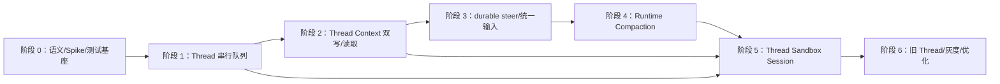

# Thread 连续上下文改造：阶段 0 核对与实施拆解

- 文档性质：阶段 0 交付与后续小切片执行清单，不替代总计划或 ADR
- 状态：阶段 0 进行中，尚未通过 Gate
- 日期：2026-07-31
- 代码基线：`8299fcf`
- 总计划：[Thread 连续上下文、输入续接、上下文压缩与 Sandbox 生命周期实施总计划](thread-continuous-context-implementation-plan.md)
- 小型 ADR：ADR-0063、ADR-0064、ADR-0065、ADR-0066

## 1. 本轮边界与结论

本轮只完成阶段 0 的现状核对、语义拆分、迁移/兼容/开关/Gate 设计和任务切片，没有修改生产读取、API、调度、Context、Workspace 或 Sandbox 业务代码。

阶段 0 当前结论：

- 总计划对主链路和目标差距的判断整体与 `8299fcf` 一致；
- 四组核心语义已拆成范围更小的提议 ADR，原大草案不再作为完整实施规范；
- 真实 CubeSandbox 即时 pause/connect、短 TTL auto-pause 和 TTL 候选，以及 Provider 基础多轮/tool/handoff 候选形状已有首轮证据；长 paused retention、精确 TTL 上限、最终 handoff 语义映射和共享测试基座仍未完成；
- 在剩余证据和测试基座完成前，阶段 0 Gate 不得标记通过，也不得开始改变生产读取语义；
- TTL、retention、compaction 预算、Provider 形状和校验层级继续作为配置或待决项，不在本轮固化。

## 2. 当前代码与总计划核对

### 2.1 一致项

| 总计划描述 | 当前代码证据 | 结论 |
|---|---|---|
| 旧客户端只提交 Thread 下的新 Run 和单条 `input` | `apps/web/src/api.ts` 调用 `POST /v1/threads/{threadId}/runs`；API `createRun` 只接收正文 | 一致；历史应由服务端恢复 |
| 创建 Run 时立即捕获 Workspace head | `pg-run-dispatch.ts` 在创建事务锁 `workspaces` 并写 `base_revision_id` | 一致；这也是排队 Run 过早绑定旧基线的问题 |
| 每个新 Run 使用空初始投影 | `pg-run-dispatch.ts` 的 `schemaVersion: 2 / checkpointId: initial / items: []` | 一致；跨 Run 模型历史当前不连续 |
| 创建 Run 即创建可领取 dispatch | 同一事务写 `run_dispatch_outbox.state='ready'` | 一致；当前没有 Thread 队首激活步骤 |
| Attempt rollout 不是 Thread Context | `runtime_rollout_streams` 主键和兼容身份绑定 run/attempt/agent thread | 一致；可恢复 Attempt，不等于跨 Run 事实流 |
| Pi compaction 关闭 | `pi-session.ts` 设置 `compaction.enabled=false`，事件层把 compaction 视为违反不变量 | 一致；Runtime compaction 尚未实现 |
| 成功 Run close、waiting pause | `run-worker.ts` 成功分支 `settleSandbox(...,"close")`，waiting 分支使用 `pause` | 一致 |
| Sandbox registry 绑定 Attempt | `0004_run_worker_state` 的 `sandbox_registry` 含 attempt/run/root scope | 一致；还不是 Thread/Workspace Session registry |
| Workspace Revision 是持久文件事实 | `workspaces.current_revision_id`、不可变 revision/manifest/Blob 和 materialize/publish 路径已存在 | 一致；但还没有按 Run 显式 result 关系 |
| Pi `steer()`/`followUp()` 只属于活跃 Session | `pi-session.ts` 暴露两方法，现有测试明确两者可能在同一安全点合入下一请求 | 一致；不能把 Pi followUp 当 durable 跨 Run 队列 |

### 2.2 需要补充或校正的细节

| 项目 | 实际状态 | 对计划的影响 |
|---|---|---|
| Sandbox TTL | 数据库约束允许 1～86400 秒；生产 Gateway/Registry 当前硬上限为 120 秒；waiting 决策代码允许最多 10 分钟，测试恢复路径还有 600 秒数据 | “数据库上限”不是“Provider/生产能力上限”。阶段 0 必须实测并统一成配置与 capability，不能承诺 10 分钟或更长 warm pause |
| Sandbox Domain 模型 | `packages/domain/src/sandbox.ts` 已有 Thread-scoped `SandboxSession`，但状态较粗且生产持久化/Worker 没有采用目标 Session registry | 可以复用领域经验，不能据此宣称 Thread Session lifecycle 已实现 |
| SDK lifecycle | vendored SDK 支持 `lifecycle.onTimeout`, `autoResume`，`connect` 文档声称自动 resume；Runtime `SandboxCreateInput` 未暴露这些字段 | SDK 类型只能形成 Spike 假设，不能成为生产能力证据 |
| pause 确认 | vendored SDK `pause()` 默认轮询到 `state=paused`；Runtime 只把异常折叠为通用 UNKNOWN，没有 Thread lifecycle receipt | 目标 effect intent/receipt 和对账仍缺失 |
| Context replacement | 现有 Attempt replacement 是单调前缀的 `from/through` 元数据；目标 Thread checkpoint 是每窗完整、可重组的 replacement history | 新实现必须使用独立 schema/version，不能迁移时直接复用旧语义 |
| 串行能力 | Workspace write lease 会让同一 Workspace 的写者互斥，但 dispatch 可以同时领取多个同 Thread Run，且没有 Thread Context writer | Workspace lease 不是 Thread 串行队列的替代品 |
| 测试基座 | Worker 内有局部 `FakeClock`/`FakeSandboxRegistry`，Sandbox 包有简单 Fake；`packages/testing` 当前为空 | 阶段 0 需要把可复用的时钟、并发屏障、崩溃点和 effect receipt 建到共享测试包 |
| Feature Flag | 进程配置已有严格布尔环境字段模式，但没有本改造的逻辑开关 | 必须先定义依赖和关闭语义，再接入各进程配置契约与 `.env.example` |

### 2.3 当前不具备的目标能力

- durable receipt/FIFO 和 Thread execution head；
- 激活队首时延迟绑定 Workspace/Context 基线；
- Thread Context facts、跨 Run Active History 和 shadow reconstruction；
- durable steer 与结束竞态转 follow-up；
- Runtime 自有 checkpoint/replacement compaction；
- Thread Sandbox Session、唯一 lease、effect intent/receipt、retention 对账；
- `run_workspace_results`；
- 上述能力的 API/Web/指标/灰度闭环。

## 3. 阶段 0 任务拆解

| ID | 任务 | 依赖 | 产物 | 状态/Gate |
|---|---|---|---|---|
| P0-01 | 基线事实核对 | `8299fcf`、总计划、相关 ADR | 本文第 2 节 | 已完成 |
| P0-02 | 拆分四份小型 ADR | P0-01 | ADR-0063～0066 | 已完成，均为“提议”，待审阅 |
| P0-03 | CubeSandbox lifecycle capability Spike | 可用测试环境、可回收测试模板 | [首轮证据](spikes/2026-07-31-thread-context-capability-spikes.md)、后续 retention/UNKNOWN 证据 | 部分完成；精确 TTL 上限、长 retention、平台版本和 UNKNOWN 未完成 |
| P0-04 | Provider `/chat/completions` history compatibility Spike | 可用模型配置、wire trace 安全边界 | [首轮证据](spikes/2026-07-31-thread-context-capability-spikes.md)、最终 capability matrix | 部分完成；基础形状可传输，最终 handoff 语义与特殊 item 未决 |
| P0-05 | 共享测试基座 | ADR 状态机与测试端口 | manual clock、并发屏障、崩溃点、scripted effect receipt | 待开发 |
| P0-06 | Feature Flag/Schema version 配置契约 | 四份 ADR | 各进程 flag 依赖、默认关闭、关闭时 drain 语义 | 本文已定义逻辑契约；代码接线待开发 |
| P0-07 | 阶段 0 Gate 审阅 | P0-02～P0-06 | 审阅记录与是否进入阶段 1 的结论 | 待执行 |

### 3.1 CubeSandbox Spike

Spike 必须使用真实 CubeSandbox 环境，并在 `finally` 中按确定 provider ID 清理。输出只保留环境/平台版本、测试时间、候选参数、状态、延迟、结果码和匿名测试 ID，不输出 API URL 中的秘密、credential、文件正文或完整上游响应。

2026-07-31 首轮实测已证明当前目标的即时 pause/connect、内存与文件恢复、短 TTL `onTimeout=pause` 以及 TTL 120～86400 create 接受；详细限制见 [能力 Spike 记录](spikes/2026-07-31-thread-context-capability-spikes.md)。这些结果没有证明精确最大 TTL 或长 paused retention。

必须覆盖：

1. create → command/file/in-memory state → pause confirmed → connect → command/file/in-memory state；
2. pause 请求耗时、达到 `paused` 的确认耗时、connect/resume 耗时，重复多次记录分布；
3. `connect` 是否自动恢复，恢复后是否返回新的可用 handle；
4. `lifecycle.onTimeout="pause"` 是否被当前平台接受、是否真实进入 paused；
5. TTL 候选值的服务端接受/拒绝边界、connect 是否续期及续期上限；
6. 可配置 paused dwell 后的快照存在性，明确区分“本次观测仍存在”和“平台保证保留”；
7. pause/connect/terminate 超时或断连时可获得的状态查询/receipt 能力；
8. terminated/NOT_FOUND 后 cold rebuild 的可判定错误。

以下均为 Spike 参数，不是产品常量：TTL 候选列表、重复次数、paused dwell、操作超时、轮询间隔、最大测试时长。长 retention 观测应作为可续跑的独立维护任务，不阻塞短 Spike，但在完成前不得承诺对应时长。

### 3.2 Provider history compatibility Spike

目标不是让 Provider 保存 Thread 状态，而是确认 Runtime 的规范化 Active History 如何可靠投影到当前 OpenAI-compatible `/chat/completions`。

2026-07-31 首轮实测中，基础多轮、低信任 handoff-as-user 候选和完整 tool pair tail 在流式/非流式请求均返回 HTTP 200；这只证明传输兼容，不代表 handoff 的最终 role 已批准。

必须覆盖：

- 当前 Canonical system + 多轮 user/assistant + 新 user；
- 完整 assistant tool call + 对应 tool result + 后续 user；
- Runtime 内部 `compaction_handoff` 的候选 wire 映射，不把它写成真实 `user_message` 事实；
- 模型/Provider 对 tool ID、role、content 数组、reasoning/多模态 item 的接受与回传；
- 相同规范化 history 在重启重建后的 wire digest 一致；
- 不兼容形状返回稳定 capability 结果，而不是静默删项。

在 Spike 与 ADR 审阅完成前，handoff 映射到低信任 `user`、受控 `assistant` 或 Provider 特殊 item 都是候选方案，不在 ADR 中永久固定；它绝不能提升为可信 system/developer。事实层始终使用独立的 `compaction_handoff` kind，避免伪造真实用户输入。

### 3.3 共享测试基座

`runtime-ts/packages/testing` 只提供测试能力，生产包不得依赖。首轮最小组件：

- `ManualClock`：受控 wall/monotonic 时间、确定性 schedule/heartbeat、同时间任务稳定顺序；
- `AsyncBarrier`：让两个 API/Worker/事务停在明确线性化点并受控释放；
- `CrashPointController`：在命名边界注入 before/after-commit 崩溃，默认关闭且不从生产环境字符串任意触发；
- `ScriptedSandboxLifecycle`：按 idempotency key 记录 create/pause/connect/terminate 调用，返回 completed、明确未生效、unknown 或延迟 receipt；
- PostgreSQL race harness：使用独立连接和 barrier 编排，不伪造数据库 `clock_timestamp()`；租约时间测试继续以数据库时钟为准。

测试工具必须自身具备单元测试，能够证明重复 effect 不会被计为两次确定成功、unknown 不会自动变为 completed、取消 barrier 不会遗留挂起 Promise。

## 4. 总体依赖关系

阶段 5 在技术上直接依赖阶段 1 的 terminal/queue 线性化和阶段 2 的 Context 事实源；实施顺序仍按总计划要求放在阶段 4 之后，避免先优化 Sandbox 而继续使用空上下文。

## 5. 各阶段实施清单

### 阶段 0：冻结语义、能力 Spike 与测试基座

- 依赖：当前基线、真实 Cube/模型测试环境、四份提议 ADR 审阅。
- 数据库迁移：无；只确定后续相对顺序和回滚协议。
- 兼容：不改变生产 API、读取、dispatch、Context 或 Sandbox 行为。
- Feature Flag：只定义逻辑名、依赖和关闭语义，默认全部关闭。
- 测试 Gate：四份 ADR 状态转换和线性化点齐全；Cube 与 Provider 有真实证据；共享测试基座自测通过；迁移/up/down/线上回滚路径完成审阅；生产读取语义未改变。

### 阶段 1：Thread 串行队列与 Run 基线延迟绑定

- 依赖：阶段 0 Gate；ADR-0063；PostgreSQL race harness。
- 迁移：M1 execution heads → M2 receipts/queue → M3 run workspace results。
- 兼容：旧 `/runs` 在开关开启时映射为 follow-up，仍立即返回 queued Run ID；未激活 Run 没有 dispatch/base/context；关闭新入口后必须继续 drain 已接收 queue item。
- Feature Flag：`thread_serial_queue_v2`；默认关闭，先测试 Tenant/新 Thread 灰度。
- 测试 Gate：并发 100 次 FIFO 且无双 active；API 幂等不重复；Run B base 等于 Run A result；旧 writer fencing 失败；queue claim 崩溃可恢复；`run_workspace_results` 覆盖 committed/unchanged/failed-before-commit；RLS/ACL/FK 通过。

### 阶段 2：Thread Context 双写与跨 Run 连续读取

- 依赖：阶段 1 单写者与激活顺序；ADR-0064；Provider history Spike 已确认基础多轮/tool 形状。
- 迁移：M4 Thread Context streams/entries/append commands；不创建 compaction checkpoint 表。
- 兼容：Attempt rollout 继续作为现有恢复路径；先 write，再 shadow reconstruction，最后按 Tenant/新 Thread开启 read；旧 Thread 未回填时走旧路径或显式 V2 anchor，不虚构历史。
- Feature Flag：`thread_context_v2_write` → `thread_context_v2_shadow_read` → `thread_context_v2_read`。
- 测试 Gate：Run B wire trace 包含 Run A 有效历史；在线/重启 digest 一致；tool pairing、partial、failed/cancelled、Blob 恢复通过；双写崩溃可幂等收敛；关闭 read 可回旧路径且新 facts 保留。

### 阶段 3：durable steer 与统一输入 API

- 依赖：阶段 1 receipt/queue；阶段 2 Thread facts/read；Provider/工具安全点定义完成。
- 迁移：优先复用 M2 receipt/queue；只有已审阅的新增 disposition/event 字段才做附加迁移，不预留无语义列。
- 兼容：新增 `/threads/{threadId}/inputs`；旧 `/runs` 永远是 follow-up；显式 `steer` 不满足 expected Run/Turn 时稳定拒绝，只有客户端指定 fallback 才转队列；waiting answer 保持显式。
- Feature Flag：`thread_input_routing_v2`；关闭后新输入统一 follow-up，已持久 pending steer 必须原子应用或转 queue，不得遗留。
- 测试 Gate：stream、工具、terminal、cancel 四类竞态不丢不重；wire trace 中真实 steer 为 `role=user`；follow-up 每条一个 Run 且 FIFO；expected mismatch 稳定；receipt 正文可恢复且幂等冲突可判定。

### 阶段 4：Runtime 持久 Compaction

- 依赖：阶段 2 Context Builder；阶段 3 安全采样点；ADR-0065；Provider replacement Spike。
- 迁移：M5 context checkpoints/replacement items/checkpoint commands。
- 兼容：未压缩 Thread 不受影响；开关关闭只停止新 checkpoint，已有 checkpoint 仍可读；Pi 内建 compaction 继续不拥有持久历史。
- Feature Flag：`thread_context_compaction`，依赖 `thread_context_v2_read`。
- 测试 Gate：至少三次压缩后链可验证；在线/重启 digest 一致；失败/CAS 冲突不改变旧 history；工具 provenance 与最近用户原文保留；原始 facts 未删改；模型兼容变化有显式结果。

### 阶段 5：Thread Sandbox Session、立即 pause 与 resume

- 依赖：阶段 1 terminal/queue 线性化；阶段 2 Context 与 Workspace 事实源；阶段 4 完成后再实施；ADR-0066；真实 Cube capability matrix。
- 迁移：M6 Thread Sandbox sessions → M7 leases/lifecycle intents/receipts；旧 Attempt registry 保留并 drain。
- 兼容：开关关闭时新 Run 使用旧 create/close；新 Session 先 shadow/只写再灰度；已有 paused/unknown effect 必须继续对账，不能随开关关闭消费者。
- Feature Flag：`thread_sandbox_session_reuse`、`thread_sandbox_retention_scheduler`。
- 测试 Gate：无队列无空闲 running；有队列安全 handoff；paused resume 与 cold rebuild 模型语义等价；pausing 输入先 pause 后 resume；unknown 可对账；revision/generation/lease mismatch 拒绝；无双 lease/跨 Tenant 复用。

### 阶段 6：旧 Thread 迁移、灰度与策略优化

- 依赖：阶段 1～5 Gate 和真实指标。
- 迁移：可选 M8 legacy V2 anchors/backfill audit；只有实际查询需要时才新增，不提前创建猜测字段。
- 兼容：按证据强度回填 user/assistant/tool/workspace/terminal；缺口写 `legacy_history_gap`；不调用模型编造旧历史；各读/路由/reuse 开关可按 Tenant 关闭。
- Feature Flag：沿用前述独立开关和 Tenant targeting，不新增“一键全开”大开关。
- 测试 Gate：新旧 Thread 边界明确；关闭 V2 read/steer/reuse 不删除事实；旧 Thread gap/anchor 可恢复；SLO、容量和成本有真实数据；回退不要求删除 Workspace revision 或用户输入。

## 6. 数据库迁移相对顺序

当前迁移到 `0017_model_wire_trace`。下列编号是当前建议占位；若合并前出现其他迁移，只保持相对顺序，使用届时下一可用编号。

| 相对顺序 | 当前建议名 | 阶段 | 主要对象 | 前置原因 |
|---|---|---|---|---|
| M1 | `0018_thread_execution_heads` | 1 | execution head、writer fencing | sequence 分配、激活和后续所有 Thread 写的线性化根 |
| M2 | `0019_thread_input_receipts_queue` | 1/3 | immutable receipts、follow-up queue | 依赖 head 分配 sequence；阶段 3 复用 |
| M3 | `0020_run_workspace_results` | 1 | Run base/result/outcome | terminal handoff 和 Context terminal 需要明确 Workspace 结果 |
| M4 | `0021_thread_context_stream` | 2 | streams、entries、append commands | 依赖单写者与 Run result，不依赖 compaction |
| M5 | `0022_thread_context_checkpoints` | 4 | checkpoints、replacement items/commands | 依赖 M4 facts 与 Provider shape |
| M6 | `0023_thread_sandbox_sessions` | 5 | Thread/Workspace Session registry | 与旧 Attempt registry 并存，先建立新身份 |
| M7 | `0024_thread_sandbox_lifecycle` | 5 | unique lease、effect intent/receipt/reconcile | 依赖 M6 registry；handoff 依赖 M1/M3 |
| M8 | `0025_legacy_thread_context_anchors`（可选） | 6 | anchor/backfill audit | 只有旧数据策略确认后才创建 |

所有迁移必须：

- 同时提供 up/down、migration source checksum、RLS/FORCE RLS、受限角色权限和 ACL manifest 更新；
- 所有业务表包含 `tenant_id`，使用 Tenant/Thread/Run/Workspace 复合外键，不只引用裸 ID；
- append-only facts/receipt/effect 一旦存在，生产 down 拒绝；线上回滚使用 Feature Flag 和兼容消费者；
- 不原地重命名旧 `sandbox_registry` 状态或复用旧 checkpoint 前缀语义；
- 大正文使用既有 Stable Blob 安全边界，不能把无上限 history 放进单个 JSONB 行；
- migration 集成测试覆盖空库 up/down、含事实时 down 拒绝、受限 runtime role 和跨 Tenant 负例。

## 7. Feature Flag 契约

| 逻辑开关 | 最早阶段 | 依赖 | 关闭语义 |
|---|---|---|---|
| `thread_serial_queue_v2` | 1 | M1～M3 | 新 `/runs` 走旧入口；已经接受的 V2 queue 继续 drain |
| `thread_context_v2_write` | 2 | serial queue | 停止新双写前必须先关 shadow/read；旧 facts 保留 |
| `thread_context_v2_shadow_read` | 2 | V2 write | 停止 digest 对比，不影响生产模型输入 |
| `thread_context_v2_read` | 2 | write + shadow Gate | 回旧每 Run projection；不删 facts/checkpoints |
| `thread_input_routing_v2` | 3 | serial queue + Context read/write | 新输入统一 follow-up；pending steer 继续收敛 |
| `thread_context_compaction` | 4 | Context read + Provider capability | 停止创建新 checkpoint，仍读取已有 checkpoint |
| `thread_sandbox_session_reuse` | 5 | serial queue、Run result、Context、Cube capability | 新 Run 走 create/close；已有 lifecycle effects 继续对账/清理 |
| `thread_sandbox_retention_scheduler` | 5 | M6/M7 | 停止新的策略回收调度，不停止已 claim effect 或 UNKNOWN 对账 |

实现配置时使用各进程严格配置契约并同步 `.env.example` 校验。逻辑开关名已冻结；环境变量拼写、Tenant targeting 存储和动态配置 Provider 仍需单独实施选择，不能在多个应用中各自发明互不一致的默认值。

依赖必须失败关闭，例如：

- read 开启但 write/serial queue 关闭：进程拒绝启动；
- compaction 开启但 Context read 或 Provider capability 未启用：进程拒绝启动；
- reuse 开启但 lifecycle reconciler/schema 未就绪：进程拒绝启动；
- Web 不自行猜测开关，必须读取 API 暴露的稳定 capability/状态。

## 8. 可配置参数与待决项

### 必须可配置且可观测

- writer/queue/Sandbox lease 时长、续租间隔、claim batch、重试退避和队列容量；
- input 内联/Blob 阈值与受控最大正文；
- compaction 软阈值、输出预留、安全 margin、最近用户原文预算、重试次数和 compactor 模型；
- paused retention、最大快照大小、租户配额、Provider TTL/续期、操作超时；
- manifest 全量/分层校验策略、后台进程 quiesce 超时；
- 灰度 Tenant/新 Thread 比例和指标告警阈值。

### 仍需证据或专项 ADR

- Provider 上 `compaction_handoff` 的 wire role/item 形状；
- 本地与远程 compaction 的默认选择规则；
- waiting answer 在统一输入 API 的最终协议；
- 旧 Thread backfill 最大深度；
- CubeSandbox 最大 TTL、续期、paused 快照保证和 `onTimeout=pause`；
- resume 后全 manifest 还是分层校验；
- UI 默认 auto steer 的交互和撤销窗口。

### 不允许配置成相反语义

- Thread 跨 Run 连续上下文；
- durable FIFO follow-up；
- steer 作为真实 user message；
- 同 Thread 单写者；
- 无队列立即 pause，不使用 Hot Running Window；
- Workspace Revision/Thread Context 是事实源，Sandbox 是缓存；
- compaction 不删除原始事实且可恢复；
- Sandbox 不可用时允许 cold rebuild。

## 9. 第一项可以开始开发的最小切片

首个切片为 **P0-05A：共享确定性测试基座**，仍属于阶段 0，不改变任何生产业务语义。

### 范围

- 在 `runtime-ts/packages/testing/src` 新增 `manual-clock.ts`、`async-barrier.ts`、`crash-point.ts`、`scripted-sandbox-lifecycle.ts`；
- 从 `index.ts` 只导出测试 API；生产 workspace package 不新增对 `@cube-runtime/testing` 的依赖；
- 为每个组件补充单元测试和中文不变量注释；
- 更新测试解析别名/包脚本所需的最小配置。

### 明确不做

- 不新增数据库迁移；
- 不修改 `/runs`、Worker dispatch、Context read、Pi Session 或 Sandbox production registry；
- 不接入 Feature Flag；
- 不实现阶段 1 队列或后续任何业务状态机。

### 验收

- ManualClock 可按稳定顺序推进定时与 heartbeat，取消后不执行；
- barrier 能确定性复现“两事务都已到达再释放”，失败/取消不挂起；
- crash point 能区分 before commit、commit unknown、after commit，默认不触发；
- scripted lifecycle 按 idempotency key 记录一次确定 effect，并能脚本化 unknown/延迟 receipt；
- `pnpm check` 通过，且仓库 diff 只有阶段 0 测试基础及对应测试/ADR 记录。

P0-05A 完成后继续补齐长 retention、UNKNOWN 和最终 Provider capability matrix。只有 P0-03～P0-07 全部通过，才允许开始阶段 1 的 M1 schema-only 小切片。
